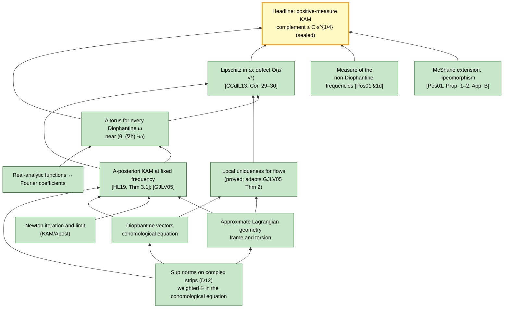

# KAM-dev — campaign HQ

Lean 4 + Mathlib formalization of the **Kolmogorov–Arnold–Moser theorem** in its positive-measure form:
for a nearly-integrable real-analytic Hamiltonian H(θ, I) = h(I) + f(θ, I) with a Kolmogorov-nondegenerate
h, most of phase space is filled by invariant Lagrangian tori that carry quasi-periodic motion with
Diophantine frequencies, as soon as f is small enough.

**Authors:** Scott Armstrong and Zohar Komargodski. Public development repository.

<!-- AUTO:updated -->
> **Last updated: 2026-10-29 15:00 UTC** (automatic: every 20 minutes and after every commit) · **estimated completion 97.2 %** · frozen statements proved: 21 / 22 · **257,476 lines of Lean** of an estimated ≈ 263,000
<!-- /AUTO:updated -->

## Overview

**The theorem (frozen and proved).** Let B ⊂ ℝⁿ be a bounded domain and h real-analytic on a complex
neighbourhood of B̄, with frequency map ∇h a diffeomorphism of B onto its image (det ∇²h ≠ 0). For every
κ > 0 there is ε₀ > 0 such that, for every f real-analytic on a fixed complex neighbourhood of Tⁿ × B̄ with
sup norm ≤ ε₀ there, the points of Tⁿ × B that lie on invariant tori of H = h + f have Lebesgue measure at
least (1 − κ)·|Tⁿ × B|. Each such torus is a real-analytic embedded Lagrangian torus close to {I = const}, and
the flow of H on it is conjugate to the linear flow θ ↦ θ + tω with a Diophantine frequency ω. Quantitative form
that the route delivers: the complement has measure ≤ C·ε^{1/4}, where ε = sup |f| (owner question Q1; the optimal
ε^{1/2} needs canonical-transformation methods). The exact Lean statement, approved by the owner and frozen, is
`KAM.kam_positive_measure`, with the qualitative form `KAM.kam_positive_measure_qualitative`. Both are sealed: their
proofs are complete, replayed by the kernel, and use only the standard axioms.

**Route** (decision D2). No canonical changes of variables and no action-angle normal forms:
1. **A-posteriori KAM at fixed frequency** ([HL19, Thm 3.1](https://arxiv.org/abs/1711.05515v1) with d = n;
   cross-checked against [GJLV05](https://doi.org/10.1088/0951-7715/18/2/020)). An approximately invariant
   torus with small error and a nondegenerate torsion lies near a true invariant torus. The proof is a Newton
   method on the torus embedding: matrix identities from the approximate Lagrangian property, constant-coefficient
   cohomological equations, Neumann-series inverses.
2. **One torus per Diophantine frequency.** Apply 1 to the unperturbed torus (θ, (∇h)⁻¹ω) of the nearly-integrable
   system; the invariance error is the size of the perturbation.
3. **Measure.** Local uniqueness for flows, which no source states (we prove it, adapting
   [GJLV05](https://doi.org/10.1088/0951-7715/18/2/020) Thm 2), and re-application of step 1 at nearby
   frequencies ([CCdlL13](https://doi.org/10.1016/j.jde.2013.05.001), Cor. 29–30) make the tori depend on the
   frequency with Lipschitz defect O(ε/γ⁴). A McShane extension ([Pos01](https://arxiv.org/abs/0908.2234v1),
   Prop. 1–2 and App. B) turns this into a lipeomorphism. The complement of the tori is then the image of the
   non-Diophantine set, of measure O(γ). Taking γ ~ ε^{1/4} gives the rate.
4. **Framework** (D12, refining D2). Estimates are sup-norm bounds of holomorphic functions on complex strips and
   domains, as in HL19 and GJLV05: products and compositions are immediate and Cauchy estimates are one-variable.
   Weighted ℓ¹ Fourier norms enter only in the cohomological equation.

**How the campaign works.** The statements we must prove are fixed first. The headline theorem, a few gate
theorems and the definitions they use are written in Lean, approved by the owner line by line, and frozen: one
declaration per file, hashed in [`manifest/frozen-anchors.json`](manifest/frozen-anchors.json), never edited.
Each frozen theorem starts with the proof `sorry`. Agents prove it in a separate provider module, and the
orchestrator *seals* it: the `sorry` becomes `by exact Provider.<name>`, and the checks (hashes, axioms, kernel
replay, build) run again. A result counts as formalized only when its frozen statement is sealed.

---

## At a glance

<!-- AUTO:progress -->
### Estimated completion: **97.2 %**

`████████████████████████░` 97.2 %

| Part of the project | Items | Weight | Done | Completion |
|---|---|---|---|---|
| Campaign infrastructure | 4 | 5 | 4.0 | `████████░░` 80 % |
| Statement and planning | 8 | 26 | 24.8 | `██████████` 95 % |
| Analytic infrastructure | 8 | 24 | 24.0 | `██████████` 100 % |
| A-posteriori KAM at fixed frequency | 4 | 24 | 24.0 | `██████████` 100 % |
| Measure of the invariant tori | 5 | 12 | 12.0 | `██████████` 100 % |
| Track I (isoenergetic, confinement, R3BP) | 2 | 12 | 12.0 | `██████████` 100 % |
| Track N (Nekhoroshev) | 4 | 22 | 22.0 | `██████████` 100 % |
| Track P (planetary) | 5 | 30 | 28.3 | `█████████░` 94 % |
| Sealing of the frozen statements | 22 | 22 | 21.0 | `██████████` 95 % |
| **Total** | 62 | 177 | 172.1 | **97.2 %** |

**How this is estimated.** The project is divided into 40 work items: planning deliverables, campaign infrastructure, the four layers of track K's proof, and the proof campaigns of tracks I, N and P. Each item is weighted by its difficulty (low 1, moderate 2, high 4, very high 8) and counts with the fraction of it that is done; each sealed frozen theorem adds 1. Items marked *graph* take that fraction from their proof graph (nodes `PROVED`, `BYPASSED` or `EXTERNAL` in [`docs/graph/`](docs/graph)), so they update themselves at every refresh, and count as complete once every frozen theorem of their track is sealed; the other items are the orchestrators' assessment, last reviewed **2026-10-28 03:25 UTC**. Files: [`docs/campaign/progress.json`](docs/campaign/progress.json) (track K and infrastructure) and [`docs/campaign/progress-INP.json`](docs/campaign/progress-INP.json) (tracks I, N, P).

<details><summary>All work items with their weight and status</summary>

| ID | Item | Difficulty | Done | Note |
|---|---|---|---|---|
| I.REPO | Repository: toolchain v4.35.0, Mathlib v4.35.0, module-system checks, source lint | L | ✅ 100 % |  |
| I.HQ | Campaign HQ: this README, generator, 20-minute cron and post-commit hook | L | 🟨 80 % |  |
| I.GUARDS | Freeze machinery: manifest, anchor guard, quarantine, kernel replay, mutation suite | M | 🟨 60 % | anchor guard (Unicode-aware), ABI hashes, lint; manual mutation tests pass (3/3); kernel replay and mutation suite to do |
| I.BUILD | Shared build snapshot for worktrees and machine-wide compile gate | L | ✅ 100 % | machine-wide compile gate (inp_lake_build.sh) and copy-on-write worktree builds on the main snapshot, in use since 2026-10-27 |
| S.SURVEY | Literature survey: candidate sources, prior formal work, Mathlib inventory | M | ✅ 100 % | three research reports (2026-10-27): sources, warm-ups and norms, prior formalizations |
| S.SOURCES | Pinned source library: PDFs with SHA-256, bibliographic data checked against arXiv and Crossref | L | 🟨 85 % | 50 PDFs pinned in sources/SHA256SUMS; 20 in the registry; per-paper summaries still to write |
| S.ROUTE | Route verdict for the measure layer (a-posteriori KAM + Lipschitz dependence on the frequency) | H | 🟨 90 % | verdict: route works; rate ε^{1/4}; flow local uniqueness must be proved by us (no published version) |
| S.STMT | Mathematical statement of the headline theorem and the gate theorems, with owner rulings | M | ✅ 100 % | docs/statement.md draft 0.2, approved |
| S.LEAN | Exact Lean statements (headline + gates): independent audit, owner approval, freeze | H | ✅ 100 % | approved (D11) and frozen: 5 theorem anchors + 20 definitions, manifest with file/prefix/ABI hashes |
| S.BP | Blueprint: every proof step written out against the pinned sources | VH | ✅ 100 % | 59 pages; Parts 2-4 reviewed, consolidated; Part 1 reviewed (ACCEPT WITH FIXES, applied) |
| S.GRAPH | Source-level dependency graph anchored to the frozen statements | H | ✅ 100 % | published: 453 nodes, 1420 edges, 0 source gaps, 11 externals; every node and coverage item independently reviewed; global review PASS |
| S.ERRATA | Errata and deviations ledger for every formalized source (continuous) | L | 🟨 30 % | ledger: 8 candidate errata, 6 planned deviations |
| F.ALG | Weighted ℓ¹ Fourier algebra on ℤⁿ: Banach algebra, exp, derivatives, averages | H | ✅ 100 % | *graph K* · graph K Part 1 (analysis): 124 PROVED, 7 BYPASSED, 11 EXTERNAL, 0 open (2026-10-28); per D12 the weighted ℓ¹ norms are used only in the cohomological equation (KAM/Fourier, Zohar) |
| F.FT | Fourier–Taylor algebra in (angles, actions); Cauchy estimates in the actions | H | ✅ 100 % | *graph K* · graph K Part 1 (analysis): 124 PROVED, 7 BYPASSED, 11 EXTERNAL, 0 open (2026-10-28); per D12 realized with sup norms on complex strips and one-variable Cauchy estimates, no separate Fourier–Taylor algebra |
| F.COMP | Composition f∘(id+u) and Taylor remainders in the weighted norms | H | ✅ 100 % | *graph K* · graph K Part 1 (analysis): 124 PROVED, 7 BYPASSED, 11 EXTERNAL, 0 open (2026-10-28); compositions and Taylor remainders in sup norms on complex domains |
| F.MAT | Matrix-valued functions: products, Neumann-series inverses, averages | M | ✅ 100 % | *graph K* · graph K Part 1 (analysis): 124 PROVED, 7 BYPASSED, 11 EXTERNAL, 0 open (2026-10-28); Neumann inverses, operator and matrix norms, averages |
| F.BRIDGE | Bridge between real-analytic functions on complex strips and coefficient spaces | H | ✅ 100 % | *graph K* · graph K Part 1 (analysis): 124 PROVED, 7 BYPASSED, 11 EXTERNAL, 0 open (2026-10-28); strip↔coefficient bridges incl. W-valued summation (I-STRIP-2b) |
| F.DIOPH | Diophantine vectors; cohomological equation with Rüssmann's exponent | M | ✅ 100 % | *graph K* · graph K Part 1 (analysis): 124 PROVED, 7 BYPASSED, 11 EXTERNAL, 0 open (2026-10-28); cohomological solver with Rüssmann exponent (Zohar) |
| F.NEWTON | Abstract Newton/KAM convergence on a scale of analytic spaces | M | ✅ 100 % | *graph K* · graph K Part 1 (analysis): 124 PROVED, 7 BYPASSED, 11 EXTERNAL, 0 open (2026-10-28); convergence proved concretely in KAM/Apost/Iteration and Limit |
| F.HAM | Hamiltonian vector fields in coordinates; invariant tori; quasi-periodic orbits as ODE solutions | M | ✅ 100 % | *graph K* · graph K Part 1 (analysis): 124 PROVED, 7 BYPASSED, 11 EXTERNAL, 0 open (2026-10-28); Hamiltonian vector fields, flows (KAM/ODE), invariant tori |
| K.GEOM | Approximate Lagrangian property, adapted symplectic frame, torsion matrix | H | ✅ 100 % | *graph K* · graph K Part 2: 113 PROVED, 1 BYPASSED, 0 open; G1 SEALED (f4cdc0d) |
| K.STEP | Newton step: reduction of the linearized equation, cohomological equations, estimates | VH | ✅ 100 % | *graph K* · graph K Part 2: 113 PROVED, 1 BYPASSED, 0 open; G1 SEALED (f4cdc0d) |
| K.ITER | Iteration and convergence: the a-posteriori existence theorem | H | ✅ 100 % | *graph K* · graph K Part 2: 113 PROVED, 1 BYPASSED, 0 open; G1 KAM.aposteriori_kam SEALED (f4cdc0d) |
| K.UNIQ | Local uniqueness modulo phase for flows (no published version: adapt GJLV05 Thm 2, §6, §8) | VH | ✅ 100 % | *graph K* · graph K Part 3: 41 PROVED, 3 BYPASSED, 0 open; G2 KAM.local_uniqueness_flow SEALED (c9dec45) |
| M.APPLY | Invariant torus for every Diophantine frequency of a nearly-integrable Hamiltonian | M | ✅ 100 % | *graph K* · graph K Part 4: 127 PROVED, 1 BYPASSED, 0 open; HEAD SEALED (e4ca720) |
| M.LIP | Lipschitz dependence of the tori on the frequency (re-application; defect O(ε/γ⁴)) | H | ✅ 100 % | *graph K* · graph K Part 4: 127 PROVED, 1 BYPASSED, 0 open; HEAD SEALED (e4ca720) |
| M.DMEAS | Measure of the non-Diophantine frequencies | M | ✅ 100 % | G3 SEALED (D26): KAM.volume_not_diophantine_le proved, audited, kernel-replayed |
| M.IMAGE | McShane extension of F̂ − id and the lipeomorphism: the complement is the image of the complement | M | ✅ 100 % | *graph K* · graph K Part 4: 127 PROVED, 1 BYPASSED, 0 open; HEAD SEALED (e4ca720) |
| M.ASSEMBLY | Assembly of the headline theorem | M | ✅ 100 % | *graph K* · HEAD KAM.kam_positive_measure (e4ca720) and HEAD-Q (5f6b154) SEALED |
| I.PHASE0 | Sources, statements, owner approval, freeze | H | ✅ 100 % | approved and frozen (D20) |
| I.PROOF | Blueprint, graph and proofs (estimate, refined after Phase 0) | VH | ✅ 100 % | *graph I* · graph I published; ALL FOUR track-I frozen theorems SEALED (I-KEPLER, I-G1, I-HEAD, I-R3BP); I Parts 1-3, 5-8 proved and audited |
| N.PHASE0 | Sources, statements, owner approval, freeze | H | ✅ 100 % | approved and frozen (D20) |
| N.PROOF | Blueprint, graph and proofs (estimate, refined after Phase 0) | VH | ✅ 100 % | *graph N* · graph N published; N-QC, N-ZERO SEALED; Lean: ODE layer (Part 3), Parts 1, 4, 5 (except C5-9) proved and audited; Parts 6-7 design in revision; Parts 2, 8-10 designs being written |
| P.PHASE0 | Sources, statements, owner approval, freeze | H | ✅ 100 % | approved and frozen (D20) |
| P.PROOF.PDKAM | Properly degenerate KAM: blueprint, graph, proofs | VH | 🟨 99 % | *graph P* · graph P published; Part 1 Lean design audited (PP1-1..3 proving); Parts 2-5 designs being written |
| P.PROOF.PLANAR | Planar two-planet and fixed-Sun applications: coordinates, secular normal form, nondegeneracy | VH | 🟨 99 % | *graph P* · graph P published; Kepler/Poincare layer (P6-1..4, P6-6, P7-1..5, P7-7) proved and audited; Parts 8-13 designs being written |
| N.ADD.PHASE0 | N-PARTIAL-CONVEX and N-AVERAGING: statements, audit, approval, freeze | M | ✅ 100 % | N-PARTIAL-CONVEX frozen (D25), N-AVERAGING frozen (D28) |
| N.ADD.PROOF | N-PARTIAL-CONVEX and N-AVERAGING: blueprint, graph, proofs | VH | ✅ 100 % | *graph N* · graph N published (Parts 11, 12 included); Lean designs for Parts 11 and 12 being written |
| P.ADD.PHASE0 | P-EXP-SAFE, P-AMD-CONFINEMENT, P-SECULAR-BOX: statements, audit, approval, freeze | M | ✅ 100 % | approved and frozen (D25): 38 anchors |
| P.ADD.PROOF | P-EXP-SAFE, P-AMD-CONFINEMENT, P-SECULAR-BOX: blueprint, graph, proofs | VH | 🟨 81 % | *graph P* · graph P published; Parts 14a/b designs being written |

</details>
<!-- /AUTO:progress -->

<!-- AUTO:size -->
### Size of the formalization

| | Lines of Lean |
|---|---|
| On `main` now | **257,476** (201,452 excluding blank lines and comments) · **+113,496** since 2026-10-28 15:00 UTC |
| Written on agent branches, not yet landed | 1,357 |
| **Estimated total at completion** | **≈ 263,000** |
| Estimated still to write | ≈ 4,000 |

**How the size is estimated.** The estimate scales the lines written so far (on `main` plus the agent branches) by the done share of the Lean work items, weighted by difficulty: track K's analysis, a-posteriori and measure items and the proof items of tracks I, N and P. It is as good as those done fractions: track K's come from its proof graph, the others from the sub-orchestrator's assessment. History of all counts: [`docs/campaign/history.csv`](docs/campaign/history.csv).
<!-- /AUTO:size -->

<!-- AUTO:glance -->
*Generated 2026-10-29 15:00 UTC from `main` at `45ac4f36` by `scripts/hq-status.py`.*

**Current phase:** Tracks K and I complete. Track P: every frozen theorem sealed except planetaryExponentialSafety, which needs lane N. Lane N (track N and its P dependencies) is paused and handed to Zohar's team. New track SO (D30, 2026-10-29): a general Lean certificate checker for numerical KAM tori, with the lunar spin–orbit problem as first client.

**Frozen statements proved: 21 / 22** · frozen definitions: 122

**Lean on `main`:** 1325 modules · 257,476 lines · 10,928 theorems · `sorry` outside frozen anchors: 0 files · `axiom` declarations: 0

```text
DRAFT_ANCHORS: 1 (KAM/Frozen/Planetary/Theorems/PlanetaryExponentialSafety.lean)
UNREGISTERED_SORRIES: 0
DRAFT_IMPORT_VIOLATIONS: 0 (frozen-anchor guard, run at every landing)
SEALED: 21 / 22 (kam.aposteriori_kam.v1, kam.kam_positive_measure.v1, kam.kam_positive_measure_qualitative.v1, kam.local_uniqueness_flow.v1, kam.volume_not_diophantine_le.v1, iso.isoenergetic_kam.v1, iso.all_time_confinement.v1, iso.kepler_bordered_det.v1, iso.restricted_near_circular.v1, nekhoroshev.quasiConvex_isoenergetic_derivative.v1, nekhoroshev.zero_perturbation.v1, nekhoroshev.quasiConvex_nekhoroshev_complexBound.v1, planetary.properlyDegenerateKAM.v1, planetary.planarTwoPlanetKAM.v1, planetary.fixedSunPlanetaryKAM.v1, planetary.d25.amdConfinement.v1, planetary.d25.secularBoxSafety.v1, planetary.d25.secularBoxAtCitedMasses.v1, nekhoroshev.d25.partialConvex_nekhoroshev.v1, nekhoroshev.d28.averaging_mean.v1, nekhoroshev.d28.averaging_most.v1)
```

**Track SO, lunar spin–orbit certificate** (D30, started 2026-10-29; [plan](docs/campaign/design/SPIN-ORBIT-PLAN.md)): a general Lean certificate checker that turns numerical KAM tori into theorems; first client: the Moon's spin rate stays within 3.3% of its orbital rate (|p(t) − 1| ≤ 33/1000) for all time.

- **Lean on `main`:** 32 modules · 7,099 lines · 382 theorems in `KAM/Certificate` and `KAM/SpinOrbit` (design estimate ≈ 18,500 lines, 21,500–23,000 with overrun)
- **Packages landed: 18 / 33** (SO-DIO, SO-MODEL, SO-GEN, SO-CLOCK, SO-PI, SO-CONST, SO-AIF, SO-CONF, SO-MINV, SO-FREQ, SO-PBASE, SO-CEXP, SO-RAT, SO-DIO3, SO-NORM, SO-HAMX, SO-GRAPHM, SO-ABK)
- **Now:** proving SO-GEN2 · in audit SO-DESIGN, SO-EXPRC, SO-ROTDIO
- **Gates:** design of the general checker: passed its fourth audit (Revision 4); Revision 5 (lunar client in the rotated frame, owner ruling O5) in progress. Kernel replay gate: GO (sharded products checked against supplied advice, about 1.5–3 kernel CPU-minutes per product); the remaining cost is data volume. SO-GEN2 is regenerating the candidates in the rotated frame to confirm the projected threshold of about 1e-75.
<!-- /AUTO:glance -->

## Tracks

Four parallel tracks (decision D14; details in [`docs/TRACKS.md`](docs/TRACKS.md)), and since 2026-10-29 a fifth, track SO
(decision D30):

<!-- AUTO:tracks -->
| Track | Headline | Frozen theorems sealed | Proof graph | Stage |
|---|---|---|---|---|
| **K** | Positive-measure KAM for nearly-integrable analytic Hamiltonians, complement ≤ C·ε^{1/4} | 5 / 5 | 453 / 453 nodes resolved | **complete**: blueprint, graph and all five frozen theorems sealed (2026-10-28) |
| **I** | All-time confinement in two degrees of freedom (isoenergetic KAM); restricted circular planar three-body problem | 4 / 4 | 450 / 450 nodes resolved | **complete**: all four frozen theorems sealed — I-G1 isoenergetic KAM, I-KEPLER, I-HEAD all-time confinement, I-R3BP restricted three-body (2026-10-28); open graph nodes are alternative routes or steps proved in a specialized form |
| **N** | Nekhoroshev stability for quasi-convex Hamiltonians, exponents 1/(2n) | 6 / 6 | 470 / 728 nodes resolved | **paused (2026-10-29), handed to Zohar's team**: Parts 1, 3, 4, 5 proved; open work and N11 branches on GitHub (`inp-n11f1`, `inp-n11f2`, `lane-n-handoff`); 5 of 6 frozen theorems sealed |
| **P** | Properly degenerate KAM; planar two-planet problem; n planets around a fixed Sun | 6 / 7 | 1319 / 1363 nodes resolved | **anchors complete except one**: fixedSunPlanetaryKAM sealed 2026-10-29; the last open theorem (planetaryExponentialSafety) needs lane N; remaining open graph nodes are lane-N steps and owner-review items |
| **SO** | A general Lean certificate checker turning numerical KAM tori into theorems; the Moon's spin rate stays within 3.3% of its orbital rate for all time | 0 / 0 | not published yet | **started 2026-10-29 (D30)**: plan [`SPIN-ORBIT-PLAN.md`](docs/campaign/design/SPIN-ORBIT-PLAN.md); model, Diophantine bounds, clock lemma, π enclosures, constants, generator data, arithmetic interface and barrier theorem landed or landing; design of the general black box in its third audit; replay-cost gate under study |
<!-- /AUTO:tracks -->

**Track SO, the lunar spin–orbit certificate.** Numerical KAM computations find invariant tori to 100+ digits, but a
number is not a proof. Track SO builds a general *certificate checker* inside Lean: an external solver supplies a
finite candidate torus (Fourier data in any dimension, for Hamiltonians given as finite expressions), the Lean kernel
evaluates a checker on it, and one soundness theorem, proved once, turns a passing check into an exact invariant torus
with explicit error bounds through the sealed isoenergetic theorem I-G1. The first client is the classical lunar
spin–orbit problem: two certified barrier tori around the synchronous resonance prove that the Moon's spin rate stays
within 3.3% of its orbital rate for all time, for every initial condition in an explicit window. Plan and owner
decisions: [`docs/campaign/design/SPIN-ORBIT-PLAN.md`](docs/campaign/design/SPIN-ORBIT-PLAN.md); proposal and
numerical pilot: [`docs/explorations/`](docs/explorations).

The phase table below is track K's.

## Phases

| Phase | Content | Status |
|---|---|---|
| 0 | Survey, pinned sources, route verdict, mathematical statement, exact Lean statements approved and frozen | **done 2026-10-27** (D11) |
| 1 | Blueprint (every step written out against the pinned sources), source-level dependency graph | **done 2026-10-27** (graph: 453 nodes) |
| 2 | Proof campaign: infrastructure, a-posteriori KAM, measure layer, assembly | **done 2026-10-28**: every graph node resolved; all five frozen theorems sealed |
| 3 | Clean-up, elaboration test, errata and deviations record, public release | not started |

## What we are formalizing: the frozen statements

<!-- AUTO:statements -->
| ID | Source | Lean name | Status | Notes |
|---|---|---|---|---|
| **kam.aposteriori_kam.v1** | Theorem 3.1, pp. 16–18; Rem. 2.3, 3.2, 3.3; App. B (5.74)–(5.77) (ledger D-G1-1) | [`aposteriori_kam`](KAM/Frozen/Theorems/AposterioriKam.lean) | ✅ proved and sealed | G1 |
| **kam.kam_positive_measure.v1** | Classical KAM Theorem, p. 6, at rate ε^{1/4} (D8, D9; ledger D-MEAS-1) | [`kam_positive_measure`](KAM/Frozen/Theorems/KamPositiveMeasure.lean) | ✅ proved and sealed | HEAD |
| **kam.kam_positive_measure_qualitative.v1** | Classical KAM Theorem, p. 6 (D9 Q1: qualitative corollary) | [`kam_positive_measure_qualitative`](KAM/Frozen/Theorems/KamPositiveMeasureQualitative.lean) | ✅ proved and sealed | HEAD-Q |
| **kam.local_uniqueness_flow.v1** | Theorem 2, p. 862 (template for flows; ledger D-UNIQ-1) | [`local_uniqueness_flow`](KAM/Frozen/Theorems/LocalUniquenessFlow.lean) | ✅ proved and sealed | G2 |
| **kam.volume_not_diophantine_le.v1** | §1d, p. 5 | [`volume_not_diophantine_le`](KAM/Frozen/Theorems/VolumeNotDiophantineLe.lean) | ✅ proved and sealed | G3 |
| **iso.isoenergetic_kam.v1** | HL19 Theorem 3.6 and Remark 3.7, pp. 18–19 (statement.md §I-G1) | [`isoenergetic_kam`](KAM/Frozen/Iso/Theorems/IsoenergeticKam.lean) | ✅ proved and sealed |  |
| **iso.all_time_confinement.v1** | statement.md §I-HEAD (our deduction: KAM tori separate the energy surface) | [`all_time_confinement`](KAM/Frozen/Iso/Theorems/AllTimeConfinement.lean) | ✅ proved and sealed |  |
| **iso.kepler_bordered_det.v1** | statement.md §I-KEPLER (direct calculation) | [`kepler_bordered_det`](KAM/Frozen/Iso/Theorems/KeplerBorderedDet.lean) | ✅ proved and sealed |  |
| **iso.restricted_near_circular.v1** | statement.md §I-R3BP (Arnold 1963; Chierchia 2005 (3.37); our deduction) | [`restricted_near_circular`](KAM/Frozen/Iso/Theorems/RestrictedNearCircular.lean) | ✅ proved and sealed |  |
| **nekhoroshev.quasiConvex_isoenergetic_derivative.v1** | BM11 Lemma 3.3, pp. 9–10 (statement.md §N-QC) | [`quasiConvex_isoenergetic_derivative`](KAM/Frozen/Nekhoroshev/Theorems/QuasiConvexIsoenergeticDerivative.lean) | ✅ proved and sealed |  |
| **nekhoroshev.zero_perturbation.v1** | statement.md §N-ZERO (our supplement; BM11 p. 1) | [`zero_perturbation`](KAM/Frozen/Nekhoroshev/Theorems/ZeroPerturbation.lean) | ✅ proved and sealed |  |
| **nekhoroshev.quasiConvex_nekhoroshev_complexBound.v1** | Pöschel 1993 Theorem 1, pp. 190–191, via BM11 Theorem 2.1, p. 5 (statement.md §N-HEAD-C) | [`quasiConvex_nekhoroshev_complexBound`](KAM/Frozen/Nekhoroshev/Theorems/QuasiConvexNekhoroshevComplexBound.lean) | ✅ proved and sealed |  |
| **planetary.properlyDegenerateKAM.v1** | CP11 Theorem 11.1, pp. 50–51, and CP10 Theorem 1.3, as the corrected specialization of Q-P1 (statement.md §P-G) | [`properlyDegenerateKAM`](KAM/Frozen/Planetary/Theorems/ProperlyDegenerateKAM.lean) | ✅ proved and sealed |  |
| **planetary.planarTwoPlanetKAM.v1** | Féjoz 2004 Proposition 77 and CP09 Theorem 4 (statement.md §P-PLANAR) | [`planarTwoPlanetKAM`](KAM/Frozen/Planetary/Theorems/PlanarTwoPlanetKAM.lean) | ✅ proved and sealed |  |
| **planetary.fixedSunPlanetaryKAM.v1** | statement.md §P-FIXED (our deduction; Féjoz Lemma 64, Proposition 77; CP09 Theorem 4) | [`fixedSunPlanetaryKAM`](KAM/Frozen/Planetary/Theorems/FixedSunPlanetaryKAM.lean) | ✅ proved and sealed |  |
| **planetary.d25.amdConfinement.v1** | P-AMD-CONFINEMENT: round 2 §2 lemmas 1, 2, 5, 6 with round 3's caveat (statement.md §P-AMD-CONFINEMENT) | [`amdConfinement`](KAM/Frozen/Planetary/Theorems/AmdConfinement.lean) | ✅ proved and sealed |  |
| **planetary.d25.planetaryExponentialSafety.v1** | P-EXP-SAFE: Nekhoroshev 1977 §12 Theorem 12.3 pp. 55–56, exponents (12.4)–(12.5) | [`planetaryExponentialSafety`](KAM/Frozen/Planetary/Theorems/PlanetaryExponentialSafety.lean) | ⬜ not yet |  |
| **planetary.d25.secularBoxSafety.v1** | P-SECULAR-BOX: LP17 (B.5), (B.8) exact average; statement.md §P-SECULAR-BOX | [`secularBoxSafety`](KAM/Frozen/Planetary/Theorems/SecularBoxSafety.lean) | ✅ proved and sealed |  |
| **planetary.d25.secularBoxAtCitedMasses.v1** | P-SECULAR-BOX at the cited rational masses; statement.md §P-SECULAR-BOX | [`secularBoxAtCitedMasses`](KAM/Frozen/Planetary/Theorems/SecularBoxAtCitedMasses.lean) | ✅ proved and sealed |  |
| **nekhoroshev.d25.partialConvex_nekhoroshev.v1** | N-PARTIAL-CONVEX: Nekhoroshev 1977 Theorem 4.4 p. 30 with Remarks 4.5.A–B, convex specialization on the enlarged fast domain | [`partialConvex_nekhoroshev`](KAM/Frozen/Nekhoroshev/Theorems/PartialConvexNekhoroshev.lean) | ✅ proved and sealed |  |
| **nekhoroshev.d28.averaging_mean.v1** | AKN06 Theorem 6.11 (6.27), p. 243; Nei76 Theorem 1 | [`averaging_mean`](KAM/Frozen/Nekhoroshev/Theorems/AveragingMean.lean) | ✅ proved and sealed |  |
| **nekhoroshev.d28.averaging_most.v1** | AKN06 Corollary 6.1 (6.28), p. 243; Nei76 Theorem 2 (8), p. 1296 | [`averaging_most`](KAM/Frozen/Nekhoroshev/Theorems/AveragingMost.lean) | ✅ proved and sealed |  |
<!-- /AUTO:statements -->

## The proof map

The planned dependency chain; arrows point from a result to what uses it. **Green**: proved. **Blue**: proved
conditionally on the nodes pointing into it. **Amber**: in progress. **Grey**: not started. **Yellow**: the
headline theorem. Node states are maintained in [`docs/campaign/campaign.json`](docs/campaign/campaign.json); the
plan behind them is [`docs/PLAN.md`](docs/PLAN.md).

<!-- AUTO:graph -->

<!-- /AUTO:graph -->

## What is formalized so far

<!-- AUTO:areas -->
| Area | Content | Modules | Lines | Theorems |
|---|---|---|---|---|
| [`KAM/Frozen/`](KAM/Frozen) | Owner-approved frozen statements and definitions (one per file, manifest-bound) | 144 | 6,763 | 22 |
| [`KAM/Provider/`](KAM/Provider) | One provider module per frozen theorem, where its proof is assembled | 22 | 1,461 | 33 |
| [`KAM/Analysis/`](KAM/Analysis) | Track K Part 1: quadratic iteration and scalar estimates | 1 | 158 | 4 |
| [`KAM/Fourier/`](KAM/Fourier) | Weighted ℓ¹ Fourier norms, used in the cohomological equation (D12) | 4 | 628 | 33 |
| [`KAM/Diophantine/`](KAM/Diophantine) | Diophantine vectors, cohomological equation, measure of the Diophantine set | 5 | 543 | 35 |
| [`KAM/Strip/`](KAM/Strip) | Holomorphic functions on complex strips: Cauchy estimates, Fourier series, cohomological equation | 23 | 5,713 | 278 |
| [`KAM/Matrix/`](KAM/Matrix) | Matrix-valued functions: Neumann series and inverse bounds | 5 | 1,147 | 83 |
| [`KAM/Torus/`](KAM/Torus) | Carriers for tori and embeddings: ℂⁿ × ℂⁿ, predicates, averages | 3 | 552 | 30 |
| [`KAM/Apost/`](KAM/Apost) | Track K Part 2: a-posteriori KAM at fixed frequency (Newton step, iteration, limit) | 19 | 7,484 | 423 |
| [`KAM/Uniq/`](KAM/Uniq) | Track K Part 3: local uniqueness of invariant tori for flows | 6 | 2,710 | 125 |
| [`KAM/Measure/`](KAM/Measure) | Track K Part 4: lattice counting, Lipschitz dependence, measure of the tori | 5 | 965 | 44 |
| [`KAM/Head/`](KAM/Head) | Track K Part 4: assembly of the headline theorem | 36 | 8,664 | 408 |
| [`KAM/ODE/`](KAM/ODE) | Flows of ODEs: solutions, symmetries, continuation (tracks N and P) | 13 | 2,372 | 98 |
| [`KAM/Iso/`](KAM/Iso) | Track I: isoenergetic KAM, confinement, restricted three-body problem | 73 | 19,130 | 792 |
| [`KAM/Kepler/`](KAM/Kepler) | Kepler problem and Delaunay coordinates (tracks I and P) | 14 | 5,120 | 366 |
| [`KAM/Weighted/`](KAM/Weighted) | Track N: weighted domains and norms | 9 | 1,847 | 71 |
| [`KAM/Canonical/`](KAM/Canonical) | Track N: canonical flows and maps | 21 | 4,684 | 195 |
| [`KAM/Nekhoroshev/`](KAM/Nekhoroshev) | Track N: Nekhoroshev stability | 135 | 33,957 | 1505 |
| [`KAM/Planetary/`](KAM/Planetary) | Track P: planetary KAM | 755 | 146,479 | 6001 |
| [`KAM/Certificate/`](KAM/Certificate) | Track SO: the general certificate checker (certified arithmetic, Fourier models, frequencies) | 24 | 5,335 | 262 |
| [`KAM/SpinOrbit/`](KAM/SpinOrbit) | Track SO: the lunar spin–orbit problem (model, barriers, frequencies, graphs) | 8 | 1,764 | 120 |
<!-- /AUTO:areas -->

## What the agents are doing now

Live state from [`docs/campaign/campaign.json`](docs/campaign/campaign.json), the agents' tmux sessions and their
branches. Rules for agents: [`AGENTS.md`](AGENTS.md). Builds:
- **Cap:** one targeted `nice -n 5 lake build <Module>` per agent at a time, through a machine-wide compile gate;
  never the whole library on a branch.
- **Reuse:** worktrees get a copy-on-write overlay on a snapshot of `main`'s build; nothing is rebuilt from scratch.

<!-- AUTO:workers -->
| Agent | Kind | Model | Account | State | Assignment | Branch | Unlanded commits |
|---|---|---|---|---|---|---|---|
| **orchestrator** | lead | Claude Opus 5.5 | claude-1 | 🔄 active | Campaign lead: track K (complete), offloaded packages of tracks I, N, P, sources, owner questions, this README | — | — |
| **zohar** | collaborator | — | GitHub zkomargo | 🔄 active | Co-author. Fourier and Diophantine infrastructure (KAM/Fourier, KAM/Diophantine); packages on docs/campaign/PACKAGES.md | — | — |
| **suborch-INP** `kam-suborch` | sub-orchestrator (D23) | Claude Opus 5.5 | claude-7 | ⏸ idle | Tracks I, N, P: graphs (I complete; P open only for lane N and owner rulings), merging/landing/sealing of all I/N/P packages incl. those run by the main orchestrator | — | — |
| **lean-status-sync** | graph bookkeeping (subagent) | Claude Sonnet 5.5 | claude-7 | ✅ done | Bring LEAN_STATUS of graphs I and N up to date from the package audits | — | — |
| **soball** | prover (offload) | Claude Sonnet 5.5 | — | 🔄 proving | last commit: SO-BALL: round-2 audit request | `inp-soball` | 8 (vs `inp`) |
| **soexprc** | prover (offload) | Claude Sonnet 5.5 | — | 🔍 in audit | last commit: SO-EXPR-B2: rename JetSmoothOn.neg to JetSmoothOn.jetNeg (Mathlib short name) | `inp-soexprc` | 4 (vs `inp`) |
| **sogen2** | prover (offload) | Claude Sonnet 5.5 | — | 🔄 proving | last commit: SO-GEN2: rotated-frame model library, exact residual builder, rigorous norm enclosures, R1 | `inp-sogen2` | 1 (vs `inp`) |
| **sorotdio** | prover (offload) | Claude Sonnet 5.5 | — | 🔍 in audit | last commit: SO-ROTDIO: Diophantine transfer along index maps; rotated lunar bounds | `inp-sorotdio` | 1 (vs `inp`) |

*5 finished agent sessions not shown.*
<!-- /AUTO:workers -->

### Recent changes on `main`

<!-- AUTO:landed -->
| When (UTC) | Commit | Change |
|---|---|---|
| 2026-10-29 14:47 | `d736ccea` | HQ: track SO package landed (SO-ABK) |
| 2026-10-29 14:46 | `00841c89` | Land inp into main |
| 2026-10-29 14:41 | `996f309e` | HQ: track SO packages landed (SO-DIO3, SO-NORM, SO-HAMX, SO-GRAPHM) |
| 2026-10-29 14:40 | `815ffd80` | Land inp into main |
| 2026-10-29 14:37 | `04fe9dd2` | Land inp into main |
| 2026-10-29 14:36 | `ff143140` | OVERNIGHT: track SO heartbeat 14:30 (checker fix, SO-ABK, Revision 5 scope) |
| 2026-10-29 14:34 | `a103445d` | Land inp into main |
| 2026-10-29 10:31 | `cd1a35ad` | Merge pull request #7 from zkomargo/zohar/n11 |
| 2026-10-29 14:30 | `c02f510d` | OVERNIGHT: orchestrator pause at 14:35 with resumption state; README: track SO packages landed and gates |
| 2026-10-29 14:21 | `cbf24c9b` | Land inp into main |
| 2026-10-29 14:21 | `e429c950` | Track SO: replay gate GO (SO-REPLAY, SO-REPLAY2 reports), constants study, owner ruling O5 (rotated lunar frame) |
| 2026-10-29 12:40 | `01476ebc` | Land inp into main |
<!-- /AUTO:landed -->

## Decisions

Full text: [`docs/DECISIONS.md`](docs/DECISIONS.md).

- **D1** Headline: the positive-measure KAM theorem for nearly-integrable real-analytic Hamiltonians on
  Tⁿ × B, general h (Kolmogorov nondegenerate). *(Scott, 2026-10-27)*
- **D2** Route: a-posteriori KAM at fixed frequency (parameterization method, no action-angle changes of
  variables), one torus per Diophantine frequency, measure via Lipschitz dependence on the frequency.
  Weighted ℓ¹ Fourier(–Taylor) norms internally; flows, not maps; coordinates on ℝⁿ with ℤⁿ-periodicity, not
  manifolds. *(Scott accepted the orchestrator's recommendation, 2026-10-27)*
- **D3** Independent development; the existing Lean formalization of Arnold's 1963 theorem (below) is a
  reference, not a dependency. *(Scott, 2026-10-27)*
- **D4** Toolchain `leanprover/lean4:v4.35.0`, Mathlib `v4.35.0` (Palomar's minimum is `v4.35.0-rc2`).
- **D5** Frozen-anchor workflow: statements frozen before proofs; one declaration per frozen file; sealing by
  `by exact Provider.<name>`; Lean module system everywhere.
- **D6** This README is regenerated at least every 20 minutes and after every commit; an errata and deviations
  ledger is kept for every formalized source. *(Scott, 2026-10-27)*
- **D7** Hosting: public GitHub repository `scottnarmstrong/KAM-dev` (source PDFs stay out of git). *(Scott)*
- **D11** Statements approved and frozen: 5 theorem anchors and 20 definitions. *(Scott, 2026-10-27)*
- **D14** Parallel tracks K, I, N, P: formalize the planetary programme too. *(Scott, 2026-10-27)*
- **D15** Authors: Scott Armstrong and Zohar Komargodski. *(Scott)*
- **D20** Tracks I, N (with N-HEAD-C) and P approved and frozen; 94 anchors in all. *(Scott)*
- **D21** Proof campaign: Sonnet provers, GPT-6.1-Sol auditors (tmux, yolo, default tier), optional second Opus sub-orchestrator. *(Scott)*
- **D12** Working norms: sup norms on complex domains (as in HL19 and GJLV05); weighted ℓ¹ norms only in the
  cohomological equation. *(orchestrator, refines D2)*
- **D22, D25, D28** Milestones from the collaborator's research question adopted; the track P additions,
  N-PARTIAL-CONVEX and N-AVERAGING approved. *(Scott)*
- **D23** An Opus sub-orchestrator runs tracks I, N and P. *(Scott)*
- **D24** Codex agents run GPT-6.1-Sol at medium effort. *(Scott)*
- **D26** First seal (G3) and the seal procedure; two corrections to the frozen-anchor guard. *(orchestrator)*
- **D27** Lean status `BYPASSED` for route substitutions. *(orchestrator)*
- **D29** Overnight mode: approvals deferred, decisions logged in
  [`docs/campaign/OVERNIGHT.md`](docs/campaign/OVERNIGHT.md). *(Scott)*
- **D8** Route verdict: rate ε^{1/4}; local uniqueness for flows is proved by us; Lipschitz dependence by
  re-application (CCdlL13); measure step by McShane extension (Pos01). *(orchestrator, 2026-10-27; revisable)*

## Owner questions

All answered: Scott accepted the recommendations on Q1–Q5 (2026-10-27), recorded as D9 in
[`docs/DECISIONS.md`](docs/DECISIONS.md).

| | Question | Ruling |
|---|---|---|
| Q1 | Rate in the frozen headline? | Yes: meas(complement) ≤ C·ε^{1/4}; the qualitative (1 − κ) form, with no boundary condition, is a corollary. |
| Q2 | Angle period? | 1: Tⁿ = ℝⁿ/ℤⁿ. |
| Q3 | Content of "invariant torus"? | Invariant, carrying the linear flow with a Diophantine frequency; Lagrangian; real-analytic embedding; close to the unperturbed torus. |
| Q4 | Gates besides the headline? | The fixed-frequency a-posteriori theorem, local uniqueness for flows, and the measure of the Diophantine set. |
| Q5 | Standing assumptions? | n ≥ 2; B bounded with regular boundary (rate form only); ∇h bi-Lipschitz on B̄; h + f real-analytic on a uniform complex neighbourhood. |

## Errata and deviations

Ledger: [`docs/errata/ledger.json`](docs/errata/ledger.json); reader-facing record (written from the ledger,
verified independently before release): [`docs/ERRATA-AND-DEVIATIONS.md`](docs/ERRATA-AND-DEVIATIONS.md). Every
source we formalize gets entries for its errata (defects in the pinned text) and for our deviations from it
(conventions, reformulations, proof routes). Candidates imported from the literature stay `CANDIDATE` until checked
against the pinned PDF.

<!-- AUTO:errata -->
| Source | Errata (by status) | Deviations (by status) |
|---|---|---|
| AKN06 | 0 | 1 planned |
| Arn63b | 1 candidate | 0 |
| BM11 | 4 candidate, 1 dropped | 7 adopted |
| CC03 | 1 candidate | 1 adopted |
| CCdlL13 | 1 candidate | 1 planned |
| CP09 | 11 candidate | 1 adopted, 2 planned |
| CP10pin | 16 candidate, 5 dropped | 5 adopted, 5 planned |
| CP11 | 2 candidate | 1 planned |
| Chi05 | 1 candidate, 1 dropped | 2 adopted, 1 planned |
| FdlLS09 | 2 candidate | 0 |
| Fej04r | 15 candidate, 3 dropped | 2 adopted, 6 planned |
| Fej07e | 1 candidate | 0 |
| GCB16 | 3 candidate | 0 |
| GJLV05 | 5 candidate | 1 planned |
| HL19 | 16 candidate, 1 dropped | 2 adopted, 6 planned |
| LP17 | 1 candidate | 1 adopted, 1 planned |
| Nei76 | 1 candidate | 3 adopted |
| Nek77 | 3 candidate | 5 adopted, 1 planned |
| Pos01 | 5 candidate | 2 planned |
| Pos93scan | 5 candidate, 3 dropped | 3 adopted, 3 planned |
| Rus01 | 2 candidate | 0 |
| Rus05 | 3 candidate | 1 planned |

<details><summary>All ledger entries</summary>

| ID | Type | Source | Location | Claim | Status |
|---|---|---|---|---|---|
| E-Pos01-1 | erratum | Pos01 | p. 29 (arXiv v1.3), footnote to Lemma A.2 | missing hypothesis: the condition Kσ ≥ 1 is missing in the printed version; the author's own footnote in arXiv v1.3 says so and the pinned arXiv version contains it | CANDIDATE |
| E-Pos01-2 | erratum | Pos01 | p. 23 (arXiv v1.3), choice of h₀ and K₀ in the proof of Theorem A | the choices of h₀ and K₀ violate h₀ ≤ α(2K₀^ν)⁻¹ (Bou20, footnote 1); Kou19 Rem. 2.1.5(4), p. 28: 'Theorem A and B are not valid for ν = τ+1' with that proof; Bou20 restores Theorem A as stated by Rüssmann approximation and a linear scheme | CANDIDATE |
| E-Pos01-3 | erratum | Pos01 | p. 13 (arXiv v1.3), measure statement after Theorem A | should be the measure of (Ω ∖ Ωα) × Tⁿ | CANDIDATE |
| E-GJLV05-1 | erratum | GJLV05 | p. 862, Theorem 3 (closeness bound) | presumably cγ^{−2}δ^{−2σ}, as in Theorems 1 and 5 | CANDIDATE |
| E-GJLV05-2 | erratum | GJLV05 | p. 865, Theorem 5 | ρ₀ is not defined in the statement (presumably ρ) | CANDIDATE |
| E-FdlLS09-1 | erratum | FdlLS09 | p. 13, Theorem 3.14 | δ is introduced but unused; the bound presumably involves δ | CANDIDATE |
| E-FdlLS09-2 | erratum | FdlLS09 | §7.1, pp. 42–43 | a bi-Lipschitz map ω ↦ K_ω into a function space does not by itself give a Lipschitz inverse of (θ, ω) ↦ K_ω(θ); the measure conclusion needs the argument we supply (D-LIP-1, D-MEAS-1) | CANDIDATE |
| E-CCdlL13-1 | erratum | CCdlL13 | pp. 31–32 (preprint mp_arc 11-188) | the two pages describe ℓ = 2 inconsistently | CANDIDATE |
| D-ROUTE-1 | deviation | Pos01 | whole proof | Proof route: the tori are obtained from an a-posteriori fixed-frequency KAM theorem (parameterization method, no canonical changes of variables) applied at each Diophantine frequency, not by Pöschel's iteration of symplectic transformations | PLANNED |
| D-MEAS-1 | deviation | Pos01 | Theorem (p. 6), Prop. 1–2 (p. 11) | Rate: our route proves meas(complement) ≤ C·ε^{1/4} (γ ~ ε^{1/4}), not Pöschel's O(√ε); the measure step applies the McShane extension of App. B to F̂ − id in frequency coordinates; in the proof the tori are parameterized by actions (not frequencies), so ∇h(B) needs no regular boundary (blueprint Part 4, V1–V2) | PLANNED |
| D-NORM-1 | deviation | HL19 | §3.1 (analytic functions and norms) | Estimates are carried out in weighted ℓ¹ Fourier(–Taylor) coefficient norms instead of sup norms on complex strips; hypotheses are stated for real-analytic functions and converted once at the interface | PLANNED |
| D-COORD-1 | deviation | HL19 | §2 (Hamiltonian systems and invariant tori) | Phase space Tⁿ × B is represented in coordinates: angles in ℝⁿ with ℤⁿ-periodicity, actions in an open set of ℝⁿ (no manifold structure, no general symplectic form) | PLANNED |
| D-UNIQ-1 | deviation | GJLV05 | Theorem 2 (maps), §6, §8 | Proof supplement: local uniqueness modulo phase for flows. No published statement exists in this framework (GJLV05 Rem. 7: 'We do not formulate such a theorem'; HL19 Rem. 3.5 asserts it without proof). We prove it by adapting the map proof of GJLV05 §6 with the flow reducibility of §8 and Prop. 18, directly for flows (not through the time-one map, which needs map-Diophantine frequencies).. Proof written in blueprint Part 3: linearization at K₁ (not K₂), the phase fixed once by ⟨BLᵀ(K₂(·+ψ) − K₁)⟩ = 0, a uniqueness constant independent of γ (∣ω∣ ≤ Γ from invariance, so γ ≤ Γ), the small-divisor exponent τ + n, and the conclusion on T_{ρ/2} | PLANNED |
| D-LIP-1 | deviation | CCdlL13 | Cor. 29–30 | Lipschitz dependence on the frequency by re-applying the a-posteriori theorem at a nearby frequency (CCdlL13 template), with the error estimate ‖E′‖ ≲ (ε + ‖K_ω − K⁰_ω‖_{C¹})·∣ω − ω′∣ and Lipschitz defect O(ε/γ⁴); refinements: stability always relative to the unperturbed torus, phase controlled by the average normalization, far pairs above λ_*γ² (blueprint Part 4, V3) | PLANNED |
| E-HL19-1 | erratum | HL19 | p. 18, (3.11) | the strict inequality is false when E = 0, where it would require ‖K∞ − K‖ < 0; it should read ≤ | CANDIDATE |
| E-HL19-2 | erratum | HL19 | p. 42, (5.66) | in the estimate for the twist term the denominator should be σ_T − ∣⟨T⟩⁻¹∣ | CANDIDATE |
| D-G1-1 | deviation | HL19 | Theorem 3.1, pp. 16–18; App. B (5.74)–(5.77) | Uniform constants: C₁, C₂ depend only on n, τ, ρ, ρ∞, a bound M for the Hamiltonian's derivatives, σK, σB, σT, a margin μ (gaps σ − ‖·‖ and distance to the boundary) and an upper bound γbar ≥ γ (App. B's constants increase with γ; without γbar the statement is false: machine-checked counterexample). Dropped hypotheses implied up to 2n factors: σ_{Kᵀ}, c_{X_hᵀ,1}; first integrals and the estimate on ⟨c∘K∞⟩ not transcribed. Pointwise operator norms on the open strip instead of sums of sups on the closed strip. Conclusion strengthened to explicit margins (μ/2) and ≤ in the closeness bound (cf. E-HL19-1). Same uniformization in our G2, where no γbar is needed: invariance with H2–H3 bounds ∣ω∣, hence γ; note: the hypotheses bound the frequency, γ ≤ ∣ω∣ ≤ 2nσ_Kσ_B(M + e), so γ̄ is needed only because the smallness condition alone does not bound e (Part 2 uses γ̄ once, to force e ≤ 1) | PLANNED |
| E-GJLV05-3 | erratum | GJLV05 | pp. 884–885, Lemma 14 (choice of the phase) | the proof never shows that Ψ maps Θ into itself, and Θ is open; Ψ(0) can be as large as ‖T‖_ρ‖K₁ − K₂‖_ρ. Correction: use the closed ball of radius 2‖T‖_ρ‖K₁ − K₂‖_ρ | CANDIDATE |
| E-GJLV05-4 | erratum | GJLV05 | p. 885, proof of Theorem 2 | should read 0 < δ < ρ/2 | CANDIDATE |
| E-GJLV05-5 | erratum | GJLV05 | p. 889, Prop. 18 | the derivative index should be θ_j, and the right-hand side norm should be ‖h‖_ρ | CANDIDATE |
| E-HL19-3 | erratum | HL19 | p. 55, Lemma A.1 | false for M̄ = M (it would give 0 < 0); should be ≤. Also (A.3)'s '< ½' only follows with ≤ | CANDIDATE |
| E-HL19-4 | erratum | HL19 | p. 33, (5.15)–(5.18); p. 43, (5.68) | false when E = 0; should be ≤ (the origin of E-HL19-1) | CANDIDATE |
| E-HL19-5 | erratum | HL19 | p. 42, after (5.67) | should refer to (5.13) and (5.17) | CANDIDATE |
| E-HL19-6 | erratum | HL19 | p. 44 | should read s → ∞ | CANDIDATE |
| E-HL19-7 | erratum | HL19 | p. 44 vs Theorem 3.1 (p. 17) | the proof's concluding sentence states the margin on the real torus only, but (5.73) does control dist(K_s(T_{ρ_s}), ∂B) on the complex strips, so the theorem's strip margin is proved; the sentence on p. 44 misstates what (5.73) gives | CANDIDATE |
| E-Pos01-4 | erratum | Pos01 | p. 6, after the definition of Ω_α | Hausdorff dimension n − 1 of the boundary does not give O(α) boundary layers. Counterexample: n = 1, Ω = (0,1) ∖ {1/k : k ≥ 1}: the boundary has dimension 0 but the inner α-layer has measure ≳ √α. The right condition is finite upper Minkowski content, or a layer bound as in our HEAD | CANDIDATE |
| E-Pos01-5 | erratum | Pos01 | p. 11, proof of Prop. 2 | the Lipschitz constant must be raised to the power n (Lipschitz maps scale n-dimensional measure by L^n; compare BC17 footnote 32) | CANDIDATE |
| D-LAG-1 | deviation | HL19 | §2.2, p. 7, eq. (2.3) | Proof supplement: the isotropy (Lagrangian property) of invariant tori with nonresonant frequency, asserted as well known, is proved in blueprint Part 4 (lemma lagrangian), citing GJLV05 Lemma 19 | PLANNED |
| E-P-A-N77-1 | erratum | Nek77 | pp. 56 and 58 (§12) | the same compactness lemma is printed with one label and cited with another; numbering only | CANDIDATE |
| E-P-A-N77-2 | erratum | Nek77 | p. 56, (12.6) | duplicate factor 1/2 in the kinetic energy; the momentum formula (12.8) Pᵢ = mᵢẋᵢ + mᵢΣmⱼẋⱼ on the same page follows from T = (1/2) Σ mᵢ ẋᵢ² | CANDIDATE |
| E-N-ADD-1 | erratum | Nek77 | p. 15, §1.18 | when two bodies approach one another the reciprocal-distance interaction grows; the sentence should read 'ceases to be small' | CANDIDATE |
| E-P-A-LP17-1 | erratum | LP17 | p. 17, between (B.9) and (B.10) | F is not introduced in that argument; the surrounding brackets use the integral K, so it should read {K, H₀} = 0 | CANDIDATE |
| D-P-A-1 | deviation | Nek77 | §12, Theorem 12.3, pp. 55–56 | P-EXP-SAFE specializes Theorem 12.3 to the planar problem with G = m₀ = 1, fixed positive planetary weights, planar prograde data in an explicit separated-annulus low-AMD region (AMDBox), with a symmetric exponential window and explicit uniqueness, Newton-equation and relative-distance conclusions; canonical element transfer is proof work | ADOPTED |
| D-P-A-2 | deviation | LP17 | (B.5), (B.8), App. B | P-SECULAR-BOX uses the raw untruncated full average over both mean longitudes in the fixed zero-coupling chart, implemented through the eccentric-longitude integral with its Jacobian, and a new elementary rational box at cited decimal masses; it is a statement about the averaged model, not the full Newtonian problem | ADOPTED |
| D-N-ADD-1 | deviation | Nek77 | Theorem 4.4 p. 30, Remarks 4.5.A–B | N-PARTIAL-CONVEX states the stopped theorem for Hamiltonians convex in the fast actions, with hypotheses on an enlarged fast domain G′ ⊇ G + (real ρ-ball) and conclusions for initial fast actions in G; the steepness of the source is obtained by an explicit convex specialization of its proof, not by a verbatim import (the naive import fails at ∂G: audit F-NADD-1) | ADOPTED |
| E-HL19-8 | erratum | HL19 | p. 19, Theorem 3.6 (3.16) | Both strict estimates fail for exact input E_c=0; replace < by ≤. Extension of existing E-HL19-1 to the isoenergetic theorem. | CANDIDATE |
| E-HL19-9 | erratum | HL19 | p. 18, (3.12), compared with p. 20 (4.1) | The sign conflicts with L_ω=−Σω_i∂_i and with (3.14). Read X_h(K)=−L_ωK. | CANDIDATE |
| E-HL19-10 | erratum | HL19 | p. 19, Remark 3.7 | Insert a minus before X_hᵀΩN in the first equality; the subsequent sign and final ωᵀ row have the intended value. | CANDIDATE |
| E-HL19-11 | erratum | HL19 | p. 59, Table 5 caption | The table collects (6.45)–(6.51), hence Section 6.3. | CANDIDATE |
| E-HL19-12 | erratum | HL19 | p. 53, (6.51), compared with p. 19 (3.16) | The same C₃ is attached to different powers of γρ^τ in (6.51) and (3.16); a uniform rescaling is necessary. This does not refute an existentially rescaled theorem. | CANDIDATE |
| E-HL19-13 | erratum | HL19 | pp. 49–51, (6.33), (6.36), (6.44) | Use the combined error ‖E_c‖ρ, including the prescribed-energy error; E alone cannot bound these corrections. | CANDIDATE |
| E-HL19-14 | erratum | HL19 | p. 52, iteration convergence | The iteration number s tends to infinity. Separate occurrence from existing E-HL19-6 on p. 44. | CANDIDATE |
| E-HL19-15 | erratum | HL19 | p. 52, frequency-margin paragraph | The eighth term is in the maximum (6.16), not the pair of inequalities (6.15). | CANDIDATE |
| E-HL19-16 | erratum | HL19 | p. 46, (6.9), constant term under the cohomological inverse | DROPPED as an erratum: omitting the constant ω̂ξ^ω inside R_ω is harmless because R_ω annihilates constants. The full zero-average compatibility condition is still required. | DROPPED |
| E-HL19-17 | erratum | HL19 | p. 19, H5′ | For ambient boundary in R^d, d≥2, a ray has empty interior and every point lies on its boundary. Specify relative boundary in its line, equivalently endpoint distances. | CANDIDATE |
| E-Chi05-1 | erratum | Chi05 | pp. 13–14, (3.38)–(3.39); compare p. 17 phase-space description | The printed domain also includes the secondary collision x^(2)=x_circ^(1)(t), where the displayed potential is singular if m₁>0. Exclude it. | CANDIDATE |
| E-Chi05-2 | erratum | Chi05 | pp. 13–16, (3.38)–(3.43) | DROPPED: the allegation that these formulas are only a first-order truncated Hamiltonian is false. The coordinate changes are exact; CC03 separately labels its approximation. | DROPPED |
| E-CC03-1 | erratum | CC03 | p. 7, Theorem 1.1 closing sentence | Scope ambiguity: nonreal ε generally does not define a real Hamiltonian flow. Clarify whether the similar statement complexifies phase space and invariance, or restrict a physical-flow version to real ε. | CANDIDATE |
| E-N-BM-1 | erratum | BM11 | p. 5, Theorem 2.1 | DROPPED as a false-theorem allegation: at ε=0 the strict size premise is empty. An explicit integrable supplement is a useful reformulation, not a counterexample to this implication. | DROPPED |
| E-N-BM-2 | erratum | BM11 | p. 9, Lemma 3.3 | A uniform image-ball radius cannot be independent of an unrestricted λ₀>0 in Ψ_h(I,λ)=(h(I),λω(I)); the centre also suppresses λ₀. Retain the pointwise inverse theorem or restrict λ₀ quantitatively. | CANDIDATE |
| E-N-BM-3 | erratum | BM11 | p. 13, restart argument | A displacement bound independent of the distance of I₀ to the boundary does not imply restart in the same inner ball for all I₀∈B(0,R/2). | CANDIDATE |
| E-N-BM-4 | erratum | BM11 | p. 8, Pos93 import; compare p. 4 B(M) | Real-slice derivative bounds B(M) do not supply the uniform complex Hessian bound required by that literal Pos93 import. Additional analytic control or a different proof is needed. | CANDIDATE |
| E-N-BM-5 | erratum | BM11 | p. 12, resonant integer vector | Require k′≠0 before deducing primitivity: i=j and p=q=1 give zero despite coprimality. The ambient integer set is Z^n. | CANDIDATE |
| E-N-GCB-1 | erratum | GCB16 | p. 4, main stability theorem | The ε=0 time expression needs an explicit integrable all-time convention or separate zero branch. This is an undefined endpoint in the literal real formula, not a refutation for positive ε. | CANDIDATE |
| E-N-GCB-2 | erratum | GCB16 | p. 3, quasi-convex steepness sentence | The steepness indices run through n−1; the last subscript should be n−1. | CANDIDATE |
| E-N-GCB-3 | erratum | GCB16 | p. 3, footnote 5 | The summand of the intended ℓ¹ norm must be ∣u_i∣. | CANDIDATE |
| E-N-POS-1 | erratum | Pos93scan | printed p. 190 (PDF p. 5), explanatory norm sentence | Restrict this equality to real symmetric Q. It is false for arbitrary complex symmetric Hessians on V_(r₀)P; retain the operator norm in the preceding hypothesis. | CANDIDATE |
| E-Pos93-1 | erratum | Pos93scan | printed p. 194 (PDF p. 9), end of Case B | The concluding target has lost its minus sign; the preceding calculation gives e^(−Ks/6)ε. The printed plus-sign upper bound is weaker and true, but does not express the intended remainder estimate. | CANDIDATE |
| E-Pos93-2 | erratum | Pos93scan | printed p. 195 (PDF p. 10), final telescoping display | The stated derivative bound is questioned: later iteration scales introduce ρσ/(ρ₀σ₀)=3/(2N²). The blueprint supplies componentwise bounds instead. No violating map has been established, so the mathematical defect remains unverified. | CANDIDATE |
| E-Pos93-3 | erratum | Pos93scan | printed p. 197 (PDF p. 12), Proposition 1 small-Ks branch | DROPPED: the source does not assert the Normal Form Lemma exponential remainder bound for the identity map in this branch. It proves Proposition 1 directly by the original vector field. | DROPPED |
| E-Pos93-4 | erratum | Pos93scan | printed p. 199 (PDF p. 14), Lemma 2 proof | The cited projected-frequency closeness was established only on U_ρD, while this segment may run to r−ρ. The printed inference is unsupported without further control; a sufficient repair is Mr≤ℓ/4 in the energy lemma and Mr≤ℓ/2 in Proposition 2. | CANDIDATE |
| E-Pos93-5 | erratum | Pos93scan | printed p. 200 (PDF p. 15), Proposition 2 small-Ks branch | DROPPED as a demonstrated false source statement: the half-radius issue is a proof-margin/transfer obligation, not a refutation of the proposition. Record the explicit smaller-radius argument as a supplement. | DROPPED |
| E-Pos93-6 | erratum | Pos93scan | printed p. 204 (PDF p. 19), choice A=11M/m | DROPPED: the alleged failed numerical domination ignores m≤M at a nonempty real point in dimension at least two. With that comparison the inequality used in the proof holds. | DROPPED |
| E-NAVG-NEI-17 | erratum | Nei76 | p. 1298, (17), with z(t) on p. 1297 and h in (4) p. 1295 | The equality interchanges supremum and initial-data integration. Only sup_t∫error≤∫sup_t error is automatic; the fixed-time Gronwall bound does not establish the required mean maximum. | CANDIDATE |
| E-P-CP10-DOMAIN | erratum | CP10pin | pp. 547, 551, 561, ball conventions | DROPPED as a mathematical erratum: conventions need a precise product-domain dictionary, but the word ball alone does not establish a false theorem. Frozen product discs are a disclosed choice. | DROPPED |
| E-P-CP10-INV | erratum | CP10pin | p. 556, Step 1, extension of the frequency diffeomorphism | Invertibility on an open V need not extend uniformly to V_ρ₀ at its boundary. A neighborhood of cl V with a quantitative inverse bound is an extra assumption or localization. | CANDIDATE |
| E-P-CP10-BOUNDARY | erratum | CP10pin | p. 561, after (56) | An arbitrary bounded open set need not have a linear boundary-collar volume estimate. Add a boundary regularity/collar hypothesis or localize to interior boxes. | CANDIDATE |
| E-P-CP10-ANNULUS | erratum | CP10pin | p. 561, (56); compare p. 559 (47) | For the positive rectangular action shell the excluded fraction is 1−(1−c√ε)^n₂, asymptotic to n₂c√ε, rather than O(ε^(n₂/2)) when n₂≥2. | CANDIDATE |
| E-P-CP10-WHOLE | erratum | CP10pin | p. 564, conclusion for Theorem 1.5 | The operation of intersecting a torus family with a cylinder alone does not prove saturation by whole invariant tori. The stronger containment/subfamily selection used by P needs a proof supplement. No actual violating CP10 family has been established. | CANDIDATE |
| E-CP10-1 | erratum | CP10pin | p. 554, Proposition 3 definition of Û | The index ranges define the last n₂ rows, an n₂×n matrix, not n×n₁. | CANDIDATE |
| E-CP10-2 | erratum | CP10pin | p. 565, Lemma B.1 initialization | Initialize the slow Hessian bound by M̂, not M, consistently with Proposition 3. | CANDIDATE |
| E-CP10-3 | erratum | CP10pin | p. 566, B.1(i), frequency-map composition | This is the identity and has the wrong target domain. Read ω_j⁻¹ ◦ ω_(j−1), as the one-step construction on p. 568 does. | CANDIDATE |
| E-CP10-4 | erratum | CP10pin | p. 555 (35), slow displacement; p. 572 (107) | The printed slow M̂/M refinement is not obtained by the displayed one-step estimate (107). Replacing that ratio by 1 gives the bound actually reconstructed. This is an unverified sharper-estimate allegation, not a supplied counterexample. | CANDIDATE |
| E-CP10-5 | erratum | CP10pin | p. 551, norm conventions and Appendix B estimates | Mixed norms are explicit, but the blanket allegation that the printed constants cannot all hold has no supplied failing inequality in those norms. The same-constant Kirszbraun step also needs its Euclidean conversion checked, not merely a change of norms asserted. | CANDIDATE |
| E-CP10-6 | erratum | CP10pin | p. 555, Proposition 3 | Without phase normalization the embedding is not unique: φ_ω(θ+a) has the same torus, frequency, analyticity and equations. | CANDIDATE |
| E-CP10-7 | erratum | CP10pin | p. 555, Proposition 3 global parameter Lipschitz claim; Appendix B | An arbitrary unbounded disconnected D does not give a global inverse-Lipschitz frequency map from a bounded inverse differential. At f=0 this can obstruct the claimed global parameter Lipschitz map. | CANDIDATE |
| E-CP10-8 | erratum | CP10pin | p. 565, (70) and its two following sums | The sums must run over k∉Λ, including (0,k₂)∉Λ in the slow part. Retained resonant modes are not divided by their divisors. | CANDIDATE |
| E-CP10-9 | erratum | CP10pin | p. 564, Lemma A.1 (66) | The target angular width should be s, not σ. | CANDIDATE |
| E-CP10-10 | erratum | CP10pin | p. 563, Theorem 1.5 proof Step 1; compare p. 564 A.1 | This substitution violates A.1 requirement ρ<r/2. To obtain the stated output action radius ρ̄/2, the natural inferred loss is ρ=ρ̄/4. | CANDIDATE |
| E-CP10-11 | erratum | CP10pin | p. 563, same Step 1 | DROPPED: the alleged printed r_p=r_q=0 is a misreading. The page prints ε₀, consistently with p. 556. | DROPPED |
| E-CP10-12 | erratum | CP10pin | pp. 562–563, Lemma 3.1 and (59) | The asserted restricted dependence is too strong for the abstract lemma when the slow radius r̂ shrinks. The covering number, hence its constants, can grow as 1/r̂. | CANDIDATE |
| E-CP10-13 | erratum | CP10pin | p. 562, use of Lemma 3.1 (59) | Rescaling only the slow block changes mixed resonances. A measure bound for ω_resc does not directly bound the originally defined ω_μ=(fast, μ slow) mixed-resonant set. | CANDIDATE |
| E-CP10-14 | erratum | CP10pin | p. 569, (91) | DROPPED: the calculation gives the sharper exponent 2(τ+1), but since 4s<1 the printed weaker upper bound remains true. | DROPPED |
| E-CP10-15 | erratum | CP10pin | p. 573, Step 3 | DROPPED: the claim that Appendix B never uses (108) overlooks this explicit sentence. Limit analyticity/domain details may still need supplementation. | DROPPED |
| E-CP10-16 | erratum | CP10pin | p. 567, Remark 3, and pp. 567–570 proof | DROPPED: the historical Arnold comparison is not an additional unproved Arnold dependency of B.1; Appendix B supplies an inductive proof. The genuine [4] finite-averaging dependency is separate. | DROPPED |
| E-P-Fej04r-1 | erratum | Fej04r | p. 55, proof of Proposition 73, q_jk display | Replace these mass products by m_jm_k. The second diagonal sum also lacks the denominator factor 2 present in the first and required by (36). | CANDIDATE |
| E-P-Fej04r-2 | erratum | Fej04r | p. 56, Lemma 76 | The universal single-valued meromorphic/pole assertion is false. b_(1/2)^(0)(α) has logarithmic divergence at α=1 and is regular at zero. | CANDIDATE |
| E-P-Fej04r-3 | erratum | Fej04r | pp. 50–51, (35)–(37), compared with corrected (31) p. 47 | Under the pinned corrected sqrt(2Λ) chart normalization, the coefficients of the quadratic matrix in (35)–(37) are twice the canonical ones. Halve both C₁ and C₂ in the displayed matrix convention. | CANDIDATE |
| E-P-Fej04r-4 | erratum | Fej04r | p. 53, Lemma 71 statement and proof | DROPPED: for sufficiently small ε, 2(1+O(ε)) is bounded by 3. These constants are compatible; an explicit threshold is an enhancement. | DROPPED |
| E-P-Fej04r-5 | erratum | Fej04r | pp. 54–55, Lemma 74 proof | DROPPED: the proof continues on p. 55, where both recurrences and a positive difference formula complete the induction. | DROPPED |
| E-P-Fej04r-6 | erratum | Fej04r | pp. 53–54, Corollary 72 | A uniform boundedness assumption on the family A_ε is missing. | CANDIDATE |
| E-P-Fej04r-7 | erratum | Fej04r | p. 58, induction block matrix | The old diagonal block generically has a nonzero O(a_n²) correction, so the stronger printed O(a_n^(5/2)) assertion is false. The off-diagonal O(a_n^(5/2)) is a valid weaker bound than O(a_n^(11/4)). | CANDIDATE |
| E-P-Fej04r-8 | erratum | Fej04r | p. 58, end of Proposition 77 induction | DROPPED as a demonstrated false source assertion: omitted quantitative detail in a true induction is a proof supplement, not an erratum. | DROPPED |
| E-P-Fej04r-9 | erratum | Fej04r | p. 56, domain A^C after Lemma 76 | A^C as defined is not simply connected: simultaneously rotate all nonzero axes through one full turn. Ratios stay fixed while each axis winds around zero. | CANDIDATE |
| E-P-Fej04r-10 | erratum | Fej04r | p. 53, Lemma 71 proof | Uniqueness needs a diagonal/skew normalization. If U solves [D,U]=−A, so does U+C for every diagonal C. A unique zero-diagonal skew solution is the intended choice. | CANDIDATE |
| E-P7-Fej48 | erratum | Fej04r | p. 48, small-eccentricity/inclination expansion before Theorem 62 | The leading factors should be √Λ_j after the corrected sqrt(2) in (31). These are stale asymptotics in the revised text. | CANDIDATE |
| E-P8-Fej50 | erratum | Fej04r | p. 50, Lemma 64 | The derivative expression for momentum misses an extra μ_j: mean motion is μ_j³M_j²/Λ_j³, whereas Y_j=μ_j Ẋ_j. | CANDIDATE |
| E-P-Fej07e | erratum | Fej07e | pp. 1–4, author corrections to original 2004 article | Historical author-reported corrections: Corollary 22 inverse parameter argument; inverse-operator constants A_j→A_j A′_(j+p+τ+1)/(2π); pair masses (28); sqrt(2) in (31). Pp. 3–4 also distinguish smooth construction and analytic planar addendum. The pinned revision already includes the (28)/(31) corrections. | CANDIDATE |
| E-P-Arn63b | erratum | Arn63b | reported in CP11 p. 34, footnote 53, concerning Arnold p. 138 (3.4.31) | CP11 reports this original exponent typo and a factor-two invariant normalization. Original English (3.4.31) has not been independently verified. | CANDIDATE |
| E-P-CP11-1 | erratum | CP11 | p. 62, Appendix B (B.2) | Insert 1/2 for this off-diagonal matrix coefficient under the frozen sqrt(2Λ) normalization. | CANDIDATE |
| E-P-CP11-2 | erratum | CP11 | p. 63, Appendix B (B.6), r₁ | The r₁ expression is only asymptotically correct as printed; its final 37α⁴ must be 37α³ to match the exact quartic coefficient. At axes (1,2) the printed and exact coefficients have opposite signs. | CANDIDATE |
| E-CP09-1 | erratum | CP09 | p. 21, perturbation threshold calculation | An upper bound on an admissible threshold does not show a prepared remainder is below that threshold. The application needs an explicit admissible lower bound of polynomial size, or a threshold chosen by equality after all estimates. | CANDIDATE |
| E-CP09-2 | erratum | CP09 | p. 15, polar action domain | A Euclidean radius controlled by ∣ρ₀∣ does not protect every oscillator component from zero. Use a radius smaller than a fixed fraction of min_j ρ₀j. | CANDIDATE |
| E-CP09-3 | erratum | CP09 | p. 14, action-dependent Birkhoff change | An action-dependent slow canonical change generally requires a fast-angle lift; it cannot leave both fast blocks unchanged while remaining symplectic. | CANDIDATE |
| E-CP09-4 | erratum | CP09 | pp. 14–15, Birkhoff normal form Q_* | The quadratic oscillator term is already written separately; including it again in Q_* double counts it. Q_* must start at degree two in the slow actions in that decomposition. | CANDIDATE |
| E-CP09-5 | erratum | CP09 | p. 15, torsion matrix dimension | There are p slow actions, so their torsion Hessian is p×p, not 2p×2p. | CANDIDATE |
| E-CP09-6 | erratum | CP09 | p. 15, polar coordinate display | The second term should be the variable ρ_j. | CANDIDATE |
| E-CP09-7 | erratum | CP09 | p. 11, frequency-selected action set | D_(γ,τ) is a frequency set; the action set is K∩ω⁻¹(D_(γ,τ)). | CANDIDATE |
| E-CP09-8 | erratum | CP09 | p. 11, internal reference; p. 6, footnote 8 | The local result is Lemma 2, and the statement of Rüssmann Theorem 1.7 starts on printed p. 126 in the pinned Rus01, with continuation/proof remarks on p. 127. | CANDIDATE |
| E-CP09-9 | erratum | CP09 | p. 6, Theorem 3 threshold dependencies versus p. 17 Lemma 8 | The analytic neighborhood A also enters quantitative thresholds through its margin ϑ. Omitting it is not a uniform statement over arbitrarily thin domains. | CANDIDATE |
| E-CP09-10 | erratum | CP09 | p. 17, transformed perturbation display | The repeated constant in the two shifted oscillator blocks should use the two distinct shifts c̄₁,c̄₂ defined in preparation. | CANDIDATE |
| E-CP09-11 | erratum | CP09 | p. 22, planetary application of Theorem 4 | The Kepler splitting used in the application depends on ε, whereas the preceding abstract theorem is stated with ε-independent input. A uniform parameter-family wrapper or exact zero-coupling splitting is required for this import. | CANDIDATE |
| E-Rus01-1 | erratum | Rus01 | p. 123, (1.2) | The elliptic z-block has 2p coordinates, so its symmetric quadratic matrix A must be 2p×2p. | CANDIDATE |
| E-Rus01-2 | erratum | Rus01 | p. 171, item 5, compared with (14.7) p. 165 | The defining bound (14.7) uses ∣A∣, not just its elliptic frequencies ∣Ω∣. General symmetric quadratic matrices with nonuniform conditioning are not controlled by their Hamiltonian eigenfrequencies alone. | CANDIDATE |
| E-Rus05-1 | erratum | Rus05 | p. 26, Lemma 8, strip integral representation | A boundedness or suitable growth hypothesis is needed to discard vertical contour sides and ensure the improper integral converges. | CANDIDATE |
| E-Rus05-2 | erratum | Rus05 | pp. 30–31, §11 (46) and final estimate | For the multipliers constructed there, dimension rescaling changes E(Tρ) to E(Tρ/n). The printed estimate fails for that construction; this is not a counterexample to existence of different approximation multipliers. | CANDIDATE |
| E-Rus05-3 | erratum | Rus05 | p. 21, abstract footnote referencing Rus01 | The pinned Rus01 footnote explaining the approximation source is on p. 135. | CANDIDATE |
| D-I-G1-UNIFORM | deviation | HL19 | Theorem 3.6; frozen I-G1 | Uniformize constants over fixed strip/ray/margin bounds, including γ̄, ν and ω*, rather than silently reusing source pointwise constants. | ADOPTED |
| D-I-ENERGY | deviation | HL19 | Theorem 3.6; frozen I energy class | Use the physical energy h, pointwise strip bounds and a bordered extended torsion in the frozen convention. | ADOPTED |
| D-I-CONFINEMENT | deviation | CC03 | Theorem 1.1 versus frozen I-HEAD | Prove a general all-initial-point two-degree-of-freedom confinement theorem through energy charts, Diophantine barriers and continuation, rather than reuse one computer-assisted fixed-energy region. | ADOPTED |
| D-I-KEPLER | deviation | Chi05 | §2 versus frozen I-KEPLER | Allow general positive Kepler parameter and rotation rate, and prove the action mean identities explicitly. | ADOPTED |
| D-I-PHYSICAL | deviation | Chi05 | §3 versus frozen I-R3BP | Use the exact barycentric restricted Hamiltonian, collision-free annuli, μ=0 endpoint, uniform μ₀≤1/2 and physical uniqueness/solution transfer. | ADOPTED |
| D-I-KEPLER-TUBE | deviation | Chi05 | p. 11 analytic Kepler equation; blueprint-I Part 7 | Supply an explicit complex tube with an eccentricity-dependent displacement guard and verify every chart consumer; the source qualitative small-∣e∣ assertion is not false. | PLANNED |
| D-I-NOA5 | deviation | HL19 | blueprint-I Part 1 geometry-noA5 / perturbation-noA5 | Restate and prove geometry/perturbation helpers without track K admissibility A5, using only their actual analytic/matrix premises. | PLANNED |
| D-N-1 | deviation | BM11 | docs/tracks/N/statement.md, deviation D-N-1 | Restrict the selected quasi-convex theorem to n≥3, while supporting local lemmas explicitly quantify their own dimensions. | ADOPTED |
| D-N-2 | deviation | BM11 | docs/tracks/N/statement.md, deviation D-N-2 | Replace strict perturbation size by a non-strict pointwise upper bound and absorb a fixed factor in thresholds. | ADOPTED |
| D-N-3 | deviation | BM11 | docs/tracks/N/statement.md, deviation D-N-3 | Separate ε=0 and prove the integrable orbit for all times; do not evaluate positive-time formulas at a zero denominator. | ADOPTED |
| D-N-4 | deviation | BM11 | docs/tracks/N/statement.md, deviation D-N-4 | Conclude genuine closed-interval solution existence and uniqueness as well as drift; impose the explicit constant margin C ε₀^(1/(2n))≤R/4. | ADOPTED |
| D-N-5 | deviation | BM11 | docs/tracks/N/statement.md, deviation D-N-5 | Spell out all typing, real analytic regularity, guarded domains and Lean-totality cases. | ADOPTED |
| D-N-6 | deviation | BM11 | docs/tracks/N/statement.md, deviation D-N-6 | Use the pointwise inverse-function conclusion on a general open set instead of the unrestricted λ-uniform ball assertion. | ADOPTED |
| D-N-7 | deviation | BM11 | docs/tracks/N/statement.md, deviation D-N-7 | Select only the classical stability endpoint; no improved tradeoff, fixed-radius second clause, Gevrey extension or optimality claim is frozen. | ADOPTED |
| D-N-8 | deviation | Pos93scan | docs/tracks/N/statement.md, deviation D-N-8 | Introduce separately named N-HEAD-C with a uniform complex Hessian bound and positive frequency lower bound; do not alter original N-HEAD. | ADOPTED |
| D-N-9 | deviation | Pos93scan | docs/tracks/N/statement.md, deviation D-N-9 | Allow N-QC and N-ZERO in all dimensions by removing unused hypotheses, including the n=2 instances needed by track I; headline dimension restrictions remain separate. | ADOPTED |
| D-N-10 | deviation | Pos93scan | docs/tracks/N/statement.md, deviation D-N-10 | Convert source Euclidean/2π/Fourier norms to frozen max/period-one pointwise norms, paying coth and √n factors and time prefactors. | ADOPTED |
| D-N-ADD-3 | deviation | Nek77 | §§4,10 versus D25 partial convexity | Specialize to a definite fast Hessian with global sign on an enlarged convex fast domain, fixed h and explicit complex Hessian bound. | ADOPTED |
| D-N-ADD-4 | deviation | Nek77 | D25 stopped partial theorem | Use max norms, closed erosion and queried histories, normalized perturbation and positive μ bound, with explicit conversion of non-strict inequalities. | ADOPTED |
| D-N-ADD-5 | deviation | AKN06 | §6.1.9 versus averaging drafts | Specialize to analytic Hamiltonians, fixed h,f,K, period-one angles, absolute volume and separate local existence. | PLANNED |
| D-N-ADD-6 | deviation | Nek77 | §10 Lemma 10.6 endpoint specialization | Use the direct definite-Hessian endpoint argument and explicit G′ collar instead of asserting source-global steepness on arbitrary bounded G. | ADOPTED |
| D-NAVG-1 | deviation | Nei76 | pp. 1295–1298; averaging v0.5 | Analytic Hamiltonian specialization, equal action/angle dimensions n≥2, fixed h,f,K before constants, period one, max norms and actual ODE solutions. | ADOPTED |
| D-NAVG-2 | deviation | Nei76 | p. 1296, condition 3°; AKN06 p. 243 | Replace a single nonzero first-frequency-component ratio chart by intrinsic projective-rank geometry and a quantitative finite chart cover. | ADOPTED |
| D-NAVG-3 | deviation | Nei76 | (17) and averaging v0.5 repair | Apply Gronwall to the integral of the running maximum using a Fourier envelope; construct actual-exit cohorts explicitly. | ADOPTED |
| D-N-POS-TRANSFER | deviation | Pos93scan | pp. 196, 199–200; N Parts 3/7 | Supply near-identity preimage surjectivity by contraction, stopped transfer, periodic continuation, first exit and the explicit half-radius small-Ks argument. | PLANNED |
| D-N-POS-GEOMETRY | deviation | Pos93scan | pp. 200–204; N Parts 8/9 | Use explicitly saturated Euclidean resonance lattices, distinguish K_a and K_g=√n K_a, and prove lattice volume, primitive-line and covering inequalities. | PLANNED |
| D-N-PARTIAL-ROUTE | deviation | Nek77 | §10 and blueprint-N Part 11 | Attempt an independent extended normal form and frequency-free convex energy argument, advertising 1/(2n) only after proof. | PLANNED |
| D-PG-1 | deviation | CP10pin | docs/tracks/P/statement.md, D-PG-1 | Joint analyticity on a closed μ interval and a data-dependent complex oscillator neighborhood, with constants uniform in μ. | ADOPTED |
| D-PG-2 | deviation | CP10pin | docs/tracks/P/statement.md, D-PG-2 | Fast physical angles use 2π periodicity; abstract torus parametrizations have period one with explicit lattice/frequency conversion. | ADOPTED |
| D-PG-3 | deviation | CP10pin | docs/tracks/P/statement.md, D-PG-3 | Use product oscillator discs and explicit max/Fourier norms rather than an ambiguous unqualified ball. | ADOPTED |
| D-PG-4 | deviation | CP10pin | docs/tracks/P/statement.md, D-PG-4 | Assume the fast frequency diffeomorphism on a fixed neighborhood of cl V with quantitative inverse control. | ADOPTED |
| D-PG-5 | deviation | CP10pin | docs/tracks/P/statement.md, D-PG-5 | State an explicit boundary-collar measure hypothesis, or use interior boxes with its proved loss. | ADOPTED |
| D-PLANAR-1 | deviation | Fej04r | docs/tracks/P/statement.md, D-PLANAR-1 | State analytic planar four-dimensional tori without the source factor-four restriction; keep actual physical closure obligations. | ADOPTED |
| D-PHYS-1 | deviation | Fej04r | docs/tracks/P/statement.md, D-PHYS-1 | Restore arbitrary G>0 and prove physical Newtonian reconstruction, collision exclusion, confinement and uniqueness. | ADOPTED |
| D-FIXED-1 | deviation | CP09 | docs/tracks/P/statement.md, D-FIXED-1 | Treat the fixed-center theorem as a new Newtonian deduction from the analytic maximal-torus route with exact physical transfer. | ADOPTED |
| D-SPATIAL-1 | deviation | Fej04r | docs/tracks/P/statement.md, spatial sketch | Defer an exact spatial Lean theorem; distinguish reduced and reconstructed frequencies/resonances. | PLANNED |
| D-PROOF-1 | deviation | Fej04r | pp. 50–55, P Parts 8/9 | Derive the corrected planar secular matrix in frozen increasing-axis order directly from pair averages. | PLANNED |
| D-PROOF-2 | deviation | Fej04r | p. 56, P Parts 9/10 | Use local holomorphy, symmetric spectral products and connected-domain continuation instead of false global meromorphy/simple connectivity. | PLANNED |
| D-P-AVERAGING | deviation | CP10pin | Appendix A / source [4], P Parts 2/3 | Prove finite two-scale averaging with direct complex nonresonance, oscillator extensions and η≤1/2 Lie-series losses. | PLANNED |
| D-P-NORM | deviation | CP10pin | pp. 551, 573, P Parts 1–4 | Use frozen max norms, period transport, explicit Fourier/sup conversion and componentwise McShane plus cube-measure estimates. | PLANNED |
| D-P-KAM-SUPPLEMENTS | deviation | CP10pin | Appendix B, P Part 3 | Prove inverse ball lifting, near/far parameter Lipschitz bounds and fixed-strip holomorphic convergence on explicit domains. | PLANNED |
| D-P-CELL | deviation | CP10pin | pp. 559–564, P Parts 4/5 | Use Liouville representatives and whole-torus inner containment, then a measurable subfamily deletion to obtain both strict measure inequalities. | PLANNED |
| D-P-REMAINDER | deviation | CP10pin | Theorem 1.5, P Part 5 | Prove the uniform fifth-order remainder from the analytic jet after choosing the data-dependent oscillator radius after the circular-torus collar. | PLANNED |
| D-P-KEPLER | deviation | Fej04r | pp. 46–48 Theorem 62, P Part 7 | Prove the analytic symplectic Poincaré chart through e=0 using regular Kepler coordinates and the guarded I-track tube, then extend symplecticity by density. | PLANNED |
| D-P-SECULAR | deviation | LP17 | P Parts 7/8, D25 secular definitions | Identify moving/fixed secular functions exactly to all orders up to the action-only term, rather than infer equality of full germs from a quadratic match. | PLANNED |
| D-P-CANONICAL-LIFT | deviation | Fej04r | p. 51, spectral oscillator change; CP09 p. 14 | Lift action-dependent slow rotations to the fast angles using the exact canonical one-form correction. | PLANNED |
| D-P-QUARTIC | deviation | CP11 | Appendix B, P Part 11b interface | Derive finite-axis exact quartic coefficients from the averaged interaction and correct B.6 rather than use only hierarchical leading asymptotics. | PLANNED |
| D-P-INDUCTION | deviation | Fej04r | pp. 57–58, P Part 10 | Supply quantitative symmetric spectral perturbation, resonance-product and axis-degeneration induction details. | PLANNED |
| D-P-WEAK-KAM | deviation | CP09 | pp. 17–21 Remark 5 / Lemma 8; Rus01 §§13–20 | Reconstruct the maximal case with strict power-law divisors, polynomial admissible thresholds and parameter inverse-Lipschitz/displacement control. | PLANNED |
| D-P-APPROX | deviation | Rus05 | §§8–11; Rus01 §7.3–7.5 | Either repair dimension/growth estimates and redo the schedules or prove elementary Fourier/Taylor approximation with changed constants. | PLANNED |
| D-P-LOCAL-WRAPPER | deviation | CP09 | Theorems 3–4 and Proposition 2; P Part 11a | Prove a local compact-action maximal-KAM wrapper with exact analytic domains, derivative nondegeneracy stability, parameter-family control and ambient whole-torus measure. | PLANNED |
| E-Pos93-7 | erratum | Pos93scan | printed p. 214 (PDF p. 29), Lemma B.3 proof, action Cauchy formula | The derivative formula needs ζ² in the denominator; the printed integral with ζ returns u itself. The next integral estimate needs the corresponding derivative kernel. | CANDIDATE |
| D-N-LIE-SERIES | deviation | Pos93scan | pp. 211–215 Appendices B–C; shared N Parts 4/5 | Prove weighted Fourier/domain/norm conversions, the flow and composition identity explicitly with η≤1/2, and propagate the stronger smallness into normal-form iterations. | PLANNED |
| D-I-LINEAR-SOLVE | deviation | HL19 | p. 46 Lemma 6.1 and source Lemma 5.1; I Part 1 | Supply the full bordered zero-mode and cohomological solve, including the energy identity and signs, rather than invoke analogy and an external Lemma 5.1 proof. | PLANNED |
| E-P-Fej04r-11 | erratum | Fej04r | p. 45, proof of Theorem 60, flat remainder | Smooth flatness alone does not imply an exponential-in-inverse-radius estimate. It implies every fixed polynomial order; this weaker consequence can suffice after a finite threshold is chosen. | CANDIDATE |
| E-P-Fej04r-12 | erratum | Fej04r | p. 42, Theorem 60(1°–3°), versus Definition 32 p. 17 and proof p. 45 | A fixed γ is incompatible with normal frequencies β=O(ε) and positive volume for every arbitrarily small ε when q>0. The proof instead chooses a shrinking γ̂. | CANDIDATE |
| E-P-Fej04r-13 | erratum | Fej04r | p. 34, Example 47, with (23)–(24) p. 33 | These constants fail for the printed Euclidean operator norm. Choose appropriate dimension-dependent constants. | CANDIDATE |
| E-P-Fej04r-14 | erratum | Fej04r | pp. 38–39, proof of Theorem 58 slicing displays | The linewise estimate concerns the bad set, but the p. 39 displays switch to the good set. They need ∉. The p. 38 reciprocal ratio also differs from the b/a factor in the theorem and preceding one-dimensional bound. | CANDIDATE |
| E-P-Fej04r-15 | erratum | Fej04r | p. 44, Step 5 polar localization, compare CP09 p. 15 | For an arbitrary positive vector ρᵒ this radius need not stay inside the positive action orthant. Choose comparable components or a radius controlled by min_j ρᵒ_j. | CANDIDATE |
| E-P-Fej04r-16 | erratum | Fej04r | p. 58, after the induction block matrix | The (n−1)-planet old block has n−1 eigenvalues; end the hatted list at n−1. | CANDIDATE |

</details>
<!-- /AUTO:errata -->

## Papers

Pinned PDFs live in `sources/pdf/` (kept out of git); their SHA-256 hashes are in
[`sources/SHA256SUMS`](sources/SHA256SUMS). arXiv versions were read from the pinned PDFs; DOIs come from the arXiv
API or exact Crossref title matches. Registry: [`docs/sources.json`](docs/sources.json).

<!-- AUTO:papers -->
| Key | Reference | arXiv | DOI | Role |
|---|---|---|---|---|
| HL19 | A. Haro, A. Luque, *A-posteriori KAM theory with optimal estimates for partially integrable systems*, J. Differential Equations (2019) | [1711.05515v1](https://arxiv.org/abs/1711.05515v1) | [10.1016/j.jde.2018.08.003](https://doi.org/10.1016/j.jde.2018.08.003) | Primary for the fixed-frequency a-posteriori theorem: Thm 3.1 (§3.2) with d = n, explicit constants in App. B |
| GJLV05 | R. de la Llave, A. González, À. Jorba, J. Villanueva, *KAM theory without action-angle variables*, Nonlinearity 18 (2005) 855–895 | — | [10.1088/0951-7715/18/2/020](https://doi.org/10.1088/0951-7715/18/2/020) | A-posteriori theorem for flows (Thm 5, p. 865) and maps (Thm 1); local uniqueness for maps (Thm 2, p. 862; proof §6, pp. 883–885), the template for our flow version; automatic Lagrangian property (Lemma 19 / Prop. 18) |
| CCdlL13 | R. Calleja, A. Celletti, R. de la Llave, *A KAM theory for conformally symplectic systems: efficient algorithms and their validation*, J. Differential Equations 255 (2013) 978–1049 | — | [10.1016/j.jde.2013.05.001](https://doi.org/10.1016/j.jde.2013.05.001) | Lipschitz dependence on the frequency by re-applying the a-posteriori theorem (Cor. 29–30, normalization (5.3)); pinned preprint mp_arc 11-188 |
| Pos01 | J. Pöschel, *A lecture on the classical KAM theorem*, Proc. Symp. Pure Math. 69 (2001) 707–732 | [0908.2234v1](https://arxiv.org/abs/0908.2234v1) | — | Measure assembly: Prop. 1–2 (p. 11) with the Lipschitz (McShane) extension of App. B (p. 31); measure of Diophantine vectors (§1d, p. 5); pinned arXiv text is Version 1.3 (2009) |
| BC17 | L. Biasco, L. Chierchia, *Explicit estimates on the measure of primary KAM tori*, Ann. Mat. Pura Appl. (2018) | [1612.01903v1](https://arxiv.org/abs/1612.01903v1) | [10.1007/s10231-017-0678-8](https://doi.org/10.1007/s10231-017-0678-8) | Measure assembly in phase space: §6.5–6.6, Lemmas 5–6 (arXiv pp. 15–18) |
| FHL17 | J.-Ll. Figueras, A. Haro, A. Luque, *Rigorous computer assisted application of KAM theory: a modern approach*, Found. Comput. Math. 17 (2017) | [1601.00084v1](https://arxiv.org/abs/1601.00084v1) | [10.1007/s10208-016-9339-3](https://doi.org/10.1007/s10208-016-9339-3) | Explicit a-posteriori constants (Thm 2.5, maps); measure of Diophantine vectors (§4.1); Rüssmann estimates (§4.2) |
| FdlLS09 | E. Fontich, R. de la Llave, Y. Sire, *Construction of invariant whiskered tori by a parameterization method. Part I: Maps and flows in finite dimensions*, J. Differential Equations 246 (2009) 3136–3213 | [0903.0311v1](https://arxiv.org/abs/0903.0311v1) | [10.1016/j.jde.2009.01.037](https://doi.org/10.1016/j.jde.2009.01.037) | Local uniqueness (Thm 3.14) and dependence on the frequency (§7.1) |
| Vil17 | J. Villanueva, *A new approach to the parameterization method for Lagrangian tori of Hamiltonian systems*, J. Nonlinear Sci. 27 (2017) 495–530 | — | [10.1007/s00332-016-9342-5](https://doi.org/10.1007/s00332-016-9342-5) | Sharper a-posteriori theorem (Thm 2.6) with split error terms; pinned author copy |
| CK21 | L. Chierchia, C. E. Koudjinan, *V. I. Arnold's "global" KAM theorem and geometric measure estimates*, Regul. Chaotic Dyn. 26 (2021) | [2010.13243v1](https://arxiv.org/abs/2010.13243v1) | [10.1134/S1560354721010044](https://doi.org/10.1134/S1560354721010044) | Explicit measure estimates (cross-check of exponents and constants) |
| Sal04 | D. A. Salamon, *The Kolmogorov–Arnold–Moser theorem*, Math. Phys. Electron. J. 10 (2004), Paper 3 | — | — | Single-torus theorem with explicit constants (Thm 1); cross-check |
| Chi03 | L. Chierchia, *KAM lectures*, in: Dynamical Systems Part I, Pubbl. Cent. Ric. Mat. Ennio De Giorgi, SNS Pisa (2003) 1–56 | — | — | Configuration-space a-posteriori theorem (Thm 6) and weighted Fourier norms (App. B); scanned two-up PDF |
| CF24 | L. Chierchia, I. Fascitiello, *Nineteen fifty-four: Kolmogorov's new "metrical approach" to Hamiltonian dynamics*, Regul. Chaotic Dyn. (2024) | [2402.00178v1](https://arxiv.org/abs/2402.00178v1) | [10.1134/S1560354724550021](https://doi.org/10.1134/S1560354724550021) | Faithful restatement of Kolmogorov's 1954 theorems (statement fidelity) |
| Vil08 | J. Villanueva, *Kolmogorov theorem revisited*, J. Differential Equations 244 (2008) 2251–2276 | — | [10.1016/j.jde.2008.02.010](https://doi.org/10.1016/j.jde.2008.02.010) | Benchmarks γ ~ ε^{1/2} and action displacement O(ε/γ) (canonical route) |
| FHL20 | J.-Ll. Figueras, A. Haro, A. Luque, *Effective bounds for the measure of rotations*, Nonlinearity 33 (2020) 700–741 | [1806.05517v1](https://arxiv.org/abs/1806.05517v1) | [10.1088/1361-6544/ab500d](https://doi.org/10.1088/1361-6544/ab500d) | Lipschitz tracking through the Newton scheme (Lemma 2.2, Thm 4.1); one-dimensional template |
| Bou20b | A. Bounemoura, *Positive measure of KAM tori for finitely differentiable Hamiltonians*, J. Éc. polytech. Math. 7 (2020) 1113–1132 | [1812.03067v2](https://arxiv.org/abs/1812.03067v2) | [10.5802/jep.137](https://doi.org/10.5802/jep.137) | Graph-Lipschitz viewpoint for the measure step (Thm B) |
| Bou20 | A. Bounemoura, *Some remarks on the classical KAM theorem, following Pöschel*, arXiv preprint (2020) | [2006.04453v1](https://arxiv.org/abs/2006.04453v1) | — | Reported flaw in Pos01 (ledger E-Pos01-2) |
| Kou19 | C. E. Koudjinan, *Quantitative KAM normal forms and sharp measure estimates*, PhD thesis, Roma Tre (2019) | [1904.13062v1](https://arxiv.org/abs/1904.13062v1) | — | Corrected version of Pöschel's argument; sharp measure estimates |
| Vano02 | J. Vano, *A Whitney–Zehnder implicit function theorem*, PhD thesis, University of Texas at Austin (2002) | — | — | Abstract Whitney-regularity implicit function theorem (mp_arc 02-276) |
| Arn63 | V. I. Arnold, *Proof of a theorem of A. N. Kolmogorov on the invariance of quasi-periodic motions under small perturbations of the Hamiltonian*, Russian Math. Surveys 18(5) (1963) 9–36 | — | [10.1070/RM1963v018n05ABEH004130](https://doi.org/10.1070/RM1963v018n05ABEH004130) | Original positive-measure theorem (not downloaded) |
| Kol54 | A. N. Kolmogorov, *On the conservation of conditionally periodic motions under small perturbation of the Hamiltonian*, Dokl. Akad. Nauk SSSR 98 (1954) 527–530 | — | — | Original theorem (restated in CF24; not downloaded) |
| CP11 | L. Chierchia, G. Pinzari, *The planetary N-body problem: symplectic foliation, reductions and invariant tori*, Invent. Math. 186 (2011) 1–77 | — | [10.1007/s00222-011-0313-z](https://doi.org/10.1007/s00222-011-0313-z) | Track P: properly degenerate KAM (Thm 11.1, pp. 50–51) and the spatial planetary theorem |
| CP10 | L. Chierchia, G. Pinzari, *Properly-degenerate KAM theory (following V. I. Arnold)*, Discrete Contin. Dyn. Syst. Ser. S 3 (2010) 545–578 | — | [10.3934/dcdss.2010.3.545](https://doi.org/10.3934/dcdss.2010.3.545) | Track P: provider of CP11 Thm 11.1 (Thm 1.3); not yet obtained |
| Fej04 | J. Féjoz, *Démonstration du « théorème d'Arnold » sur la stabilité du système planétaire (d'après Herman)*, Ergodic Theory Dynam. Systems 24 (2004) 1521–1582 | — | [10.1017/s0143385704000410](https://doi.org/10.1017/s0143385704000410) | Track P: Herman–Féjoz proof of Arnold's planetary theorem (revised version; erratum fejoz04_erratum.pdf) |
| Arn63b | V. I. Arnold, *Small denominators and problems of stability of motion in classical and celestial mechanics*, Russian Math. Surveys 18(6) (1963) 85–191 | — | [10.1070/RM1963v018n06ABEH001143](https://doi.org/10.1070/RM1963v018n06ABEH001143) | Track P: Arnold's planetary theorem (not downloaded) |
| BM11 | A. Bounemoura, J.-P. Marco, *Improved exponential stability for near-integrable quasi-convex Hamiltonians*, Nonlinearity 24 (2011) 97–112 | [1004.1014v2](https://arxiv.org/abs/1004.1014v2) | [10.1088/0951-7715/24/1/005](https://doi.org/10.1088/0951-7715/24/1/005) | Track N: quasi-convex Nekhoroshev, Thm 2.1, p. 5 (classical exponents at the endpoint) |
| Pos93 | J. Pöschel, *Nekhoroshev estimates for quasi-convex Hamiltonian systems*, Math. Z. 213 (1993) 187–216 | — | [10.1007/BF03025718](https://doi.org/10.1007/BF03025718) | Track N: classical quasi-convex route (not yet obtained) |
| GCB16 | M. Guzzo, L. Chierchia, G. Benettin, *The steep Nekhoroshev's theorem*, Comm. Math. Phys. 342 (2016) 569–601 | [1403.6776v1](https://arxiv.org/abs/1403.6776v1) | [10.1007/s00220-015-2555-x](https://doi.org/10.1007/s00220-015-2555-x) | Track N (later): steep systems, Thm 1 |
| BN18 | S. Barbieri, L. Niederman, *Sharp Nekhoroshev estimates for the three-body problem around periodic orbits*, arXiv preprint (2018) | [1810.05987v1](https://arxiv.org/abs/1810.05987v1) | — | Tracks N/P: planetary and restricted problems near periodic Kepler tori |
| LG09 | J. Laskar, M. Gastineau, *Existence of collisional trajectories of Mercury, Mars and Venus with the Earth*, Nature 459 (2009) 817–819 | — | [10.1038/nature08096](https://doi.org/10.1038/nature08096) | Context: numerical instability of the observed Solar System |
| CFG24 | J. Clarke, J. Féjoz, M. Guardia, *A counterexample to the theorem of Laplace–Lagrange on the stability of semimajor axes*, Arch. Ration. Mech. Anal. 248 (2024) | — | [10.1007/s00205-024-01960-6](https://doi.org/10.1007/s00205-024-01960-6) | Context: analytic instability in a hierarchical three-planet problem |
| AKN06 | V. I. Arnold, V. V. Kozlov, A. I. Neishtadt, *Mathematical Aspects of Classical and Celestial Mechanics*, 3rd ed., Encyclopaedia of Mathematical Sciences 3, Springer (2006) | — | [10.1007/978-3-540-48926-9](https://doi.org/10.1007/978-3-540-48926-9) | N-AVERAGING: §6.1.9, Theorem 6.11 and Corollary 6.1, printed p. 243 (PDF page 254; printed page = PDF page - 11). Supplied by the owner 2026-10-27. |
| Rus01 | H. Rüssmann, *Invariant tori in non-degenerate nearly integrable Hamiltonian systems*, Regul. Chaotic Dyn. 6(2) (2001) 119-204 (MR1843664) | — | [10.1070/RD2001v006n02ABEH000169](https://doi.org/10.1070/RD2001v006n02ABEH000169) | P-FIXED: the analytic weak-nondegeneracy KAM theorem, Theorem 1.7 (p. 127), cited by CP09 Thm 4. Its proof relies on the 2005 addendum, pinned as Rus05. Supplied by the owner 2026-10-27. |
| Rus05 | H. Rüssmann, *Addendum to "Invariant tori in non-degenerate nearly integrable Hamiltonian systems", RCD 6(2) 2001*, Regul. Chaotic Dyn. 10(1) (2005) 21-31 | — | [10.1070/RD2005v010n01ABEH000297](https://doi.org/10.1070/RD2005v010n01ABEH000297) | Proves the theorem on approximation of periodic holomorphic functions by trigonometric polynomials that Rus01 relies on. Supplied by the owner 2026-10-27. |
| Nei76 | A. I. Neishtadt, *Averaging in multifrequency systems. II* (Russian: Об осреднении в многочастотных системах. II), Dokl. Akad. Nauk SSSR 226(6) (1976) 1295-1298 | — | — | N-AVERAGING: original proof behind AKN06 Thm 6.11 / Cor. 6.1 (source-proof gap E-NAVG-NEI-17, the sup/integral interchange in (17), is repaired in the proof route). Russian original; the English translation (Soviet Phys. Dokl. 21 (1976)) is not pinned. |
| Nek77 | N. N. Nekhoroshev, An exponential estimate of the time of stability of nearly-integrable Hamiltonian systems, Russian Mathematical Surveys 32(6) (1977), 1–65. English translation. | — | [10.1070/RM1977v032n06ABEH003859](https://doi.org/10.1070/RM1977v032n06ABEH003859) | D25 partial convexity and planetary confinement. DOI verified by exact Crossref record; pinned English text includes announcements of later proofs, not a proof-complete Part II. |
| LP17 | J. Laskar and A. C. Petit, AMD-stability and the classification of planetary systems, Astronomy & Astrophysics 605 (2017), A72. | [1703.07125v2](https://arxiv.org/abs/1703.07125v2) | [10.1051/0004-6361/201630022](https://doi.org/10.1051/0004-6361/201630022) | D25 AMD and heliocentric Hamiltonian. Exact publisher title/author/volume match verified. |
| CP09 | L. Chierchia and F. Pusateri, Analytic Lagrangian tori for the planetary many-body problem, Ergodic Theory and Dynamical Systems 29(3) (2009), 849–873. | [1206.3475v1](https://arxiv.org/abs/1206.3475v1) | [10.1017/S0143385708000503](https://doi.org/10.1017/S0143385708000503) | P-FIXED analytic maximal-torus route. DOI verified against Cambridge publisher record; pagination in audits refers to the 25-page pinned preprint. |
| Chi05 | L. Chierchia, The restricted, circular, planar three-body problem, March 2005 lecture notes. | — | — | I Kepler/Delaunay and restricted Hamiltonian. Title/date checked against author-hosted PDF; no DOI asserted. |
| CC03 | A. Celletti and L. Chierchia, KAM stability and celestial mechanics, December 2003 author preprint, 127 pp.; published as Memoirs of the American Mathematical Society 187(878) (2007). | — | [10.1090/memo/0878](https://doi.org/10.1090/memo/0878) | I isoenergetic confinement comparator. DOI verified by exact Crossref metadata in cc07-crossref.json; quoted page numbers refer to this preprint, not assumed identical to the published memoir. |
| Fej07e | J. Féjoz, Erratum de la Démonstration du ‘théorème d’Arnold’ et addendum, 6 February 2007, 5 pp. | — | — | Author corrections to the original 2004 printing, and planar/smooth addendum. Original unrevised printing is not pinned; do not attribute every historical defect to the revised PDF. No DOI asserted for the separate erratum. |
| Fej04r | J. Féjoz, Démonstration du ‘théorème d’Arnold’ sur la stabilité du système planétaire (d’après Michael Herman), Ergodic Theory and Dynamical Systems 24(5) (2004), 1521–1582; pinned January 2007 revision, 65 pp. | — | [10.1017/S0143385704000410](https://doi.org/10.1017/S0143385704000410) | Explicit alias of existing Fej04 for the revised printing used throughout P. DOI agrees with existing exact source record; no original-printing PDF is implied. |
| Nek79II | N. N. Nekhoroshev, An exponential estimate of the time of stability of nearly-integrable Hamiltonian systems. II, Trudy Seminara imeni I. G. Petrovskogo 5 (1979), 5–50 (Russian). English translation: Topics in Modern Mathematics, Petrovskii Seminar No. 5, ed. O. A. Oleinik, Consultants Bureau, New York, 1985, 1–58. | — | — | UNPINNED source-acquisition gap for proofs announced in Nek77 §10. Russian bibliographic record verified against MathNet references; translation bibliography checked. No DOI verified; no claim that Part II proves the new blueprint strengthening. |
| Pos93scan | J. Pöschel, *Nekhoroshev estimates for quasi-convex Hamiltonian systems*, Math. Z. 213 (1993) 187–216 | — | [10.1007/BF03025718](https://doi.org/10.1007/BF03025718) | Pinned-copy alias for Pos93; the pre-existing record is preserved append-only. GDZ scan: PDF page = printed page − 185; formulas require image inspection. |
| CP10pin | L. Chierchia, G. Pinzari, *Properly-degenerate KAM theory (following V. I. Arnold)*, Discrete Contin. Dyn. Syst. Ser. S 3 (2010) 545–578 | — | [10.3934/dcdss.2010.3.545](https://doi.org/10.3934/dcdss.2010.3.545) | Pinned-copy alias for CP10; the pre-existing record is preserved append-only. Pinned author text; PDF page = printed page − 544. |
| AS26 | T. Alazard, C. Shao, *KAM via standard fixed point theorems*, Forum Math. Sigma (2026) | [2312.13971v3](https://arxiv.org/abs/2312.13971v3) | [10.1017/fms.2026.10207](https://doi.org/10.1017/fms.2026.10207) | Context: finite-regularity (Sobolev) Kolmogorov and translated-torus theorems (Thms 1.1-1.2) by para-linearization and the Schauder fixed point theorem, with no KAM iteration; alternative route to G1-type a posteriori results, not consumed by any frozen statement |
| Pos96K | J. Pöschel, *A KAM-theorem for some nonlinear partial differential equations*, Ann. Sc. Norm. Super. Pisa Cl. Sci. (4) 23 (1996) 119–148 | — | — | Context: PDE-KAM extension study (docs/explorations/pde-kam-and-leapfrogging.md); abstract infinite-dimensional KAM theorem (Numdam scan) |
| Pos96W | J. Pöschel, *Quasi-periodic solutions for a nonlinear wave equation*, Comment. Math. Helv. 71 (1996) 269–296 | — | [10.1007/BF02566420](https://doi.org/10.1007/BF02566420) | Context: PDE-KAM extension study (docs/explorations/pde-kam-and-leapfrogging.md); proposed first target (cubic Dirichlet wave); candidate errata E-PDE-W-1/2 |
| KP96 | S. Kuksin, J. Pöschel, *Invariant Cantor manifolds of quasi-periodic oscillations for a nonlinear Schrödinger equation*, Ann. of Math. 143 (1996) 149–179 (author version 2.1) | — | [10.2307/2118656](https://doi.org/10.2307/2118656) | Context: PDE-KAM extension study (docs/explorations/pde-kam-and-leapfrogging.md); Cantor manifold theorem used by Pos96W; NLS fallback; candidate errata E-PDE-KP-1/2 |
| HHM25 | Z. Hassainia, T. Hmidi, N. Masmoudi, *Rigorous derivation of the leapfrogging motion for planar Euler equations*, Invent. Math. (2025) | [2311.15765v2](https://arxiv.org/abs/2311.15765v2) | [10.1007/s00222-025-01368-3](https://doi.org/10.1007/s00222-025-01368-3) | Context: PDE-KAM extension study (docs/explorations/pde-kam-and-leapfrogging.md); later target (leapfrogging vortex patches; Nash–Moser) |
<!-- /AUTO:papers -->

## Prior and related formal work

- **arnold1963-kam** ([GitHub](https://github.com/ybq1415926-droid/arnold1963-kam), Lean 4, v1.0.0, 2026-10-08):
  Arnold's 1963 theorem (positive-measure family of invariant tori), about 17.8k lines, no `sorry`; frequencies
  non-resonant rather than Diophantine, no explicit measure estimate; reviewed only by its author. Method: Arnold's
  scheme with generating functions and sup norms.
- **PlasmaLean** ([GitHub](https://github.com/siddhartha-gadgil/PlasmaLean)): a-posteriori, explicit-constant KAM
  for one magnetic field-line flow on T², with computer-assisted certificates; weighted ℓ¹(ℤ²) algebra.
- **lean-eval** `kam_invariant_curve`: the 1-D twist-map invariant curve; several accepted AI-prover solutions
  (June–September 2026).
- **Grad-Conjecture** ([GitHub](https://github.com/lukasliehr/Grad-Conjecture)): reusable Nash–Moser iteration
  components (no packaged theorem; no licence file).
- **TauCeti** ([GitHub](https://github.com/TauCetiProject/TauCeti)): symplectic geometry and Hamiltonian flows on
  top of Mathlib.

## Repository layout

| Path | Content |
|---|---|
| `KAM/Frozen/` | owner-approved frozen statements and definitions (one per file; `by sorry` until sealed) |
| `KAM/Provider/` | one provider module per frozen theorem, where its proof is assembled |
| `KAM/` (rest) | the library: infrastructure and proofs, one folder per area (table above) |
| `KAM.lean` | root file importing every module (generated by `scripts/gen_root_imports.py`) |
| `manifest/frozen-anchors.json` | hashes, provenance and state of every frozen declaration |
| `docs/PLAN.md` | the mathematical plan: theorem chain, framework, Lean design |
| `docs/DECISIONS.md` | owner rulings and orchestrator decisions |
| `docs/errata/` | findings ledger (errata and deviations) |
| `blueprint/`, `blueprint-I/`, `blueprint-N/`, `blueprint-P/` | the blueprints of tracks K, I, N, P: every proof step written out against the pinned sources |
| `docs/graph/` | source-level dependency graphs of tracks K, I, N, P; each node carries its Lean status |
| `docs/tracks/` | tracks I, N, P: statements, Lean designs, audits |
| `docs/campaign/` | `campaign.json` (phase, agents, proof map), `progress.json` and `progress-INP.json` (work items), `history.csv`, `OVERNIGHT.md` (decisions taken overnight) |
| `docs/sources.json`, `sources/` | pinned papers (registry, hashes; PDFs local only) |
| `scripts/` | `lint_sources.sh` (all source checks), `hq-status.py` / `hq-update.sh` (this README), checkers |

## Rules for Lean code

1. Every `.lean` file is a Lean module; `python3 scripts/check_lean_modules.py --root .` passes.
2. Never `set_option maxHeartbeats` (or any heartbeat or recursion override); no file over 1500 lines; no `axiom`;
   `sorry` only as the manifest-bound body of a frozen statement.
3. Ambient spaces are `Fin n → ℝ` and `Fin n → ℂ` (indices `Fin n → ℤ`); never `EuclideanSpace`.
4. Frozen files are read-only. A theorem is proved in its provider module and sealed by changing only the anchor's
   proof body to `by exact KAM.Provider.<name>`; no production module imports a draft anchor.
5. No conclusion-shaped hypotheses: every step from the source premises to the conclusion is proved, not assumed.
6. `scripts/lint_sources.sh` (also `lake lint`) and `lake build` pass before anything lands on `main`.

---
*Live sections generated by [`scripts/hq-status.py`](scripts/hq-status.py) from
[`docs/campaign/campaign.json`](docs/campaign/campaign.json), [`docs/campaign/progress.json`](docs/campaign/progress.json),
the ledger, the manifest, git and the agents' terminals. Edit the static text here and the JSON files; never edit
a section between `AUTO` markers by hand.*
