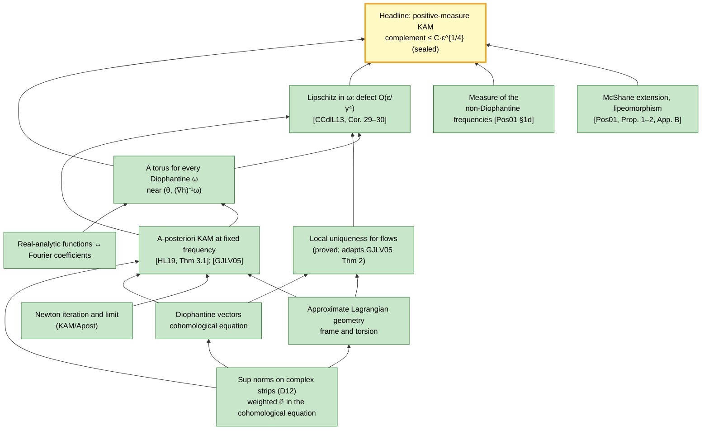

# KAM-dev — campaign HQ

Lean 4 + Mathlib formalization of the **Kolmogorov–Arnold–Moser theorem** in its positive-measure form:
for a nearly-integrable real-analytic Hamiltonian H(θ, I) = h(I) + f(θ, I) with a Kolmogorov-nondegenerate
h, most of phase space is filled by invariant Lagrangian tori that carry quasi-periodic motion with
Diophantine frequencies, as soon as f is small enough.

**Authors:** Scott Armstrong and Zohar Komargodski. Public development repository.

<!-- AUTO:updated -->
> **Last updated: 2026-10-31 03:00 UTC** (automatic: every 20 minutes and after every commit) · **estimated completion: original project 95.7 % · SO checker 100 % · SO Moon 74 % · Moon locked 50 % · track W 26 %** · frozen statements proved: 23 / 24 · **365,931 lines of Lean** of an estimated ≈ 373,000
<!-- /AUTO:updated -->

## Main theorems

All 23 frozen theorems are proved and sealed: the 22 of the original project and Rüssmann's theorem (track R, added
on 2026-10-30). Each Lean statement below was approved by the owner and frozen before its proof, the proofs are
complete, and they use only the standard axioms (`propext`,
`Classical.choice`, `Quot.sound`). The plain-language versions simplify; the linked Lean statements are exact. The full
list, with sources, is under [docs/STATEMENTS.md](docs/STATEMENTS.md).

**KAM theory (track K).**

1. **The KAM theorem, positive measure with a rate.** Let h be real-analytic on a bounded domain B ⊂ ℝⁿ (with a
   regular boundary: its δ-neighbourhood has volume ≤ C_B·δ) and frequency map ∇h a diffeomorphism (det ∇²h ≠ 0). For every real-analytic perturbation f of size ε small enough,
   all of 𝕋ⁿ × B except a set of measure at most C·ε^(1/4) lies on invariant tori of H = h + f: real-analytic
   Lagrangian tori close to {I = const}, on which the motion is quasi-periodic with a Diophantine frequency.
   [`KAM.kam_positive_measure`](KAM/Frozen/Theorems/KamPositiveMeasure.lean#L39)
2. **A-posteriori KAM at a fixed frequency** (Haro–Luque 2019, Theorem 3.1). An analytic torus that is
   approximately invariant for a Diophantine frequency ω, with invariance error below an explicit threshold, lies
   close to a true invariant torus with frequency ω, at a distance proportional to the error. [`KAM.aposteriori_kam`](KAM/Frozen/Theorems/AposterioriKam.lean#L40)
   **Sharp explicit constants.** `KAM.Sharp.g1_sharp` and its isoenergetic companion `KAM.Iso.Sharp.g1_sharp`
   prove these theorems with much smaller explicit constants: HL19's torsion route (no strip loss in the torsion),
   Rüssmann's small-divisor exponent τ (`KAM.cohomological_russmann`), a 3δ schedule and separate norms. They have
   the same hypotheses as the explicit theorems behind the frozen statements and imply them. For the lunar
   certificate the admissible invariance error grows from about 10⁻⁷⁵ to about 10⁻²⁵.
   [`KAM.Sharp.g1_sharp`](KAM/Sharp/G1.lean) · [`KAM.Iso.Sharp.g1_sharp`](KAM/Iso/Sharp/G1.lean)
   **v2.** Route A of the v2 theorem (`KAM.Sharp2.RouteA.g1_v2A`, `KAM.Iso.Sharp2.RouteA.iso_g1_v2A`; additive Newton
   step with certificate-checkable refined data and frequency-specific small-divisor constants) moves the lunar
   threshold to about 10⁻¹¹; its default-data wrappers conclude the same frozen bodies. Route B (Figueras–Haro's
   modified step with a cubic tangential error, `KAM.Sharp2.RouteB.g1_v2B`, iso `iso_g1_v2B_frozen`) is proved too, and
   `KAM.Sharp2.g1_v2` / `KAM.Iso.Sharp2.iso_g1_v2` conclude the frozen bodies with the best of v1, route A and route B
   (lunar figures such as 10⁻¹²·² for route B belong to the refined forms with measured data and frequency-specific
   constants; the literal wrappers use the frozen data and classical constants). On a
   fair grid of 1176 parameter sets, the v2 design's threshold and closeness constants beat Haro–Luque 2019 and
   (corrected) Figueras–Haro 2024 everywhere ([design §12](docs/campaign/design/APOST-SHARP-V2.md)). As an example,
   `KAM.Sharp2.Examples.plasmaLean_torus'` certifies an error tolerance of 3.72·10⁻¹⁷ at PlasmaLean's frequency
   and strip (65 times its proved tolerance, at assumed canonical data; lever L8′, torsion against the initial
   torus, `KAM.Sharp2.RouteA.g1_v2A'`).

**Weak non-degeneracy (track R).**

3. **Rüssmann's KAM theorem.** Let h be real-analytic on a complex neighbourhood of a bounded connected open set
   B ⊂ ℝⁿ, and assume only that the image of the frequency map ∇h lies in no hyperplane through the origin (Rüssmann's
   condition; the Hessian of h may be singular everywhere, as for h = I₁ + I₂³/3). Then there is a Diophantine
   exponent τ such that, for every κ, δ > 0 and every real-analytic perturbation f small enough, all of Tⁿ × B except
   a set of measure at most κ·|Tⁿ × B| lies on real-analytic invariant Lagrangian tori of H = h + f that carry
   quasi-periodic motion with Diophantine frequencies and lie within δ of the unperturbed tori {I = const}. Under weak
   non-degeneracy the frequencies of the surviving tori shift away from ∇h. (Rüssmann 2001, Theorem 1.7, maximal case;
   proved through track P's quantitative weak-non-degeneracy theorem.)
   [`KAM.Russmann.russmann_kam`](KAM/Frozen/Russmann/Theorems/RussmannKam.lean#L47)

**Isoenergetic KAM and confinement (track I).**

4. **All-time confinement in two degrees of freedom.** Let h be analytic on B ⊂ ℝ², isoenergetically nondegenerate
   (nonzero bordered Hessian). For every η > 0 there is ε₀ > 0 such that, for every analytic perturbation of size
   below ε₀, every solution starting with actions in a compact subdomain exists for all time and its actions never
   move by more than η; every local solution through the same point agrees with it. [`KAM.Iso.all_time_confinement`](KAM/Frozen/Iso/Theorems/AllTimeConfinement.lean#L45)
5. **The restricted circular planar three-body problem.** There is an explicit open set of near-circular initial
   conditions (osculating semi-major axis and eccentricity in given ranges) and μ₀, d, R > 0 such that, for every mass
   ratio 0 ≤ μ < μ₀, every solution starting there exists for all time, stays bounded, and stays at distance at least d
   from both primaries. [`KAM.Iso.restricted_near_circular`](KAM/Frozen/Iso/Theorems/RestrictedNearCircular.lean#L48)

**Exponential stability (track N).**

6. **Nekhoroshev's theorem for quasi-convex Hamiltonians**, exponents 1/(2n) (Pöschel 1993). For n ≥ 3 and a
   quasi-convex analytic h with uniform bounds, every solution of h + f with |f| ≤ ε ≤ ε₀ exists for times
   |t| ≤ T·exp(c·ε^(−1/(2n))), and its actions move by at most C·ε^(1/(2n)) during that time; the constants depend only
   on the dimension and the bounds. [`KAM.Nekhoroshev.quasiConvex_nekhoroshev_complexBound`](KAM/Frozen/Nekhoroshev/Theorems/QuasiConvexNekhoroshevComplexBound.lean#L47)
7. **Nekhoroshev's theorem for partially convex Hamiltonians** (Nekhoroshev 1977, Theorem 4.4), with fast actions
   convex in h and slow variables: the fast actions stay put for exponentially long times while the slow variables
   remain in their domain. [`KAM.Nekhoroshev.partialConvex_nekhoroshev`](KAM/Frozen/Nekhoroshev/Theorems/PartialConvexNekhoroshev.lean#L48)

**Planetary systems (track P).**

8. **Two planets and a moving Sun in the plane** (Chierchia–Pinzari 2009, Féjoz 2004). For two planets with distinct
   semi-major axes and every small enough planetary mass ratio μ, a set of positive measure of initial conditions is
   filled by invariant Lagrangian 4-tori carrying Diophantine quasi-periodic motions of the full Newtonian three-body
   problem; these motions exist for all time, never collide, and keep all mutual distances between d and D.
   [`KAM.Planetary.planarTwoPlanetKAM`](KAM/Frozen/Planetary/Theorems/PlanarTwoPlanetKAM.lean#L47)
9. **Exponential stability of planetary systems** (Nekhoroshev 1977, Theorem 12.3). For n ≥ 2 planets around a moving
   Sun in the plane and an admissible region of near-circular, well-separated initial data, there are μ*, c, C > 0 such
   that, for every mass ratio 0 < μ < μ*, every solution exists for |t| ≤ exp(c·μ^(−a)), a = 2/(6n² − 3n + 14),
   without collisions and with bounded eccentricities and distances, while every semi-major axis drifts by at most
   C·μ^(3a/2). The constants are asymptotic: this does not certify the actual Solar System. [`KAM.Planetary.planetaryExponentialSafety`](KAM/Frozen/Planetary/Theorems/PlanetaryExponentialSafety.lean#L53)

**Certified numerical tori (track SO, in progress).** These are ordinary proved theorems, not frozen statements.

10. **A sound certificate checker for KAM tori.** `checkTorusCertificate` is a Lean function, evaluated inside the
   kernel, that reads a finite certificate: a Hamiltonian written as an expression, a candidate torus given by
   Fourier models with rigorous enclosures, a box around the reference frequency and explicit constants. If it
   returns `true`, and the reference frequency ω* lies in the box and is Diophantine, then the Hamiltonian has an
   exact real-analytic invariant torus on the certified energy level, carrying quasi-periodic motion with
   frequency s∞·ω* for a scale 1 < s∞ < σ_ω, within the certified distance of the candidate. The proof runs through
   the sealed isoenergetic a-posteriori theorem. [`KAM.Certificate.checkTorusCertificate_sound`](KAM/Certificate/Soundness.lean#L62)
    A second, **sharp certifier** `checkTorusCertificateSharp` reads the same certificates and runs the same
    checks with the threshold of the sharp isoenergetic theorem; the a-posteriori theorem is a parameter of the
    certifier, so sharper theorems plug in without changing the certificate format. On the toy certificates its
    margin (threshold over invariance error) is 10^19.4 instead of 10^4.3 (two degrees of freedom) and 10^27.9
    instead of 10^4.3 (three). [`KAM.CertificateSharp.checkTorusCertificateSharp_sound`](KAM/CertificateSharp/Sound.lean)
    The **v2 certifier** `checkTorusCertificateV2 routeV2All` offers every route of the v2 theorem (route A with
    frozen or refined data and L8′, the l1 entry step, route B); a witness names the route, and the sharp certifier
    is one of them, so it is never worse. With refined bounds checked against the certificate's models
    and certified frequency-specific constants, the lunar design package passes at 10⁻¹¹·³ (10⁻¹⁰·⁸ with the L8′
    route); these lunar-size kernel checks are opt-in ([`kernel-tests/`](kernel-tests/README.md)).
    [`KAM.CertificateSharp.checkTorusCertificateV2_sound`](KAM/CertificateSharp/V2/Engine.lean)
11. **The first certified tori.** Toy certificates in two and three degrees of freedom pass the checker inside
    Lean's kernel and yield invariant tori with the Diophantine frequencies (ν₋/2, 1/2), ν₋ the quadratic
    irrational of the lunar problem, and (∛2/2, ∛4/2, 1/2). [`KAM.Certificate.toyCert3_torus`](KAM/Certificate/Tests/Toy3.lean#L53)

The first application, in progress, is the lunar spin–orbit problem: the Moon's spin rate stays within about 2.7 %
of its orbital rate for all time (barriers at N = 65 with the sharp certifier; the separatrix floor is 2.62 %).

## Overview

**The theorem (frozen and proved).** Let B ⊂ ℝⁿ be a bounded domain and h real-analytic on a complex
neighbourhood of B̄, with frequency map ∇h a diffeomorphism of B onto its image (det ∇²h ≠ 0). For every
κ > 0 there is ε₀ > 0 such that, for every f real-analytic on a fixed complex neighbourhood of Tⁿ × B̄ with
sup norm ≤ ε₀ there, the points of Tⁿ × B that lie on invariant tori of H = h + f have Lebesgue measure at
least (1 − κ)·|Tⁿ × B|. Each such torus is a real-analytic embedded Lagrangian torus close to {I = const}, and
the flow of H on it is conjugate to the linear flow θ ↦ θ + tω with a Diophantine frequency ω. Quantitative form
that the route delivers: the complement has measure ≤ C·ε^{1/4}, where ε = sup |f| (owner question Q1; the optimal
ε^{1/2} needs canonical-transformation methods). The exact Lean statement, approved by the owner and frozen, is
`KAM.kam_positive_measure`, with the qualitative form `KAM.kam_positive_measure_qualitative`. Both are sealed: their
proofs are complete, replayed by the kernel, and use only the standard axioms.

**Route** (decision D2). No canonical changes of variables and no action-angle normal forms:
1. **A-posteriori KAM at fixed frequency** ([HL19, Thm 3.1](https://arxiv.org/abs/1711.05515v1) with d = n;
   cross-checked against [GJLV05](https://doi.org/10.1088/0951-7715/18/2/020)). An approximately invariant
   torus with small error and a nondegenerate torsion lies near a true invariant torus. The proof is a Newton
   method on the torus embedding: matrix identities from the approximate Lagrangian property, constant-coefficient
   cohomological equations, Neumann-series inverses.
2. **One torus per Diophantine frequency.** Apply 1 to the unperturbed torus (θ, (∇h)⁻¹ω) of the nearly-integrable
   system; the invariance error is the size of the perturbation.
3. **Measure.** Local uniqueness for flows, which no source states (we prove it, adapting
   [GJLV05](https://doi.org/10.1088/0951-7715/18/2/020) Thm 2), and re-application of step 1 at nearby
   frequencies ([CCdlL13](https://doi.org/10.1016/j.jde.2013.05.001), Cor. 29–30) make the tori depend on the
   frequency with Lipschitz defect O(ε/γ⁴). A McShane extension ([Pos01](https://arxiv.org/abs/0908.2234v1),
   Prop. 1–2 and App. B) turns this into a lipeomorphism. The complement of the tori is then the image of the
   non-Diophantine set, of measure O(γ). Taking γ ~ ε^{1/4} gives the rate.
4. **Framework** (D12, refining D2). Estimates are sup-norm bounds of holomorphic functions on complex strips and
   domains, as in HL19 and GJLV05: products and compositions are immediate and Cauchy estimates are one-variable.
   Weighted ℓ¹ Fourier norms enter only in the cohomological equation.

**How the campaign works.** The statements we must prove are fixed first. The headline theorem, a few gate
theorems and the definitions they use are written in Lean, approved by the owner line by line, and frozen: one
declaration per file, hashed in [`manifest/frozen-anchors.json`](manifest/frozen-anchors.json), never edited.
Each frozen theorem starts with the proof `sorry`. Agents prove it in a separate provider module, and the
orchestrator *seals* it: the `sorry` becomes `by exact Provider.<name>`, and the checks (hashes, axioms, kernel
replay, build) run again. A result counts as formalized only when its frozen statement is sealed.

---

## At a glance

<!-- AUTO:progress -->
### Estimated completion: original project **95.7 %** · SO checker **100 %** · SO Moon **74 %** · Moon locked **50 %** · track W **26 %** · LG00 **42 %**

Original project (tracks K, I, N, P): `████████████████████████░` 95.7 %

Track SO, part 1, the general Lean certificate checker: `█████████████████████████` 100.0 %

Track SO, part 2, the Moon's spin rate (its first client): `███████████████████░░░░░░` 74.2 %

Track SO, part 3, the Moon locked in synchronous rotation forever (D42): `████████████░░░░░░░░░░░░░` 50 % (stages: scoping study, design, statements frozen, Lean proof modules, certificate data, sealed; read from the repository)

Track W, PDE KAM for the cubic wave equation: `██████░░░░░░░░░░░░░░░░░░░` 25.8 % (statements frozen 1, blueprint milestones 3, graph published 1, graph nodes resolved 10, seal 0.5; all read from the repository)

Side project LG00, a certified torus of the secular Sun–Jupiter–Saturn model: `██████████░░░░░░░░░░░░░░░` 42 % (stages, weighted by effort: scout: model, torus, thresholds, cost, Diophantine lemmas for the frequency directions (Lean), certificate-data generator and exact dry run, pilot: kernel cost measured on representative shards, kernel certificate of the torus T′ and the closed theorem, second torus T″ (confinement between two tori), independent audit and separate repository; from [`docs/campaign/side/lg00-status.json`](docs/campaign/side/lg00-status.json), the side orchestrator's assessment, last reviewed 2026-10-31 03:05 UTC)

Overall, everything together: 78.6 %

| Part of the project | Items | Weight | Done | Completion |
|---|---|---|---|---|
| Campaign infrastructure | 4 | 5 | 5.0 | `██████████` 100 % |
| Statement and planning | 8 | 26 | 24.8 | `██████████` 95 % |
| Analytic infrastructure | 8 | 24 | 24.0 | `██████████` 100 % |
| A-posteriori KAM at fixed frequency | 4 | 24 | 24.0 | `██████████` 100 % |
| Measure of the invariant tori | 5 | 12 | 12.0 | `██████████` 100 % |
| Track I (isoenergetic, confinement, R3BP) | 2 | 12 | 12.0 | `██████████` 100 % |
| Track N (Nekhoroshev) | 4 | 22 | 22.0 | `██████████` 100 % |
| Track P (planetary) | 5 | 30 | 30.0 | `██████████` 100 % |
| Sealing of the frozen statements | 23 | 23 | 23.0 | `██████████` 100 % |
| Track SO, part 1: general Lean certificate checker | 6 | 32 | 32.0 | `██████████` 100 % |
| Track SO, part 2: the Moon's spin rate (lunar spin–orbit) | 6 | 20 | 14.8 | `███████░░░` 74 % |
| Track SO, part 3: the Moon locked in synchronous rotation (D42) | 6 | 16 | 8.0 | `█████░░░░░` 50 % |
| Side project LG00: certified torus of the secular Sun–Jupiter–Saturn model | 7 | 12 | 5.0 | `████░░░░░░` 42 % |
| Track W: PDE KAM for the cubic wave equation (D30, D41) | 5 | 64 | 16.5 | `███░░░░░░░` 26 % |
| **Total** | 93 | 322 | 253.1 | **78.6 %** |

**How this is estimated.** The project is divided into 52 work items: planning deliverables, campaign infrastructure, the four layers of track K's proof, the proof campaigns of tracks I, N and P, and track SO (its items count the design's line estimates of the packages landed so far; [`docs/campaign/progress-SO.json`](docs/campaign/progress-SO.json)). Each item is weighted by its difficulty (low 1, moderate 2, high 4, very high 8) and counts with the fraction of it that is done; each sealed frozen theorem adds 1. Items marked *graph* take that fraction from their proof graph (nodes `PROVED`, `BYPASSED`, `EXTERNAL` or owner-accepted `ASSUMED` in [`docs/graph/`](docs/graph)), so they update themselves at every refresh, and count as complete once every frozen theorem of their track is sealed; the other items are the orchestrators' assessment, last reviewed **2026-10-28 03:25 UTC**. Files: [`docs/campaign/progress.json`](docs/campaign/progress.json) (track K and infrastructure) and [`docs/campaign/progress-INP.json`](docs/campaign/progress-INP.json) (tracks I, N, P).

<details><summary>All work items with their weight and status</summary>

| ID | Item | Difficulty | Done | Note |
|---|---|---|---|---|
| I.REPO | Repository: toolchain v4.35.0, Mathlib v4.35.0, module-system checks, source lint | L | ✅ 100 % |  |
| I.HQ | Campaign HQ: this README, generator, 20-minute cron and post-commit hook | L | ✅ 100 % | generated README (scripts/hq-status.py), 20-minute cron and post-commit hook, running since 2026-10-27 |
| I.GUARDS | Freeze machinery: manifest, anchor guard, quarantine, kernel replay, mutation suite | M | ✅ 100 % | anchor guard (Unicode-aware), ABI hashes, provider quarantine (anchors and the generated root only), proof-escape and meta-code lint, run at every landing; whole-library kernel replay (scripts/kernel_replay.sh, leanchecker, clean); guard mutation suite (72 mutations: all real ones rejected, 2026-10-29) |
| I.BUILD | Shared build snapshot for worktrees and machine-wide compile gate | L | ✅ 100 % | machine-wide compile gate (inp_lake_build.sh) and copy-on-write worktree builds on the main snapshot, in use since 2026-10-27 |
| S.SURVEY | Literature survey: candidate sources, prior formal work, Mathlib inventory | M | ✅ 100 % | three research reports (2026-10-27): sources, warm-ups and norms, prior formalizations |
| S.SOURCES | Pinned source library: PDFs with SHA-256, bibliographic data checked against arXiv and Crossref | L | 🟨 85 % | 50 PDFs pinned in sources/SHA256SUMS; 20 in the registry; per-paper summaries still to write |
| S.ROUTE | Route verdict for the measure layer (a-posteriori KAM + Lipschitz dependence on the frequency) | H | 🟨 90 % | verdict: route works; rate ε^{1/4}; flow local uniqueness must be proved by us (no published version) |
| S.STMT | Mathematical statement of the headline theorem and the gate theorems, with owner rulings | M | ✅ 100 % | docs/statement.md draft 0.2, approved |
| S.LEAN | Exact Lean statements (headline + gates): independent audit, owner approval, freeze | H | ✅ 100 % | approved (D11) and frozen: 5 theorem anchors + 20 definitions, manifest with file/prefix/ABI hashes |
| S.BP | Blueprint: every proof step written out against the pinned sources | VH | ✅ 100 % | 59 pages; Parts 2-4 reviewed, consolidated; Part 1 reviewed (ACCEPT WITH FIXES, applied) |
| S.GRAPH | Source-level dependency graph anchored to the frozen statements | H | ✅ 100 % | published: 453 nodes, 1420 edges, 0 source gaps, 11 externals; every node and coverage item independently reviewed; global review PASS |
| S.ERRATA | Errata and deviations ledger for every formalized source (continuous) | L | 🟨 30 % | ledger: 8 candidate errata, 6 planned deviations |
| F.ALG | Weighted ℓ¹ Fourier algebra on ℤⁿ: Banach algebra, exp, derivatives, averages | H | ✅ 100 % | *graph K* · graph K Part 1 (analysis): 124 PROVED, 7 BYPASSED, 11 EXTERNAL, 0 open (2026-10-28); per D12 the weighted ℓ¹ norms are used only in the cohomological equation |
| F.FT | Fourier–Taylor algebra in (angles, actions); Cauchy estimates in the actions | H | ✅ 100 % | *graph K* · graph K Part 1 (analysis): 124 PROVED, 7 BYPASSED, 11 EXTERNAL, 0 open (2026-10-28); per D12 realized with sup norms on complex strips and one-variable Cauchy estimates, no separate Fourier–Taylor algebra |
| F.COMP | Composition f∘(id+u) and Taylor remainders in the weighted norms | H | ✅ 100 % | *graph K* · graph K Part 1 (analysis): 124 PROVED, 7 BYPASSED, 11 EXTERNAL, 0 open (2026-10-28); compositions and Taylor remainders in sup norms on complex domains |
| F.MAT | Matrix-valued functions: products, Neumann-series inverses, averages | M | ✅ 100 % | *graph K* · graph K Part 1 (analysis): 124 PROVED, 7 BYPASSED, 11 EXTERNAL, 0 open (2026-10-28); Neumann inverses, operator and matrix norms, averages |
| F.BRIDGE | Bridge between real-analytic functions on complex strips and coefficient spaces | H | ✅ 100 % | *graph K* · graph K Part 1 (analysis): 124 PROVED, 7 BYPASSED, 11 EXTERNAL, 0 open (2026-10-28); strip↔coefficient bridges incl. W-valued summation (I-STRIP-2b) |
| F.DIOPH | Diophantine vectors; cohomological equation with Rüssmann's exponent | M | ✅ 100 % | *graph K* · graph K Part 1 (analysis): 124 PROVED, 7 BYPASSED, 11 EXTERNAL, 0 open (2026-10-28); cohomological solver with Rüssmann exponent |
| F.NEWTON | Abstract Newton/KAM convergence on a scale of analytic spaces | M | ✅ 100 % | *graph K* · graph K Part 1 (analysis): 124 PROVED, 7 BYPASSED, 11 EXTERNAL, 0 open (2026-10-28); convergence proved concretely in KAM/Apost/Iteration and Limit |
| F.HAM | Hamiltonian vector fields in coordinates; invariant tori; quasi-periodic orbits as ODE solutions | M | ✅ 100 % | *graph K* · graph K Part 1 (analysis): 124 PROVED, 7 BYPASSED, 11 EXTERNAL, 0 open (2026-10-28); Hamiltonian vector fields, flows (KAM/ODE), invariant tori |
| K.GEOM | Approximate Lagrangian property, adapted symplectic frame, torsion matrix | H | ✅ 100 % | *graph K* · graph K Part 2: 113 PROVED, 1 BYPASSED, 0 open; G1 SEALED (f4cdc0d) |
| K.STEP | Newton step: reduction of the linearized equation, cohomological equations, estimates | VH | ✅ 100 % | *graph K* · graph K Part 2: 113 PROVED, 1 BYPASSED, 0 open; G1 SEALED (f4cdc0d) |
| K.ITER | Iteration and convergence: the a-posteriori existence theorem | H | ✅ 100 % | *graph K* · graph K Part 2: 113 PROVED, 1 BYPASSED, 0 open; G1 KAM.aposteriori_kam SEALED (f4cdc0d) |
| K.UNIQ | Local uniqueness modulo phase for flows (no published version: adapt GJLV05 Thm 2, §6, §8) | VH | ✅ 100 % | *graph K* · graph K Part 3: 41 PROVED, 3 BYPASSED, 0 open; G2 KAM.local_uniqueness_flow SEALED (c9dec45) |
| M.APPLY | Invariant torus for every Diophantine frequency of a nearly-integrable Hamiltonian | M | ✅ 100 % | *graph K* · graph K Part 4: 127 PROVED, 1 BYPASSED, 0 open; HEAD SEALED (e4ca720) |
| M.LIP | Lipschitz dependence of the tori on the frequency (re-application; defect O(ε/γ⁴)) | H | ✅ 100 % | *graph K* · graph K Part 4: 127 PROVED, 1 BYPASSED, 0 open; HEAD SEALED (e4ca720) |
| M.DMEAS | Measure of the non-Diophantine frequencies | M | ✅ 100 % | G3 SEALED (D26): KAM.volume_not_diophantine_le proved, audited, kernel-replayed |
| M.IMAGE | McShane extension of F̂ − id and the lipeomorphism: the complement is the image of the complement | M | ✅ 100 % | *graph K* · graph K Part 4: 127 PROVED, 1 BYPASSED, 0 open; HEAD SEALED (e4ca720) |
| M.ASSEMBLY | Assembly of the headline theorem | M | ✅ 100 % | *graph K* · HEAD KAM.kam_positive_measure (e4ca720) and HEAD-Q (5f6b154) SEALED |
| I.PHASE0 | Sources, statements, owner approval, freeze | H | ✅ 100 % | approved and frozen (D20) |
| I.PROOF | Blueprint, graph and proofs (estimate, refined after Phase 0) | VH | ✅ 100 % | *graph I* · graph I published; ALL FOUR track-I frozen theorems SEALED (I-KEPLER, I-G1, I-HEAD, I-R3BP); I Parts 1-3, 5-8 proved and audited |
| N.PHASE0 | Sources, statements, owner approval, freeze | H | ✅ 100 % | approved and frozen (D20) |
| N.PROOF | Blueprint, graph and proofs (estimate, refined after Phase 0) | VH | ✅ 100 % | *graph N* · graph N published; N-QC, N-ZERO SEALED; Lean: ODE layer (Part 3), Parts 1, 4, 5 (except C5-9) proved and audited; Parts 6-7 design in revision; Parts 2, 8-10 designs being written |
| P.PHASE0 | Sources, statements, owner approval, freeze | H | ✅ 100 % | approved and frozen (D20) |
| P.PROOF.PDKAM | Properly degenerate KAM: blueprint, graph, proofs | VH | ✅ 100 % | *graph P* · graph P published; Part 1 Lean design audited (PP1-1..3 proving); Parts 2-5 designs being written |
| P.PROOF.PLANAR | Planar two-planet and fixed-Sun applications: coordinates, secular normal form, nondegeneracy | VH | ✅ 100 % | *graph P* · graph P published; Kepler/Poincare layer (P6-1..4, P6-6, P7-1..5, P7-7) proved and audited; Parts 8-13 designs being written |
| N.ADD.PHASE0 | N-PARTIAL-CONVEX and N-AVERAGING: statements, audit, approval, freeze | M | ✅ 100 % | N-PARTIAL-CONVEX frozen (D25), N-AVERAGING frozen (D28) |
| N.ADD.PROOF | N-PARTIAL-CONVEX and N-AVERAGING: blueprint, graph, proofs | VH | ✅ 100 % | *graph N* · graph N published (Parts 11, 12 included); Lean designs for Parts 11 and 12 being written |
| P.ADD.PHASE0 | P-EXP-SAFE, P-AMD-CONFINEMENT, P-SECULAR-BOX: statements, audit, approval, freeze | M | ✅ 100 % | approved and frozen (D25): 38 anchors |
| P.ADD.PROOF | P-EXP-SAFE, P-AMD-CONFINEMENT, P-SECULAR-BOX: blueprint, graph, proofs | VH | ✅ 100 % | *graph P* · graph P published; Parts 14a/b designs being written |
| SO1.DESIGN | Lean design of the general checker: seven revisions, independent design audits, replay gate (packed products checked against supplied advice) | H | ✅ 100 % | design accepted (Revision 7, seventh audit PASS WITH NOTES); replay gate GO |
| SO1.ARITH | Certified arithmetic: interface, exact and fixed-point backends, π and exp enclosures, range-reduced complex exponential, explicit KAM constants | H | ✅ 100 % | landed: SO-AIF, SO-RAT, SO-CEXP, SO-PI, SO-ABK, SO-CONST (of SO-AIF, SO-RAT, SO-CEXP, SO-PI, SO-ABK, SO-CONST) |
| SO1.FOURIER | Exact Fourier data and Fourier models: packed products checked against advice, model algebra, exponential and inverse witnesses | VH | ✅ 100 % | landed: SO-PBASE, SO-POLY-A, SO-POLY-B, SO-MALG, SO-EXPW, SO-PACKFIX (of SO-PBASE, SO-POLY-A, SO-POLY-B, SO-MALG, SO-EXPW, SO-PACKFIX) |
| SO1.EXPR | Hamiltonians as expressions: semantics, symbolic jets to third order, certified ball evaluation, norm bridges | H | ✅ 100 % | landed: SO-EXPR-A, SO-EXPR-B1, SO-EXPR-B2, SO-BALL, SO-NORM (of SO-EXPR-A, SO-EXPR-B1, SO-EXPR-B2, SO-BALL, SO-NORM) |
| SO1.MATRIX | Matrix certificates: approximate inverses, embeddings, Gram and torsion checks, positivity | H | ✅ 100 % | landed: SO-MINV, SO-EMB, SO-MAT, SO-TORS, SO-POS (of SO-MINV, SO-EMB, SO-MAT, SO-TORS, SO-POS) |
| SO1.CHECK | The certificate, the checker and its soundness theorem through the sealed isoenergetic theorem; toy and negative tests | VH | ✅ 100 % | landed: SO-DEFS, SO-SOUND-A, SO-SOUND-B, SO-DIO3, SO-TEST (of SO-DEFS, SO-SOUND-A, SO-SOUND-B, SO-DIO3, SO-TEST) |
| SO2.PLAN | Plan and owner rulings O1–O5: momentum window, rotated frame, parameter package R1 (confirmed with enclosed numbers), data packaging option A | M | ✅ 100 % | SO-GEN2: threshold 10^-74.7, about 8.5k terms per torus; SO-ADVCOUNT: about 4 MB of advice per torus |
| SO2.MODEL | Lunar model: the spin–orbit Hamiltonian, Diophantine lunar frequencies, clock, rotated frame | H | ✅ 100 % | landed: SO-MODEL, SO-DIO, SO-CLOCK, SO-FREQ, SO-HAMX, SO-ROT, SO-ROTDIO, SO-RFREQ, SO-DION (of SO-MODEL, SO-DIO, SO-CLOCK, SO-FREQ, SO-HAMX, SO-ROT, SO-ROTDIO, SO-RFREQ, SO-DION) |
| SO2.BARRIER | Confinement: two invariant barriers confine every solution for all time; graph inversion of an exact torus in both frames; certified graphs | H | ✅ 100 % | landed: SO-CONF, SO-GRAPHM, SO-GRAPHR, SO-GRAPH, SO-SHARPLINK (of SO-CONF, SO-GRAPHM, SO-GRAPHR, SO-GRAPH, SO-SHARPLINK) |
| SO2.DATA | Numerical candidates and certificate data: generator, the N = 65 tori and parameter package for the sharp certifier (SO-GEN3), kernel-reducible emitter, Lean data modules and their kernel replay | H | 🟨 67 % | landed: SO-GEN, SO-GEN2, SO-DATA-PY, SO-GEN3 (of SO-GEN, SO-GEN2, SO-DATA-PY, SO-DATA, SO-GEN3, SO-EMITFIX) |
| SO2.LUNAR | The lunar certificates pass and the confinement theorem: the Moon's spin rate stays within about 2.7 % of its orbital rate for all time (N = 65, D38) | H | 🟨 55 % | landed: SO-R1, SO-LUNAR-A, SO-R2 (of SO-R1, SO-LUNAR, SO-LUNAR-A, SO-R2) |
| SO2.FREEZE | Owner approval of the final statement, freeze, and seal | M | ⬜ 0 % | the final statement is approved by the owner before freezing |

</details>
<!-- /AUTO:progress -->

<!-- AUTO:size -->
### Size of the formalization

| | Lines of Lean |
|---|---|
| On `main` now | **365,931** (284,125 excluding blank lines and comments) · **+91,443** since 2026-10-30 02:00 UTC |
| Written on agent branches, not yet landed | 5,638 |
| Generated certificate data on agent branches (numeric literals, not counted above or below) | 639,776 |
| **Estimated total at completion** | **≈ 373,000** |
| Estimated still to write | ≈ 2,000 |

**How the size is estimated.** The estimate scales the lines written so far (on `main` plus the agent branches) by the done share of the Lean work items, weighted by difficulty: track K's analysis, a-posteriori and measure items and the proof items of tracks I, N and P. It is as good as those done fractions: track K's come from its proof graph, the others from the sub-orchestrator's assessment; track SO is added from its design (lines on `main` plus the line estimates of its packages not yet landed). History of all counts: [`docs/campaign/history.csv`](docs/campaign/history.csv).
<!-- /AUTO:size -->

<!-- AUTO:glance -->
*Generated 2026-10-31 03:00 UTC from `main` at `95dc7aab` by `scripts/hq-status.py`.*

**Current phase:** Original project complete: all 22 frozen theorems of tracks K, I, N and P are proved and sealed (144 of 144 frozen declarations), and every node of graphs K, I, N and P is resolved. Now: track SO (D30), in two parts: a general Lean certificate checker for numerical KAM tori, and its first client, the Moon's spin rate.

**Track SO** (D30, started 2026-10-29; [plan](docs/campaign/design/SPIN-ORBIT-PLAN.md)), in three parts:

- **Part 1, a general Lean certificate checker:** a numerical KAM candidate (any dimension, Hamiltonians given as finite expressions) passes a kernel-evaluated checker, and one soundness theorem turns it into an exact invariant torus. `KAM/Certificate`: 90 modules · 22,540 lines. **Packages landed: 27 / 27**.
- **Part 2, the Moon's spin rate:** two certified barrier tori prove that the Moon's spin rate stays within 3 % of its orbital rate for all time (target about 2.7 % at N = 65, D38). `KAM/SpinOrbit` and the data generator: 33 modules · 6,498 lines. **Packages landed: 21 / 24**.
- **Part 3, the Moon locked in synchronous rotation forever** (D42, D45): one librational invariant torus around a certified synchronous periodic orbit confines the spin (a stronger result than the spin-rate band; route: polar coordinates, the landed certifier, one new primitive `HamExpr.sqrt`; N = 65) · **50 %** · stages reached: scoping study, design, Lean proof modules · the lock sub-orchestrator is running (2 package workers)
- Design estimate for parts 1 and 2: ≈ 18,500 lines, 21,500–23,000 with overrun; landed: SO-AIF, SO-RAT, SO-CEXP, SO-PI, SO-ABK, SO-CONST, SO-PBASE, SO-POLY-A, SO-POLY-B, SO-MALG, SO-EXPW, SO-PACKFIX, SO-EXPR-A, SO-EXPR-B1, SO-EXPR-B2, SO-BALL, SO-NORM, SO-MINV, SO-EMB, SO-MAT, SO-TORS, SO-POS, SO-DEFS, SO-SOUND-A, SO-SOUND-B, SO-DIO3, SO-TEST, SO-MODEL, SO-DIO, SO-CLOCK, SO-FREQ, SO-HAMX, SO-ROT, SO-ROTDIO, SO-RFREQ, SO-DION, SO-CONF, SO-GRAPHM, SO-GRAPHR, SO-GRAPH, SO-SHARPLINK, SO-GEN, SO-GEN2, SO-DATA-PY, SO-GEN3, SO-R1, SO-LUNAR-A, SO-R2.
- **Gates:** design of the general checker ACCEPTED (Revision 7). Lunar route (2026-10-30): sharp certifier checkTorusCertificateSharp (D36, threshold about 1e-25), barriers at N = 65, band about 2.71 % (D38; floor 2.62 %), kernel-cheap packed products (D34, SO-PACKFIX). SO-GEN3 sizes the data: about 40 digits and 1-2k terms per torus (R1 had 88 digits and 8.5k terms). Final data wait for the next certifier version (same format).

**Track W** (D30, D41; [plan](blueprint-W/PLAN.md)): PDE KAM for the cubic wave equation u_tt = u_xx − m u − u³ on [0, π] (Pöschel 1996) · **26 %**
- Statements: frozen (12 anchors; `nlw2` draft until proved) · blueprint milestones written: 9 / 9 (W0, W1, W2, W3, W4, W5, W6, W7, W8) · proof graph: not published yet · `KAM/Wave`: 71 modules, 13,374 lines

**Frozen statements proved: 23 / 24** · frozen definitions: 134

**Lean on `main`:** 1836 modules · 365,931 lines · 15,315 theorems · `sorry` outside frozen anchors: 0 files · `axiom` declarations: 0

```text
DRAFT_ANCHORS: 1 (KAM/Frozen/Wave/Theorems/Nlw2.lean)
UNREGISTERED_SORRIES: 0
DRAFT_IMPORT_VIOLATIONS: 0 (frozen-anchor guard, run at every landing)
SEALED: 23 / 24 (kam.aposteriori_kam.v1, kam.kam_positive_measure.v1, kam.kam_positive_measure_qualitative.v1, kam.local_uniqueness_flow.v1, kam.volume_not_diophantine_le.v1, iso.isoenergetic_kam.v1, iso.all_time_confinement.v1, iso.kepler_bordered_det.v1, iso.restricted_near_circular.v1, nekhoroshev.quasiConvex_isoenergetic_derivative.v1, nekhoroshev.zero_perturbation.v1, nekhoroshev.quasiConvex_nekhoroshev_complexBound.v1, planetary.properlyDegenerateKAM.v1, planetary.planarTwoPlanetKAM.v1, planetary.fixedSunPlanetaryKAM.v1, planetary.d25.amdConfinement.v1, planetary.d25.planetaryExponentialSafety.v1, planetary.d25.secularBoxSafety.v1, planetary.d25.secularBoxAtCitedMasses.v1, nekhoroshev.d25.partialConvex_nekhoroshev.v1, nekhoroshev.d28.averaging_mean.v1, nekhoroshev.d28.averaging_most.v1, russmann.russmann_kam.v1)
```
<!-- /AUTO:glance -->

## Tracks

Four parallel tracks (decision D14; details in [`docs/TRACKS.md`](docs/TRACKS.md)), and since 2026-10-29 a fifth, track SO
(decision D30):

<!-- AUTO:tracks -->
| Track | Headline | Frozen theorems sealed | Proof graph | Stage |
|---|---|---|---|---|
| **K** | Positive-measure KAM for nearly-integrable analytic Hamiltonians, complement ≤ C·ε^{1/4} | 5 / 5 | 453 / 453 nodes resolved | **complete**: blueprint, graph and all five frozen theorems sealed (2026-10-28) |
| **I** | All-time confinement in two degrees of freedom (isoenergetic KAM); restricted circular planar three-body problem | 4 / 4 | 450 / 450 nodes resolved | **complete**: all four frozen theorems sealed — I-G1 isoenergetic KAM, I-KEPLER, I-HEAD all-time confinement, I-R3BP restricted three-body (2026-10-28); open graph nodes are alternative routes or steps proved in a specialized form |
| **N** | Nekhoroshev stability for quasi-convex Hamiltonians, exponents 1/(2n) | 6 / 6 | 728 / 728 nodes resolved | **complete**: all six frozen theorems sealed (the last, partialConvex_nekhoroshev, on 2026-10-29); every graph node resolved (one convention accepted under D31, three blueprint steps repaired under D32) |
| **P** | Properly degenerate KAM; planar two-planet problem; n planets around a fixed Sun | 7 / 7 | 1363 / 1363 nodes resolved | **complete**: all seven frozen theorems sealed (the last, planetaryExponentialSafety, on 2026-10-29); every graph node resolved (two conventions accepted by owner ruling D31) |
| **R** | Rüssmann's KAM theorem under weak non-degeneracy: invariant tori fill all but κ of phase space | 1 / 1 | not published yet |  |
| **W** | PDE KAM: two-frequency quasi-periodic solutions of the cubic wave equation u_tt = u_xx − m u − u³ on [0, π], every m > 0 (Pöschel 1996) | 0 / 1 | not published yet | statements frozen (D41: twelve declarations, on main since 762a7e3d; `nlw2` awaits its proof); blueprint parts W1–W8 being written and independently audited by the track W sub-orchestrator; then the dependency graph and the proof campaign |
| **SO-1** | Track SO, part 1: a general Lean certificate checker turning numerical KAM tori into theorems | 0 / 0 | not published yet | the certificate checker, its soundness theorem (`checkTorusCertificate_sound`, through the sealed isoenergetic theorem), the sharp certifier (D36) and the toy certificates landed; kernel-scale fixes for the lunar data under way (sparse packing, D34, landed; recursion depth and dyadic ball rounding, D39, in audit) |
| **SO-3** | Track SO, part 3: the Moon stays locked in synchronous rotation forever (librational tori; scoping, D42) | 0 / 0 | not published yet |  |
| **SO-2** | Track SO, part 2: the Moon's spin rate stays within about 2.7 % of its orbital rate for all time (N = 65, D38) | 0 / 0 | not published yet | barriers at N = 65 (D38), band about 2.7 %: general-N Diophantine lemmas, the sharp barrier, the band-parametric assembly and the N = 65 parameter package R2 landed; next the N = 65 certificate data, its kernel passes and the final theorems (SO-DATA3), then the freeze of the lunar statements (D40) |
| **LG00** | Side project: a kernel-checked KAM torus of Locatelli–Giorgilli's secular Sun–Jupiter–Saturn model (first formally verified torus of a planetary model; v2 certifier) | 0 / 0 | not published yet | 42 %: done: scout: model, torus, thresholds, cost; Diophantine lemmas for the frequency directions (Lean); certificate-data generator and exact dry run; pilot: kernel cost measured on representative shards; now: kernel certificate of the torus T′ and the closed theorem (0 %) |
<!-- /AUTO:tracks -->

**Track SO, the lunar spin–orbit certificate.** Numerical KAM computations find invariant tori to 100+ digits, but a
number is not a proof. Track SO builds a general *certificate checker* inside Lean: an external solver supplies a
finite candidate torus (Fourier data in any dimension, for Hamiltonians given as finite expressions), the Lean kernel
evaluates a checker on it, and one soundness theorem, proved once, turns a passing check into an exact invariant torus
with explicit error bounds through the sealed isoenergetic theorem I-G1. The first client is the classical lunar
spin–orbit problem: two certified barrier tori around the synchronous resonance prove that the Moon's spin rate stays
within 3.3% of its orbital rate for all time, for every initial condition in an explicit window. Plan and owner
decisions: [`docs/campaign/design/SPIN-ORBIT-PLAN.md`](docs/campaign/design/SPIN-ORBIT-PLAN.md); proposal and
numerical pilot: [`docs/explorations/`](docs/explorations).

**Side project LG00, a planetary torus.** Locatelli and Giorgilli (Celest. Mech. Dyn. Astron. 78, 2000) proved, with
interval arithmetic, KAM tori of a secular Sun–Jupiter–Saturn model: two degrees of freedom, a polynomial of degree 6
in the eccentricity–perihelion variables. LG00 certifies their torus in Lean's kernel with the v2 certifier, for the
exact Hamiltonian (through the `sqrt` node): to our knowledge the first formally verified KAM torus of a planetary model,
a formal reproduction of the KAM part of their result. The certificate runs on a separate branch and never enters this
library's default build. Scout: [`docs/explorations/sjs-lg00-scout.md`](docs/explorations/sjs-lg00-scout.md); status:
[`docs/campaign/side/lg00-status.json`](docs/campaign/side/lg00-status.json) (the LG00 row above and the progress bar).

The phase table below is track K's.

## Phases

| Phase | Content | Status |
|---|---|---|
| 0 | Survey, pinned sources, route verdict, mathematical statement, exact Lean statements approved and frozen | **done 2026-10-27** (D11) |
| 1 | Blueprint (every step written out against the pinned sources), source-level dependency graph | **done 2026-10-27** (graph: 453 nodes) |
| 2 | Proof campaign: infrastructure, a-posteriori KAM, measure layer, assembly | **done 2026-10-28**: every graph node resolved; all five frozen theorems sealed |
| 3 | Clean-up, elaboration test, errata and deviations record, public release | not started |

## What we are formalizing: the frozen statements

<!-- AUTO:statements -->
**24 frozen theorems (23 sealed) and 134 frozen definitions.** Each theorem, with its source, its docstring, a link to the exact Lean declaration and its status, is on its own page: **[docs/STATEMENTS.md](docs/STATEMENTS.md)**.

- Track K: positive-measure KAM: [`aposteriori_kam`](docs/STATEMENTS.md#aposteriori_kam), [`kam_positive_measure`](docs/STATEMENTS.md#kam_positive_measure), [`kam_positive_measure_qualitative`](docs/STATEMENTS.md#kam_positive_measure_qualitative), [`local_uniqueness_flow`](docs/STATEMENTS.md#local_uniqueness_flow), [`volume_not_diophantine_le`](docs/STATEMENTS.md#volume_not_diophantine_le)
- Track I: isoenergetic KAM, confinement, restricted three-body problem: [`isoenergetic_kam`](docs/STATEMENTS.md#isoenergetic_kam), [`all_time_confinement`](docs/STATEMENTS.md#all_time_confinement), [`kepler_bordered_det`](docs/STATEMENTS.md#kepler_bordered_det), [`restricted_near_circular`](docs/STATEMENTS.md#restricted_near_circular)
- Track N: Nekhoroshev stability: [`quasiConvex_isoenergetic_derivative`](docs/STATEMENTS.md#quasiconvex_isoenergetic_derivative), [`zero_perturbation`](docs/STATEMENTS.md#zero_perturbation), [`quasiConvex_nekhoroshev_complexBound`](docs/STATEMENTS.md#quasiconvex_nekhoroshev_complexbound), [`partialConvex_nekhoroshev`](docs/STATEMENTS.md#partialconvex_nekhoroshev), [`averaging_mean`](docs/STATEMENTS.md#averaging_mean), [`averaging_most`](docs/STATEMENTS.md#averaging_most)
- Track P: planetary systems: [`properlyDegenerateKAM`](docs/STATEMENTS.md#properlydegeneratekam), [`planarTwoPlanetKAM`](docs/STATEMENTS.md#planartwoplanetkam), [`fixedSunPlanetaryKAM`](docs/STATEMENTS.md#fixedsunplanetarykam), [`amdConfinement`](docs/STATEMENTS.md#amdconfinement), [`planetaryExponentialSafety`](docs/STATEMENTS.md#planetaryexponentialsafety), [`secularBoxSafety`](docs/STATEMENTS.md#secularboxsafety), [`secularBoxAtCitedMasses`](docs/STATEMENTS.md#secularboxatcitedmasses)
- Track R: Rüssmann's KAM theorem (weak non-degeneracy): [`russmann_kam`](docs/STATEMENTS.md#russmann_kam)
- Track W: PDE KAM (cubic wave equation): [`nlw2`](docs/STATEMENTS.md#nlw2)
<!-- /AUTO:statements -->

## The proof map

The planned dependency chain; arrows point from a result to what uses it. **Green**: proved. **Blue**: proved
conditionally on the nodes pointing into it. **Amber**: in progress. **Grey**: not started. **Yellow**: the
headline theorem. Node states are maintained in [`docs/campaign/campaign.json`](docs/campaign/campaign.json); the
plan behind them is [`docs/PLAN.md`](docs/PLAN.md).

<!-- AUTO:graph -->

<!-- /AUTO:graph -->

## What is formalized so far

<!-- AUTO:areas -->
| Area | Content | Modules | Lines | Theorems |
|---|---|---|---|---|
| [`KAM/Frozen/`](KAM/Frozen) | Owner-approved frozen statements and definitions (one per file, manifest-bound) | 158 | 7,366 | 24 |
| [`KAM/Provider/`](KAM/Provider) | One provider module per frozen theorem, where its proof is assembled | 24 | 1,643 | 37 |
| [`KAM/Analysis/`](KAM/Analysis) | Track K Part 1: quadratic iteration and scalar estimates | 1 | 158 | 4 |
| [`KAM/Fourier/`](KAM/Fourier) | Weighted ℓ¹ Fourier norms, used in the cohomological equation (D12) | 4 | 628 | 33 |
| [`KAM/Diophantine/`](KAM/Diophantine) | Diophantine vectors, cohomological equation, measure of the Diophantine set | 5 | 532 | 34 |
| [`KAM/Strip/`](KAM/Strip) | Holomorphic functions on complex strips: Cauchy estimates, Fourier series, cohomological equation | 41 | 9,671 | 389 |
| [`KAM/Matrix/`](KAM/Matrix) | Matrix-valued functions: Neumann series and inverse bounds | 5 | 1,147 | 83 |
| [`KAM/Torus/`](KAM/Torus) | Carriers for tori and embeddings: ℂⁿ × ℂⁿ, predicates, averages | 3 | 550 | 30 |
| [`KAM/Apost/`](KAM/Apost) | Track K Part 2: a-posteriori KAM at fixed frequency (Newton step, iteration, limit) | 19 | 7,466 | 421 |
| [`KAM/Uniq/`](KAM/Uniq) | Track K Part 3: local uniqueness of invariant tori for flows | 6 | 2,710 | 125 |
| [`KAM/Measure/`](KAM/Measure) | Track K Part 4: lattice counting, Lipschitz dependence, measure of the tori | 5 | 965 | 44 |
| [`KAM/Head/`](KAM/Head) | Track K Part 4: assembly of the headline theorem | 36 | 8,634 | 406 |
| [`KAM/ODE/`](KAM/ODE) | Flows of ODEs: solutions, symmetries, continuation (tracks N and P) | 13 | 2,372 | 98 |
| [`KAM/Iso/`](KAM/Iso) | Track I: isoenergetic KAM, confinement, restricted three-body problem | 117 | 32,270 | 1106 |
| [`KAM/Kepler/`](KAM/Kepler) | Kepler problem and Delaunay coordinates (tracks I and P) | 14 | 5,116 | 365 |
| [`KAM/Weighted/`](KAM/Weighted) | Track N: weighted domains and norms | 9 | 1,843 | 70 |
| [`KAM/Canonical/`](KAM/Canonical) | Track N: canonical flows and maps | 21 | 4,673 | 195 |
| [`KAM/Nekhoroshev/`](KAM/Nekhoroshev) | Track N: Nekhoroshev stability | 136 | 34,055 | 1501 |
| [`KAM/Planetary/`](KAM/Planetary) | Track P: planetary KAM | 761 | 147,974 | 6062 |
| [`KAM/Russmann/`](KAM/Russmann) | Track R: Rüssmann's KAM theorem (finite-order non-degeneracy, Lipschitz extension, assembly) | 12 | 1,631 | 48 |
| [`KAM/Sharp/`](KAM/Sharp) | Sharp explicit a-posteriori KAM: Newton engine, torsion route, step, g1_sharp, parameter boxes | 20 | 4,469 | 107 |
| [`KAM/CertificateSharp/`](KAM/CertificateSharp) | The sharp KAM certifier: engine-agnostic checker, rational constants, soundness | 98 | 18,240 | 772 |
| [`KAM/Sharp2/`](KAM/Sharp2) | v2 sharp a-posteriori KAM: route A, modified step (route B), l1 entry, small-divisor constants, PlasmaLean example | 108 | 27,182 | 1121 |
| [`KAM/Root/`](KAM/Root) | Generated parts of the root import file KAM.lean (scripts/gen_root_imports.py) | 26 | 2,224 | 0 |
| [`KAM/Certificate/`](KAM/Certificate) | Track SO: the general certificate checker (certified arithmetic, Fourier models, frequencies) | 90 | 22,540 | 1054 |
| [`KAM/SpinOrbit/`](KAM/SpinOrbit) | Track SO: the lunar spin–orbit problem (model, barriers, frequencies, graphs) | 33 | 6,498 | 376 |
| [`KAM/Wave/`](KAM/Wave) | — | 71 | 13,374 | 810 |
<!-- /AUTO:areas -->

## What the agents are doing now

Live state from [`docs/campaign/campaign.json`](docs/campaign/campaign.json), the agents' tmux sessions and their
branches. Rules for agents: [`AGENTS.md`](AGENTS.md). Builds:
- **Cap:** one targeted `nice -n 5 lake build <Module>` per agent at a time, through a machine-wide compile gate;
  never the whole library on a branch.
- **Reuse:** worktrees get a copy-on-write overlay on a snapshot of `main`'s build; nothing is rebuilt from scratch.

<!-- AUTO:workers -->
| Agent | Kind | Model | Account | State | Assignment | Branch | Unlanded commits |
|---|---|---|---|---|---|---|---|
| **orchestrator** | lead | Claude Opus 5.5 | claude-1 | 🔄 active | Campaign lead: track K (complete), offloaded packages of tracks I, N, P, sources, owner questions, this README | — | — |
| **suborch-INP** `kam-suborch` | sub-orchestrator (D23) | Claude Opus 5.5 | claude-7 | ⏸ idle | Tracks I, N, P: graphs (I complete; P open only for lane N and owner rulings), merging/landing/sealing of all I/N/P packages incl. those run by the main orchestrator | — | — |
| **lean-status-sync** | graph bookkeeping (subagent) | Claude Sonnet 5.5 | claude-7 | ✅ done | Bring LEAN_STATUS of graphs I and N up to date from the package audits | — | — |
| **lockdata** | prover (offload) | Claude Sonnet 5.5 | — | 🔄 proving | last commit: LOCK-DATA: jet bridge lock_jet kernel-checked (33.7 CPU-s, 3.37 GB peak) | `inp-lockdata` | 122 (vs `inp`) |
| **sodata3** | prover (offload) | Claude Sonnet 5.5 | — | 🔄 proving | last commit: SO-CSEG-GEN: product and character side checks as separate theorems (nested decides shared | `inp-sodata3` | 19 (vs `inp`) |
| **wgraph** | prover (offload) | Claude Sonnet 5.5 | — | ⏸ parked (no session) | last commit: Track W graph: delta review 7 (codex-1), reports only (track W paused) | `inp-wgraph` | 24 (vs `inp`) |
| **wph** | prover (offload) | Claude Sonnet 5.5 | — | ✅ audited, handed back | last commit: W1-CUBIC: audit 2 report (track W paused) | `inp-wph` | 13 (vs `inp`) |
| **wpj** | prover (offload) | Claude Sonnet 5.5 | — | ⏸ parked (no session) | last commit: W4-HOMOLOGICAL WIP: solve (i)(ii)(iv), linear images, wave frequencies, divisors (all file | `inp-wpj` | 2 (vs `inp`) |

*5 finished agent sessions not shown.*
<!-- /AUTO:workers -->

### Recent changes on `main`

<!-- AUTO:landed -->
| When (UTC) | Commit | Change |
|---|---|---|
| 2026-10-31 03:00 | `95dc7aab` | Merge remote-tracking branch 'origin/main' |
| 2026-10-31 02:57 | `a75cf5a6` | Log: earlyoom killed LOCK-DATA python at 15.5 GB; caps for Python jobs |
| 2026-10-31 02:49 | `5e8e6f1d` | Log: heartbeat (DATA3 throughput drop; diagnosis requested) |
| 2026-10-31 02:20 | `cfeab6de` | LG00 status: pilot stage at 25 % (checkHamBounds kernel-checked at L = 8 on lg00-cert) |
| 2026-10-31 01:49 | `221e164f` | Log: heartbeat (DATA3 heartbeat-timeout stall fixed by splitting; lock sizing done) |
| 2026-10-31 00:49 | `af1d5ef7` | Log: heartbeat (DATA3 one-third through kernel build; landing plan for data build output) |
| 2026-10-31 00:20 | `e67b85a4` | Merge remote-tracking branch 'origin/main' |
| 2026-10-31 00:19 | `2bb8f09e` | Land sharp-v2: hybrid producer and mirror aligned with the Lean checker (SHARP2-C8DFIX; fixes AUDIT-C8C-1 F1, F2 and a Cauchy-bound finding; R1-L8 hybrid margin +0.471) |
| 2026-10-31 00:00 | `b5b7c4ac` | Merge remote-tracking branch 'origin/main' |
| 2026-10-30 23:49 | `7d8d62f3` | Log: heartbeat (band lanes building; lock sizing) |
| 2026-10-30 23:27 | `b1b404b1` | Land sharp-v2: the certified first step, theorem side (restart and transfer lemmas, g1_hybrid_R, iso_g1_hybrid_R, never-worse disjunctions; AUDIT-C8AB-1 PASS), its producer and design; plans: Sun-Jupiter-Saturn (SJS-PLAN), the magnetic barrier and Mercury 3:2, effective-stability programs A-D, next demonstrations, ambition |
| 2026-10-30 23:21 | `e4cc5411` | Merge remote-tracking branch 'origin/main' |
<!-- /AUTO:landed -->

## Decisions

Full text: [`docs/DECISIONS.md`](docs/DECISIONS.md).

- **D1** Headline: the positive-measure KAM theorem for nearly-integrable real-analytic Hamiltonians on
  Tⁿ × B, general h (Kolmogorov nondegenerate). *(Scott, 2026-10-27)*
- **D2** Route: a-posteriori KAM at fixed frequency (parameterization method, no action-angle changes of
  variables), one torus per Diophantine frequency, measure via Lipschitz dependence on the frequency.
  Weighted ℓ¹ Fourier(–Taylor) norms internally; flows, not maps; coordinates on ℝⁿ with ℤⁿ-periodicity, not
  manifolds. *(Scott accepted the orchestrator's recommendation, 2026-10-27)*
- **D3** Independent development; the existing Lean formalization of Arnold's 1963 theorem (below) is a
  reference, not a dependency. *(Scott, 2026-10-27)*
- **D4** Toolchain `leanprover/lean4:v4.35.0`, Mathlib `v4.35.0` (Palomar's minimum is `v4.35.0-rc2`).
- **D5** Frozen-anchor workflow: statements frozen before proofs; one declaration per frozen file; sealing by
  `by exact Provider.<name>`; Lean module system everywhere.
- **D6** This README is regenerated at least every 20 minutes and after every commit; an errata and deviations
  ledger is kept for every formalized source. *(Scott, 2026-10-27)*
- **D7** Hosting: public GitHub repository `scottnarmstrong/KAM-dev` (source PDFs stay out of git). *(Scott)*
- **D11** Statements approved and frozen: 5 theorem anchors and 20 definitions. *(Scott, 2026-10-27)*
- **D14** Parallel tracks K, I, N, P: formalize the planetary programme too. *(Scott, 2026-10-27)*
- **D15** Authors: Scott Armstrong and Zohar Komargodski. *(Scott)*
- **D20** Tracks I, N (with N-HEAD-C) and P approved and frozen; 94 anchors in all. *(Scott)*
- **D21** Proof campaign: Sonnet provers, GPT-6.1-Sol auditors (tmux, yolo, default tier), optional second Opus sub-orchestrator. *(Scott)*
- **D12** Working norms: sup norms on complex domains (as in HL19 and GJLV05); weighted ℓ¹ norms only in the
  cohomological equation. *(orchestrator, refines D2)*
- **D22, D25, D28** Milestones from the collaborator's research question adopted; the track P additions,
  N-PARTIAL-CONVEX and N-AVERAGING approved. *(Scott)*
- **D23** An Opus sub-orchestrator runs tracks I, N and P. *(Scott)*
- **D24** Codex agents run GPT-6.1-Sol at medium effort. *(Scott)*
- **D26** First seal (G3) and the seal procedure; two corrections to the frozen-anchor guard. *(orchestrator)*
- **D27** Lean status `BYPASSED` for route substitutions. *(orchestrator)*
- **D29** Overnight mode: approvals deferred, decisions logged in
  [`docs/campaign/OVERNIGHT.md`](docs/campaign/OVERNIGHT.md). *(Scott)*
- **D8** Route verdict: rate ε^{1/4}; local uniqueness for flows is proved by us; Lipschitz dependence by
  re-application (CCdlL13); measure step by McShane extension (Pos01). *(orchestrator, 2026-10-27; revisable)*

## Owner questions

All answered: Scott accepted the recommendations on Q1–Q5 (2026-10-27), recorded as D9 in
[`docs/DECISIONS.md`](docs/DECISIONS.md).

| | Question | Ruling |
|---|---|---|
| Q1 | Rate in the frozen headline? | Yes: meas(complement) ≤ C·ε^{1/4}; the qualitative (1 − κ) form, with no boundary condition, is a corollary. |
| Q2 | Angle period? | 1: Tⁿ = ℝⁿ/ℤⁿ. |
| Q3 | Content of "invariant torus"? | Invariant, carrying the linear flow with a Diophantine frequency; Lagrangian; real-analytic embedding; close to the unperturbed torus. |
| Q4 | Gates besides the headline? | The fixed-frequency a-posteriori theorem, local uniqueness for flows, and the measure of the Diophantine set. |
| Q5 | Standing assumptions? | n ≥ 2; B bounded with regular boundary (rate form only); ∇h bi-Lipschitz on B̄; h + f real-analytic on a uniform complex neighbourhood. |

## Errata and deviations

Ledger: [`docs/errata/ledger.json`](docs/errata/ledger.json); reader-facing record (written from the ledger,
verified independently before release): [`docs/ERRATA-AND-DEVIATIONS.md`](docs/ERRATA-AND-DEVIATIONS.md). Every
source we formalize gets entries for its errata (defects in the pinned text) and for our deviations from it
(conventions, reformulations, proof routes). Candidates imported from the literature stay `CANDIDATE` until checked
against the pinned PDF.

<!-- AUTO:errata -->
| Source | Errata (by status) | Deviations (by status) |
|---|---|---|
| AKN06 | 0 | 1 planned |
| Arn63b | 1 candidate | 0 |
| BM11 | 4 confirmed, 1 dropped | 7 adopted |
| CC03 | 1 candidate | 1 adopted |
| CC07 | 1 confirmed | 0 |
| CC87 | 1 confirmed | 0 |
| CC88 | 1 dropped | 0 |
| CC95 | 1 confirmed, 1 dropped | 0 |
| CC97 | 1 confirmed | 0 |
| CCGdlL22 | 2 confirmed | 0 |
| CCdlL13 | 1 confirmed, 3 dropped | 1 planned |
| CCdlL20d | 3 confirmed | 0 |
| CCdlL20s | 1 candidate | 0 |
| CP09 | 3 candidate, 8 confirmed | 1 adopted, 2 planned |
| CP10pin | 3 candidate, 13 confirmed, 5 dropped | 5 adopted, 5 planned |
| CP11 | 2 confirmed | 1 planned |
| CVCGL05 | 2 candidate | 0 |
| Chi05 | 1 confirmed, 1 dropped | 2 adopted, 1 planned |
| FH24 | 3 confirmed, 2 dropped | 0 |
| FH25 | 2 candidate | 0 |
| FHL17 | 3 confirmed | 0 |
| FdlLS09 | 1 candidate, 1 dropped | 0 |
| Fej04r | 15 confirmed, 3 dropped | 2 adopted, 6 planned |
| Fej07e | 1 confirmed | 0 |
| GCB16 | 1 candidate, 2 confirmed | 0 |
| GJLV05 | 6 confirmed | 1 planned |
| HL19 | 1 candidate, 15 confirmed, 2 dropped | 2 adopted, 6 planned |
| KP96 | 1 candidate, 3 confirmed | 0 |
| LP17 | 1 confirmed | 1 adopted, 1 planned |
| Nei76 | 1 confirmed | 3 adopted |
| Nek77 | 3 confirmed | 5 adopted, 1 planned |
| Pos01 | 5 confirmed | 2 planned |
| Pos93scan | 2 candidate, 3 confirmed, 3 dropped | 3 adopted, 3 planned |
| Pos96K | 4 confirmed | 2 adopted |
| Pos96W | 1 candidate, 7 confirmed | 2 adopted |
| Rus01 | 2 confirmed | 0 |
| Rus05 | 3 confirmed | 1 planned |
| VL22 | 2 candidate, 1 confirmed | 0 |

<details><summary>All ledger entries</summary>

| ID | Type | Source | Location | Claim | Status |
|---|---|---|---|---|---|
| E-Pos01-1 | erratum | Pos01 | p. 29 (arXiv v1.3), footnote to Lemma A.2 | missing hypothesis: the condition Kσ ≥ 1 is missing in the printed version; the author's own footnote in arXiv v1.3 says so and the pinned arXiv version contains it | CONFIRMED |
| E-Pos01-2 | erratum | Pos01 | p. 23 (arXiv v1.3), choice of h₀ and K₀ in the proof of Theorem A | the choices of h₀ and K₀ violate h₀ ≤ α(2K₀^ν)⁻¹ (Bou20, footnote 1); Kou19 Rem. 2.1.5(4), p. 28: 'Theorem A and B are not valid for ν = τ+1' with that proof; Bou20 restores Theorem A as stated by Rüssmann approximation and a linear scheme | CONFIRMED |
| E-Pos01-3 | erratum | Pos01 | p. 13 (arXiv v1.3), measure statement after Theorem A | should be the measure of (Ω ∖ Ωα) × Tⁿ | CONFIRMED |
| E-GJLV05-1 | erratum | GJLV05 | p. 862, Theorem 3 (closeness bound) | presumably cγ^{−2}δ^{−2σ}, as in Theorems 1 and 5 | CONFIRMED |
| E-GJLV05-2 | erratum | GJLV05 | p. 865, Theorem 5 | ρ₀ is not defined in the statement (presumably ρ) | CONFIRMED |
| E-FdlLS09-1 | erratum | FdlLS09 | p. 13, Theorem 3.14 | δ is introduced but unused; the bound presumably involves δ | DROPPED |
| E-FdlLS09-2 | erratum | FdlLS09 | §7.1, pp. 42–43 | a bi-Lipschitz map ω ↦ K_ω into a function space does not by itself give a Lipschitz inverse of (θ, ω) ↦ K_ω(θ); the measure conclusion needs the argument we supply (D-LIP-1, D-MEAS-1) | CANDIDATE |
| E-CCdlL13-1 | erratum | CCdlL13 | pp. 31–32 (preprint mp_arc 11-188) | the two pages describe ℓ = 2 inconsistently | CONFIRMED |
| D-ROUTE-1 | deviation | Pos01 | whole proof | Proof route: the tori are obtained from an a-posteriori fixed-frequency KAM theorem (parameterization method, no canonical changes of variables) applied at each Diophantine frequency, not by Pöschel's iteration of symplectic transformations | PLANNED |
| D-MEAS-1 | deviation | Pos01 | Theorem (p. 6), Prop. 1–2 (p. 11) | Rate: our route proves meas(complement) ≤ C·ε^{1/4} (γ ~ ε^{1/4}), not Pöschel's O(√ε); the measure step applies the McShane extension of App. B to F̂ − id in frequency coordinates; in the proof the tori are parameterized by actions (not frequencies), so ∇h(B) needs no regular boundary (blueprint Part 4, V1–V2) | PLANNED |
| D-NORM-1 | deviation | HL19 | §3.1 (analytic functions and norms) | Estimates are carried out in weighted ℓ¹ Fourier(–Taylor) coefficient norms instead of sup norms on complex strips; hypotheses are stated for real-analytic functions and converted once at the interface | PLANNED |
| D-COORD-1 | deviation | HL19 | §2 (Hamiltonian systems and invariant tori) | Phase space Tⁿ × B is represented in coordinates: angles in ℝⁿ with ℤⁿ-periodicity, actions in an open set of ℝⁿ (no manifold structure, no general symplectic form) | PLANNED |
| D-UNIQ-1 | deviation | GJLV05 | Theorem 2 (maps), §6, §8 | Proof supplement: local uniqueness modulo phase for flows. No published statement exists in this framework (GJLV05 Rem. 7: 'We do not formulate such a theorem'; HL19 Rem. 3.5 asserts it without proof). We prove it by adapting the map proof of GJLV05 §6 with the flow reducibility of §8 and Prop. 18, directly for flows (not through the time-one map, which needs map-Diophantine frequencies).. Proof written in blueprint Part 3: linearization at K₁ (not K₂), the phase fixed once by ⟨BLᵀ(K₂(·+ψ) − K₁)⟩ = 0, a uniqueness constant independent of γ (∣ω∣ ≤ Γ from invariance, so γ ≤ Γ), the small-divisor exponent τ + n, and the conclusion on T_{ρ/2} | PLANNED |
| D-LIP-1 | deviation | CCdlL13 | Cor. 29–30 | Lipschitz dependence on the frequency by re-applying the a-posteriori theorem at a nearby frequency (CCdlL13 template), with the error estimate ‖E′‖ ≲ (ε + ‖K_ω − K⁰_ω‖_{C¹})·∣ω − ω′∣ and Lipschitz defect O(ε/γ⁴); refinements: stability always relative to the unperturbed torus, phase controlled by the average normalization, far pairs above λ_*γ² (blueprint Part 4, V3) | PLANNED |
| E-HL19-1 | erratum | HL19 | p. 18, (3.11) | the strict inequality is false when E = 0, where it would require ‖K∞ − K‖ < 0; it should read ≤ | CONFIRMED |
| E-HL19-2 | erratum | HL19 | p. 42, (5.66) | in the estimate for the twist term the denominator should be σ_T − ∣⟨T⟩⁻¹∣ | CONFIRMED |
| D-G1-1 | deviation | HL19 | Theorem 3.1, pp. 16–18; App. B (5.74)–(5.77) | Uniform constants: C₁, C₂ depend only on n, τ, ρ, ρ∞, a bound M for the Hamiltonian's derivatives, σK, σB, σT, a margin μ (gaps σ − ‖·‖ and distance to the boundary) and an upper bound γbar ≥ γ (App. B's constants increase with γ; without γbar the statement is false: machine-checked counterexample). Dropped hypotheses implied up to 2n factors: σ_{Kᵀ}, c_{X_hᵀ,1}; first integrals and the estimate on ⟨c∘K∞⟩ not transcribed. Pointwise operator norms on the open strip instead of sums of sups on the closed strip. Conclusion strengthened to explicit margins (μ/2) and ≤ in the closeness bound (cf. E-HL19-1). Same uniformization in our G2, where no γbar is needed: invariance with H2–H3 bounds ∣ω∣, hence γ; note: the hypotheses bound the frequency, γ ≤ ∣ω∣ ≤ 2nσ_Kσ_B(M + e), so γ̄ is needed only because the smallness condition alone does not bound e (Part 2 uses γ̄ once, to force e ≤ 1) | PLANNED |
| E-GJLV05-3 | erratum | GJLV05 | pp. 884–885, Lemma 14 (choice of the phase) | the proof never shows that Ψ maps Θ into itself, and Θ is open; Ψ(0) can be as large as ‖T‖_ρ‖K₁ − K₂‖_ρ. Correction: use the closed ball of radius 2‖T‖_ρ‖K₁ − K₂‖_ρ | CONFIRMED |
| E-GJLV05-4 | erratum | GJLV05 | p. 885, proof of Theorem 2 | should read 0 < δ < ρ/2 | CONFIRMED |
| E-GJLV05-5 | erratum | GJLV05 | p. 889, Prop. 18 | the derivative index should be θ_j, and the right-hand side norm should be ‖h‖_ρ | CONFIRMED |
| E-HL19-3 | erratum | HL19 | p. 55, Lemma A.1 | false for M̄ = M (it would give 0 < 0); should be ≤. Also (A.3)'s '< ½' only follows with ≤ | CONFIRMED |
| E-HL19-4 | erratum | HL19 | p. 33, (5.15)–(5.18); p. 43, (5.68) | false when E = 0; should be ≤ (the origin of E-HL19-1) | CONFIRMED |
| E-HL19-5 | erratum | HL19 | p. 42, after (5.67) | should refer to (5.13) and (5.17) | CONFIRMED |
| E-HL19-6 | erratum | HL19 | p. 44 | should read s → ∞ | CONFIRMED |
| E-HL19-7 | erratum | HL19 | p. 44 vs Theorem 3.1 (p. 17) | the proof's concluding sentence states the margin on the real torus only, but (5.73) does control dist(K_s(T_{ρ_s}), ∂B) on the complex strips, so the theorem's strip margin is proved; the sentence on p. 44 misstates what (5.73) gives | DROPPED |
| E-Pos01-4 | erratum | Pos01 | p. 6, after the definition of Ω_α | Hausdorff dimension n − 1 of the boundary does not give O(α) boundary layers. Counterexample: n = 1, Ω = (0,1) ∖ {1/k : k ≥ 1}: the boundary has dimension 0 but the inner α-layer has measure ≳ √α. The right condition is finite upper Minkowski content, or a layer bound as in our HEAD | CONFIRMED |
| E-Pos01-5 | erratum | Pos01 | p. 11, proof of Prop. 2 | the Lipschitz constant must be raised to the power n (Lipschitz maps scale n-dimensional measure by L^n; compare BC17 footnote 32) | CONFIRMED |
| D-LAG-1 | deviation | HL19 | §2.2, p. 7, eq. (2.3) | Proof supplement: the isotropy (Lagrangian property) of invariant tori with nonresonant frequency, asserted as well known, is proved in blueprint Part 4 (lemma lagrangian), citing GJLV05 Lemma 19 | PLANNED |
| E-P-A-N77-1 | erratum | Nek77 | pp. 56 and 58 (§12) | the same compactness lemma is printed with one label and cited with another; numbering only | CONFIRMED |
| E-P-A-N77-2 | erratum | Nek77 | p. 56, (12.6) | duplicate factor 1/2 in the kinetic energy; the momentum formula (12.8) Pᵢ = mᵢẋᵢ + mᵢΣmⱼẋⱼ on the same page follows from T = (1/2) Σ mᵢ ẋᵢ² | CONFIRMED |
| E-N-ADD-1 | erratum | Nek77 | p. 15, §1.18 | when two bodies approach one another the reciprocal-distance interaction grows; the sentence should read 'ceases to be small' | CONFIRMED |
| E-P-A-LP17-1 | erratum | LP17 | p. 17, between (B.9) and (B.10) | F is not introduced in that argument; the surrounding brackets use the integral K, so it should read {K, H₀} = 0 | CONFIRMED |
| D-P-A-1 | deviation | Nek77 | §12, Theorem 12.3, pp. 55–56 | P-EXP-SAFE specializes Theorem 12.3 to the planar problem with G = m₀ = 1, fixed positive planetary weights, planar prograde data in an explicit separated-annulus low-AMD region (AMDBox), with a symmetric exponential window and explicit uniqueness, Newton-equation and relative-distance conclusions; canonical element transfer is proof work | ADOPTED |
| D-P-A-2 | deviation | LP17 | (B.5), (B.8), App. B | P-SECULAR-BOX uses the raw untruncated full average over both mean longitudes in the fixed zero-coupling chart, implemented through the eccentric-longitude integral with its Jacobian, and a new elementary rational box at cited decimal masses; it is a statement about the averaged model, not the full Newtonian problem | ADOPTED |
| D-N-ADD-1 | deviation | Nek77 | Theorem 4.4 p. 30, Remarks 4.5.A–B | N-PARTIAL-CONVEX states the stopped theorem for Hamiltonians convex in the fast actions, with hypotheses on an enlarged fast domain G′ ⊇ G + (real ρ-ball) and conclusions for initial fast actions in G; the steepness of the source is obtained by an explicit convex specialization of its proof, not by a verbatim import (the naive import fails at ∂G: audit F-NADD-1) | ADOPTED |
| E-HL19-8 | erratum | HL19 | p. 19, Theorem 3.6 (3.16) | Both strict estimates fail for exact input E_c=0; replace < by ≤. Extension of existing E-HL19-1 to the isoenergetic theorem. | CONFIRMED |
| E-HL19-9 | erratum | HL19 | p. 18, (3.12), compared with p. 20 (4.1) | The sign conflicts with L_ω=−Σω_i∂_i and with (3.14). Read X_h(K)=−L_ωK. | CONFIRMED |
| E-HL19-10 | erratum | HL19 | p. 19, Remark 3.7 | Insert a minus before X_hᵀΩN in the first equality; the subsequent sign and final ωᵀ row have the intended value. | CONFIRMED |
| E-HL19-11 | erratum | HL19 | p. 59, Table 5 caption | The table collects (6.45)–(6.51), hence Section 6.3. | CONFIRMED |
| E-HL19-12 | erratum | HL19 | p. 53, (6.51), compared with p. 19 (3.16) | The same C₃ is attached to different powers of γρ^τ in (6.51) and (3.16); a uniform rescaling is necessary. This does not refute an existentially rescaled theorem. | CONFIRMED |
| E-HL19-13 | erratum | HL19 | pp. 49–51, (6.33), (6.36), (6.44) | Use the combined error ‖E_c‖ρ, including the prescribed-energy error; E alone cannot bound these corrections. | CONFIRMED |
| E-HL19-14 | erratum | HL19 | p. 52, iteration convergence | The iteration number s tends to infinity. Separate occurrence from existing E-HL19-6 on p. 44. | CONFIRMED |
| E-HL19-15 | erratum | HL19 | p. 52, frequency-margin paragraph | The eighth term is in the maximum (6.16), not the pair of inequalities (6.15). | CONFIRMED |
| E-HL19-16 | erratum | HL19 | p. 46, (6.9), constant term under the cohomological inverse | DROPPED as an erratum: omitting the constant ω̂ξ^ω inside R_ω is harmless because R_ω annihilates constants. The full zero-average compatibility condition is still required. | DROPPED |
| E-HL19-17 | erratum | HL19 | p. 19, H5′ | For ambient boundary in R^d, d≥2, a ray has empty interior and every point lies on its boundary. Specify relative boundary in its line, equivalently endpoint distances. | CANDIDATE |
| E-Chi05-1 | erratum | Chi05 | pp. 13–14, (3.38)–(3.39); compare p. 17 phase-space description | The printed domain also includes the secondary collision x^(2)=x_circ^(1)(t), where the displayed potential is singular if m₁>0. Exclude it. | CONFIRMED |
| E-Chi05-2 | erratum | Chi05 | pp. 13–16, (3.38)–(3.43) | DROPPED: the allegation that these formulas are only a first-order truncated Hamiltonian is false. The coordinate changes are exact; CC03 separately labels its approximation. | DROPPED |
| E-CC03-1 | erratum | CC03 | p. 7, Theorem 1.1 closing sentence | Scope ambiguity: nonreal ε generally does not define a real Hamiltonian flow. Clarify whether the similar statement complexifies phase space and invariance, or restrict a physical-flow version to real ε. | CANDIDATE |
| E-N-BM-1 | erratum | BM11 | p. 5, Theorem 2.1 | DROPPED as a false-theorem allegation: at ε=0 the strict size premise is empty. An explicit integrable supplement is a useful reformulation, not a counterexample to this implication. | DROPPED |
| E-N-BM-2 | erratum | BM11 | p. 9, Lemma 3.3 | A uniform image-ball radius cannot be independent of an unrestricted λ₀>0 in Ψ_h(I,λ)=(h(I),λω(I)); the centre also suppresses λ₀. Retain the pointwise inverse theorem or restrict λ₀ quantitatively. | CONFIRMED |
| E-N-BM-3 | erratum | BM11 | p. 13, restart argument | A displacement bound independent of the distance of I₀ to the boundary does not imply restart in the same inner ball for all I₀∈B(0,R/2). | CONFIRMED |
| E-N-BM-4 | erratum | BM11 | p. 8, Pos93 import; compare p. 4 B(M) | Real-slice derivative bounds B(M) do not supply the uniform complex Hessian bound required by that literal Pos93 import. Additional analytic control or a different proof is needed. | CONFIRMED |
| E-N-BM-5 | erratum | BM11 | p. 12, resonant integer vector | Require k′≠0 before deducing primitivity: i=j and p=q=1 give zero despite coprimality. The ambient integer set is Z^n. | CONFIRMED |
| E-N-GCB-1 | erratum | GCB16 | p. 4, main stability theorem | The ε=0 time expression needs an explicit integrable all-time convention or separate zero branch. This is an undefined endpoint in the literal real formula, not a refutation for positive ε. | CANDIDATE |
| E-N-GCB-2 | erratum | GCB16 | p. 3, quasi-convex steepness sentence | The steepness indices run through n−1; the last subscript should be n−1. | CONFIRMED |
| E-N-GCB-3 | erratum | GCB16 | p. 3, footnote 5 | The summand of the intended ℓ¹ norm must be ∣u_i∣. | CONFIRMED |
| E-N-POS-1 | erratum | Pos93scan | printed p. 190 (PDF p. 5), explanatory norm sentence | Restrict this equality to real symmetric Q. It is false for arbitrary complex symmetric Hessians on V_(r₀)P; retain the operator norm in the preceding hypothesis. | CONFIRMED |
| E-Pos93-1 | erratum | Pos93scan | printed p. 194 (PDF p. 9), end of Case B | The concluding target has lost its minus sign; the preceding calculation gives e^(−Ks/6)ε. The printed plus-sign upper bound is weaker and true, but does not express the intended remainder estimate. | CONFIRMED |
| E-Pos93-2 | erratum | Pos93scan | printed p. 195 (PDF p. 10), final telescoping display | The stated derivative bound is questioned: later iteration scales introduce ρσ/(ρ₀σ₀)=3/(2N²). The blueprint supplies componentwise bounds instead. No violating map has been established, so the mathematical defect remains unverified. | CANDIDATE |
| E-Pos93-3 | erratum | Pos93scan | printed p. 197 (PDF p. 12), Proposition 1 small-Ks branch | DROPPED: the source does not assert the Normal Form Lemma exponential remainder bound for the identity map in this branch. It proves Proposition 1 directly by the original vector field. | DROPPED |
| E-Pos93-4 | erratum | Pos93scan | printed p. 199 (PDF p. 14), Lemma 2 proof | The cited projected-frequency closeness was established only on U_ρD, while this segment may run to r−ρ. The printed inference is unsupported without further control; a sufficient repair is Mr≤ℓ/4 in the energy lemma and Mr≤ℓ/2 in Proposition 2. | CANDIDATE |
| E-Pos93-5 | erratum | Pos93scan | printed p. 200 (PDF p. 15), Proposition 2 small-Ks branch | DROPPED as a demonstrated false source statement: the half-radius issue is a proof-margin/transfer obligation, not a refutation of the proposition. Record the explicit smaller-radius argument as a supplement. | DROPPED |
| E-Pos93-6 | erratum | Pos93scan | printed p. 204 (PDF p. 19), choice A=11M/m | DROPPED: the alleged failed numerical domination ignores m≤M at a nonempty real point in dimension at least two. With that comparison the inequality used in the proof holds. | DROPPED |
| E-NAVG-NEI-17 | erratum | Nei76 | p. 1298, (17), with z(t) on p. 1297 and h in (4) p. 1295 | The equality interchanges supremum and initial-data integration. Only sup_t∫error≤∫sup_t error is automatic; the fixed-time Gronwall bound does not establish the required mean maximum. | CONFIRMED |
| E-P-CP10-DOMAIN | erratum | CP10pin | pp. 547, 551, 561, ball conventions | DROPPED as a mathematical erratum: conventions need a precise product-domain dictionary, but the word ball alone does not establish a false theorem. Frozen product discs are a disclosed choice. | DROPPED |
| E-P-CP10-INV | erratum | CP10pin | p. 556, Step 1, extension of the frequency diffeomorphism | Invertibility on an open V need not extend uniformly to V_ρ₀ at its boundary. A neighborhood of cl V with a quantitative inverse bound is an extra assumption or localization. | CONFIRMED |
| E-P-CP10-BOUNDARY | erratum | CP10pin | p. 561, after (56) | An arbitrary bounded open set need not have a linear boundary-collar volume estimate. Add a boundary regularity/collar hypothesis or localize to interior boxes. | CONFIRMED |
| E-P-CP10-ANNULUS | erratum | CP10pin | p. 561, (56); compare p. 559 (47) | For the positive rectangular action shell the excluded fraction is 1−(1−c√ε)^n₂, asymptotic to n₂c√ε, rather than O(ε^(n₂/2)) when n₂≥2. | CONFIRMED |
| E-P-CP10-WHOLE | erratum | CP10pin | p. 564, conclusion for Theorem 1.5 | The operation of intersecting a torus family with a cylinder alone does not prove saturation by whole invariant tori. The stronger containment/subfamily selection used by P needs a proof supplement. No actual violating CP10 family has been established. | CANDIDATE |
| E-CP10-1 | erratum | CP10pin | p. 554, Proposition 3 definition of Û | The index ranges define the last n₂ rows, an n₂×n matrix, not n×n₁. | CONFIRMED |
| E-CP10-2 | erratum | CP10pin | p. 565, Lemma B.1 initialization | Initialize the slow Hessian bound by M̂, not M, consistently with Proposition 3. | CONFIRMED |
| E-CP10-3 | erratum | CP10pin | p. 566, B.1(i), frequency-map composition | This is the identity and has the wrong target domain. Read ω_j⁻¹ ◦ ω_(j−1), as the one-step construction on p. 568 does. | CONFIRMED |
| E-CP10-4 | erratum | CP10pin | p. 555 (35), slow displacement; p. 572 (107) | The printed slow M̂/M refinement is not obtained by the displayed one-step estimate (107). Replacing that ratio by 1 gives the bound actually reconstructed. This is an unverified sharper-estimate allegation, not a supplied counterexample. | CANDIDATE |
| E-CP10-5 | erratum | CP10pin | p. 551, norm conventions and Appendix B estimates | Mixed norms are explicit, but the blanket allegation that the printed constants cannot all hold has no supplied failing inequality in those norms. The same-constant Kirszbraun step also needs its Euclidean conversion checked, not merely a change of norms asserted. | CANDIDATE |
| E-CP10-6 | erratum | CP10pin | p. 555, Proposition 3 | Without phase normalization the embedding is not unique: φ_ω(θ+a) has the same torus, frequency, analyticity and equations. | CONFIRMED |
| E-CP10-7 | erratum | CP10pin | p. 555, Proposition 3 global parameter Lipschitz claim; Appendix B | An arbitrary unbounded disconnected D does not give a global inverse-Lipschitz frequency map from a bounded inverse differential. At f=0 this can obstruct the claimed global parameter Lipschitz map. | CONFIRMED |
| E-CP10-8 | erratum | CP10pin | p. 565, (70) and its two following sums | The sums must run over k∉Λ, including (0,k₂)∉Λ in the slow part. Retained resonant modes are not divided by their divisors. | CONFIRMED |
| E-CP10-9 | erratum | CP10pin | p. 564, Lemma A.1 (66) | The target angular width should be s, not σ. | CONFIRMED |
| E-CP10-10 | erratum | CP10pin | p. 563, Theorem 1.5 proof Step 1; compare p. 564 A.1 | This substitution violates A.1 requirement ρ<r/2. To obtain the stated output action radius ρ̄/2, the natural inferred loss is ρ=ρ̄/4. | CONFIRMED |
| E-CP10-11 | erratum | CP10pin | p. 563, same Step 1 | DROPPED: the alleged printed r_p=r_q=0 is a misreading. The page prints ε₀, consistently with p. 556. | DROPPED |
| E-CP10-12 | erratum | CP10pin | pp. 562–563, Lemma 3.1 and (59) | The asserted restricted dependence is too strong for the abstract lemma when the slow radius r̂ shrinks. The covering number, hence its constants, can grow as 1/r̂. | CONFIRMED |
| E-CP10-13 | erratum | CP10pin | p. 562, use of Lemma 3.1 (59) | Rescaling only the slow block changes mixed resonances. A measure bound for ω_resc does not directly bound the originally defined ω_μ=(fast, μ slow) mixed-resonant set. | CONFIRMED |
| E-CP10-14 | erratum | CP10pin | p. 569, (91) | DROPPED: the calculation gives the sharper exponent 2(τ+1), but since 4s<1 the printed weaker upper bound remains true. | DROPPED |
| E-CP10-15 | erratum | CP10pin | p. 573, Step 3 | DROPPED: the claim that Appendix B never uses (108) overlooks this explicit sentence. Limit analyticity/domain details may still need supplementation. | DROPPED |
| E-CP10-16 | erratum | CP10pin | p. 567, Remark 3, and pp. 567–570 proof | DROPPED: the historical Arnold comparison is not an additional unproved Arnold dependency of B.1; Appendix B supplies an inductive proof. The genuine [4] finite-averaging dependency is separate. | DROPPED |
| E-P-Fej04r-1 | erratum | Fej04r | p. 55, proof of Proposition 73, q_jk display | Replace these mass products by m_jm_k. The second diagonal sum also lacks the denominator factor 2 present in the first and required by (36). | CONFIRMED |
| E-P-Fej04r-2 | erratum | Fej04r | p. 56, Lemma 76 | The universal single-valued meromorphic/pole assertion is false. b_(1/2)^(0)(α) has logarithmic divergence at α=1 and is regular at zero. | CONFIRMED |
| E-P-Fej04r-3 | erratum | Fej04r | pp. 50–51, (35)–(37), compared with corrected (31) p. 47 | Under the pinned corrected sqrt(2Λ) chart normalization, the coefficients of the quadratic matrix in (35)–(37) are twice the canonical ones. Halve both C₁ and C₂ in the displayed matrix convention. | CONFIRMED |
| E-P-Fej04r-4 | erratum | Fej04r | p. 53, Lemma 71 statement and proof | DROPPED: for sufficiently small ε, 2(1+O(ε)) is bounded by 3. These constants are compatible; an explicit threshold is an enhancement. | DROPPED |
| E-P-Fej04r-5 | erratum | Fej04r | pp. 54–55, Lemma 74 proof | DROPPED: the proof continues on p. 55, where both recurrences and a positive difference formula complete the induction. | DROPPED |
| E-P-Fej04r-6 | erratum | Fej04r | pp. 53–54, Corollary 72 | A uniform boundedness assumption on the family A_ε is missing. | CONFIRMED |
| E-P-Fej04r-7 | erratum | Fej04r | p. 58, induction block matrix | The old diagonal block generically has a nonzero O(a_n²) correction, so the stronger printed O(a_n^(5/2)) assertion is false. The off-diagonal O(a_n^(5/2)) is a valid weaker bound than O(a_n^(11/4)). | CONFIRMED |
| E-P-Fej04r-8 | erratum | Fej04r | p. 58, end of Proposition 77 induction | DROPPED as a demonstrated false source assertion: omitted quantitative detail in a true induction is a proof supplement, not an erratum. | DROPPED |
| E-P-Fej04r-9 | erratum | Fej04r | p. 56, domain A^C after Lemma 76 | A^C as defined is not simply connected: simultaneously rotate all nonzero axes through one full turn. Ratios stay fixed while each axis winds around zero. | CONFIRMED |
| E-P-Fej04r-10 | erratum | Fej04r | p. 53, Lemma 71 proof | Uniqueness needs a diagonal/skew normalization. If U solves [D,U]=−A, so does U+C for every diagonal C. A unique zero-diagonal skew solution is the intended choice. | CONFIRMED |
| E-P7-Fej48 | erratum | Fej04r | p. 48, small-eccentricity/inclination expansion before Theorem 62 | The leading factors should be √Λ_j after the corrected sqrt(2) in (31). These are stale asymptotics in the revised text. | CONFIRMED |
| E-P8-Fej50 | erratum | Fej04r | p. 50, Lemma 64 | The derivative expression for momentum misses an extra μ_j: mean motion is μ_j³M_j²/Λ_j³, whereas Y_j=μ_j Ẋ_j. | CONFIRMED |
| E-P-Fej07e | erratum | Fej07e | pp. 1–4, author corrections to original 2004 article | Historical author-reported corrections: Corollary 22 inverse parameter argument; inverse-operator constants A_j→A_j A′_(j+p+τ+1)/(2π); pair masses (28); sqrt(2) in (31). Pp. 3–4 also distinguish smooth construction and analytic planar addendum. The pinned revision already includes the (28)/(31) corrections. | CONFIRMED |
| E-P-Arn63b | erratum | Arn63b | reported in CP11 p. 34, footnote 53, concerning Arnold p. 138 (3.4.31) | CP11 reports this original exponent typo and a factor-two invariant normalization. Original English (3.4.31) has not been independently verified. | CANDIDATE |
| E-P-CP11-1 | erratum | CP11 | p. 62, Appendix B (B.2) | Insert 1/2 for this off-diagonal matrix coefficient under the frozen sqrt(2Λ) normalization. | CONFIRMED |
| E-P-CP11-2 | erratum | CP11 | p. 63, Appendix B (B.6), r₁ | The r₁ expression is only asymptotically correct as printed; its final 37α⁴ must be 37α³ to match the exact quartic coefficient. At axes (1,2) the printed and exact coefficients have opposite signs. | CONFIRMED |
| E-CP09-1 | erratum | CP09 | p. 21, perturbation threshold calculation | An upper bound on an admissible threshold does not show a prepared remainder is below that threshold. The application needs an explicit admissible lower bound of polynomial size, or a threshold chosen by equality after all estimates. | CANDIDATE |
| E-CP09-2 | erratum | CP09 | p. 15, polar action domain | A Euclidean radius controlled by ∣ρ₀∣ does not protect every oscillator component from zero. Use a radius smaller than a fixed fraction of min_j ρ₀j. | CONFIRMED |
| E-CP09-3 | erratum | CP09 | p. 14, action-dependent Birkhoff change | An action-dependent slow canonical change generally requires a fast-angle lift; it cannot leave both fast blocks unchanged while remaining symplectic. | CONFIRMED |
| E-CP09-4 | erratum | CP09 | pp. 14–15, Birkhoff normal form Q_* | The quadratic oscillator term is already written separately; including it again in Q_* double counts it. Q_* must start at degree two in the slow actions in that decomposition. | CONFIRMED |
| E-CP09-5 | erratum | CP09 | p. 15, torsion matrix dimension | There are p slow actions, so their torsion Hessian is p×p, not 2p×2p. | CONFIRMED |
| E-CP09-6 | erratum | CP09 | p. 15, polar coordinate display | The second term should be the variable ρ_j. | CONFIRMED |
| E-CP09-7 | erratum | CP09 | p. 11, frequency-selected action set | D_(γ,τ) is a frequency set; the action set is K∩ω⁻¹(D_(γ,τ)). | CONFIRMED |
| E-CP09-8 | erratum | CP09 | p. 11, internal reference; p. 6, footnote 8 | The local result is Lemma 2, and the statement of Rüssmann Theorem 1.7 starts on printed p. 126 in the pinned Rus01, with continuation/proof remarks on p. 127. | CONFIRMED |
| E-CP09-9 | erratum | CP09 | p. 6, Theorem 3 threshold dependencies versus p. 17 Lemma 8 | The analytic neighborhood A also enters quantitative thresholds through its margin ϑ. Omitting it is not a uniform statement over arbitrarily thin domains. | CANDIDATE |
| E-CP09-10 | erratum | CP09 | p. 17, transformed perturbation display | The repeated constant in the two shifted oscillator blocks should use the two distinct shifts c̄₁,c̄₂ defined in preparation. | CONFIRMED |
| E-CP09-11 | erratum | CP09 | p. 22, planetary application of Theorem 4 | The Kepler splitting used in the application depends on ε, whereas the preceding abstract theorem is stated with ε-independent input. A uniform parameter-family wrapper or exact zero-coupling splitting is required for this import. | CANDIDATE |
| E-Rus01-1 | erratum | Rus01 | p. 123, (1.2) | The elliptic z-block has 2p coordinates, so its symmetric quadratic matrix A must be 2p×2p. | CONFIRMED |
| E-Rus01-2 | erratum | Rus01 | p. 171, item 5, compared with (14.7) p. 165 | The defining bound (14.7) uses ∣A∣, not just its elliptic frequencies ∣Ω∣. General symmetric quadratic matrices with nonuniform conditioning are not controlled by their Hamiltonian eigenfrequencies alone. | CONFIRMED |
| E-Rus05-1 | erratum | Rus05 | p. 26, Lemma 8, strip integral representation | A boundedness or suitable growth hypothesis is needed to discard vertical contour sides and ensure the improper integral converges. | CONFIRMED |
| E-Rus05-2 | erratum | Rus05 | pp. 30–31, §11 (46) and final estimate | For the multipliers constructed there, dimension rescaling changes E(Tρ) to E(Tρ/n). The printed estimate fails for that construction; this is not a counterexample to existence of different approximation multipliers. | CONFIRMED |
| E-Rus05-3 | erratum | Rus05 | p. 21, abstract footnote referencing Rus01 | The pinned Rus01 footnote explaining the approximation source is on p. 135. | CONFIRMED |
| D-I-G1-UNIFORM | deviation | HL19 | Theorem 3.6; frozen I-G1 | Uniformize constants over fixed strip/ray/margin bounds, including γ̄, ν and ω*, rather than silently reusing source pointwise constants. | ADOPTED |
| D-I-ENERGY | deviation | HL19 | Theorem 3.6; frozen I energy class | Use the physical energy h, pointwise strip bounds and a bordered extended torsion in the frozen convention. | ADOPTED |
| D-I-CONFINEMENT | deviation | CC03 | Theorem 1.1 versus frozen I-HEAD | Prove a general all-initial-point two-degree-of-freedom confinement theorem through energy charts, Diophantine barriers and continuation, rather than reuse one computer-assisted fixed-energy region. | ADOPTED |
| D-I-KEPLER | deviation | Chi05 | §2 versus frozen I-KEPLER | Allow general positive Kepler parameter and rotation rate, and prove the action mean identities explicitly. | ADOPTED |
| D-I-PHYSICAL | deviation | Chi05 | §3 versus frozen I-R3BP | Use the exact barycentric restricted Hamiltonian, collision-free annuli, μ=0 endpoint, uniform μ₀≤1/2 and physical uniqueness/solution transfer. | ADOPTED |
| D-I-KEPLER-TUBE | deviation | Chi05 | p. 11 analytic Kepler equation; blueprint-I Part 7 | Supply an explicit complex tube with an eccentricity-dependent displacement guard and verify every chart consumer; the source qualitative small-∣e∣ assertion is not false. | PLANNED |
| D-I-NOA5 | deviation | HL19 | blueprint-I Part 1 geometry-noA5 / perturbation-noA5 | Restate and prove geometry/perturbation helpers without track K admissibility A5, using only their actual analytic/matrix premises. | PLANNED |
| D-N-1 | deviation | BM11 | docs/tracks/N/statement.md, deviation D-N-1 | Restrict the selected quasi-convex theorem to n≥3, while supporting local lemmas explicitly quantify their own dimensions. | ADOPTED |
| D-N-2 | deviation | BM11 | docs/tracks/N/statement.md, deviation D-N-2 | Replace strict perturbation size by a non-strict pointwise upper bound and absorb a fixed factor in thresholds. | ADOPTED |
| D-N-3 | deviation | BM11 | docs/tracks/N/statement.md, deviation D-N-3 | Separate ε=0 and prove the integrable orbit for all times; do not evaluate positive-time formulas at a zero denominator. | ADOPTED |
| D-N-4 | deviation | BM11 | docs/tracks/N/statement.md, deviation D-N-4 | Conclude genuine closed-interval solution existence and uniqueness as well as drift; impose the explicit constant margin C ε₀^(1/(2n))≤R/4. | ADOPTED |
| D-N-5 | deviation | BM11 | docs/tracks/N/statement.md, deviation D-N-5 | Spell out all typing, real analytic regularity, guarded domains and Lean-totality cases. | ADOPTED |
| D-N-6 | deviation | BM11 | docs/tracks/N/statement.md, deviation D-N-6 | Use the pointwise inverse-function conclusion on a general open set instead of the unrestricted λ-uniform ball assertion. | ADOPTED |
| D-N-7 | deviation | BM11 | docs/tracks/N/statement.md, deviation D-N-7 | Select only the classical stability endpoint; no improved tradeoff, fixed-radius second clause, Gevrey extension or optimality claim is frozen. | ADOPTED |
| D-N-8 | deviation | Pos93scan | docs/tracks/N/statement.md, deviation D-N-8 | Introduce separately named N-HEAD-C with a uniform complex Hessian bound and positive frequency lower bound; do not alter original N-HEAD. | ADOPTED |
| D-N-9 | deviation | Pos93scan | docs/tracks/N/statement.md, deviation D-N-9 | Allow N-QC and N-ZERO in all dimensions by removing unused hypotheses, including the n=2 instances needed by track I; headline dimension restrictions remain separate. | ADOPTED |
| D-N-10 | deviation | Pos93scan | docs/tracks/N/statement.md, deviation D-N-10 | Convert source Euclidean/2π/Fourier norms to frozen max/period-one pointwise norms, paying coth and √n factors and time prefactors. | ADOPTED |
| D-N-ADD-3 | deviation | Nek77 | §§4,10 versus D25 partial convexity | Specialize to a definite fast Hessian with global sign on an enlarged convex fast domain, fixed h and explicit complex Hessian bound. | ADOPTED |
| D-N-ADD-4 | deviation | Nek77 | D25 stopped partial theorem | Use max norms, closed erosion and queried histories, normalized perturbation and positive μ bound, with explicit conversion of non-strict inequalities. | ADOPTED |
| D-N-ADD-5 | deviation | AKN06 | §6.1.9 versus averaging drafts | Specialize to analytic Hamiltonians, fixed h,f,K, period-one angles, absolute volume and separate local existence. | PLANNED |
| D-N-ADD-6 | deviation | Nek77 | §10 Lemma 10.6 endpoint specialization | Use the direct definite-Hessian endpoint argument and explicit G′ collar instead of asserting source-global steepness on arbitrary bounded G. | ADOPTED |
| D-NAVG-1 | deviation | Nei76 | pp. 1295–1298; averaging v0.5 | Analytic Hamiltonian specialization, equal action/angle dimensions n≥2, fixed h,f,K before constants, period one, max norms and actual ODE solutions. | ADOPTED |
| D-NAVG-2 | deviation | Nei76 | p. 1296, condition 3°; AKN06 p. 243 | Replace a single nonzero first-frequency-component ratio chart by intrinsic projective-rank geometry and a quantitative finite chart cover. | ADOPTED |
| D-NAVG-3 | deviation | Nei76 | (17) and averaging v0.5 repair | Apply Gronwall to the integral of the running maximum using a Fourier envelope; construct actual-exit cohorts explicitly. | ADOPTED |
| D-N-POS-TRANSFER | deviation | Pos93scan | pp. 196, 199–200; N Parts 3/7 | Supply near-identity preimage surjectivity by contraction, stopped transfer, periodic continuation, first exit and the explicit half-radius small-Ks argument. | PLANNED |
| D-N-POS-GEOMETRY | deviation | Pos93scan | pp. 200–204; N Parts 8/9 | Use explicitly saturated Euclidean resonance lattices, distinguish K_a and K_g=√n K_a, and prove lattice volume, primitive-line and covering inequalities. | PLANNED |
| D-N-PARTIAL-ROUTE | deviation | Nek77 | §10 and blueprint-N Part 11 | Attempt an independent extended normal form and frequency-free convex energy argument, advertising 1/(2n) only after proof. | PLANNED |
| D-PG-1 | deviation | CP10pin | docs/tracks/P/statement.md, D-PG-1 | Joint analyticity on a closed μ interval and a data-dependent complex oscillator neighborhood, with constants uniform in μ. | ADOPTED |
| D-PG-2 | deviation | CP10pin | docs/tracks/P/statement.md, D-PG-2 | Fast physical angles use 2π periodicity; abstract torus parametrizations have period one with explicit lattice/frequency conversion. | ADOPTED |
| D-PG-3 | deviation | CP10pin | docs/tracks/P/statement.md, D-PG-3 | Use product oscillator discs and explicit max/Fourier norms rather than an ambiguous unqualified ball. | ADOPTED |
| D-PG-4 | deviation | CP10pin | docs/tracks/P/statement.md, D-PG-4 | Assume the fast frequency diffeomorphism on a fixed neighborhood of cl V with quantitative inverse control. | ADOPTED |
| D-PG-5 | deviation | CP10pin | docs/tracks/P/statement.md, D-PG-5 | State an explicit boundary-collar measure hypothesis, or use interior boxes with its proved loss. | ADOPTED |
| D-PLANAR-1 | deviation | Fej04r | docs/tracks/P/statement.md, D-PLANAR-1 | State analytic planar four-dimensional tori without the source factor-four restriction; keep actual physical closure obligations. | ADOPTED |
| D-PHYS-1 | deviation | Fej04r | docs/tracks/P/statement.md, D-PHYS-1 | Restore arbitrary G>0 and prove physical Newtonian reconstruction, collision exclusion, confinement and uniqueness. | ADOPTED |
| D-FIXED-1 | deviation | CP09 | docs/tracks/P/statement.md, D-FIXED-1 | Treat the fixed-center theorem as a new Newtonian deduction from the analytic maximal-torus route with exact physical transfer. | ADOPTED |
| D-SPATIAL-1 | deviation | Fej04r | docs/tracks/P/statement.md, spatial sketch | Defer an exact spatial Lean theorem; distinguish reduced and reconstructed frequencies/resonances. | PLANNED |
| D-PROOF-1 | deviation | Fej04r | pp. 50–55, P Parts 8/9 | Derive the corrected planar secular matrix in frozen increasing-axis order directly from pair averages. | PLANNED |
| D-PROOF-2 | deviation | Fej04r | p. 56, P Parts 9/10 | Use local holomorphy, symmetric spectral products and connected-domain continuation instead of false global meromorphy/simple connectivity. | PLANNED |
| D-P-AVERAGING | deviation | CP10pin | Appendix A / source [4], P Parts 2/3 | Prove finite two-scale averaging with direct complex nonresonance, oscillator extensions and η≤1/2 Lie-series losses. | PLANNED |
| D-P-NORM | deviation | CP10pin | pp. 551, 573, P Parts 1–4 | Use frozen max norms, period transport, explicit Fourier/sup conversion and componentwise McShane plus cube-measure estimates. | PLANNED |
| D-P-KAM-SUPPLEMENTS | deviation | CP10pin | Appendix B, P Part 3 | Prove inverse ball lifting, near/far parameter Lipschitz bounds and fixed-strip holomorphic convergence on explicit domains. | PLANNED |
| D-P-CELL | deviation | CP10pin | pp. 559–564, P Parts 4/5 | Use Liouville representatives and whole-torus inner containment, then a measurable subfamily deletion to obtain both strict measure inequalities. | PLANNED |
| D-P-REMAINDER | deviation | CP10pin | Theorem 1.5, P Part 5 | Prove the uniform fifth-order remainder from the analytic jet after choosing the data-dependent oscillator radius after the circular-torus collar. | PLANNED |
| D-P-KEPLER | deviation | Fej04r | pp. 46–48 Theorem 62, P Part 7 | Prove the analytic symplectic Poincaré chart through e=0 using regular Kepler coordinates and the guarded I-track tube, then extend symplecticity by density. | PLANNED |
| D-P-SECULAR | deviation | LP17 | P Parts 7/8, D25 secular definitions | Identify moving/fixed secular functions exactly to all orders up to the action-only term, rather than infer equality of full germs from a quadratic match. | PLANNED |
| D-P-CANONICAL-LIFT | deviation | Fej04r | p. 51, spectral oscillator change; CP09 p. 14 | Lift action-dependent slow rotations to the fast angles using the exact canonical one-form correction. | PLANNED |
| D-P-QUARTIC | deviation | CP11 | Appendix B, P Part 11b interface | Derive finite-axis exact quartic coefficients from the averaged interaction and correct B.6 rather than use only hierarchical leading asymptotics. | PLANNED |
| D-P-INDUCTION | deviation | Fej04r | pp. 57–58, P Part 10 | Supply quantitative symmetric spectral perturbation, resonance-product and axis-degeneration induction details. | PLANNED |
| D-P-WEAK-KAM | deviation | CP09 | pp. 17–21 Remark 5 / Lemma 8; Rus01 §§13–20 | Reconstruct the maximal case with strict power-law divisors, polynomial admissible thresholds and parameter inverse-Lipschitz/displacement control. | PLANNED |
| D-P-APPROX | deviation | Rus05 | §§8–11; Rus01 §7.3–7.5 | Either repair dimension/growth estimates and redo the schedules or prove elementary Fourier/Taylor approximation with changed constants. | PLANNED |
| D-P-LOCAL-WRAPPER | deviation | CP09 | Theorems 3–4 and Proposition 2; P Part 11a | Prove a local compact-action maximal-KAM wrapper with exact analytic domains, derivative nondegeneracy stability, parameter-family control and ambient whole-torus measure. | PLANNED |
| E-Pos93-7 | erratum | Pos93scan | printed p. 214 (PDF p. 29), Lemma B.3 proof, action Cauchy formula | The derivative formula needs ζ² in the denominator; the printed integral with ζ returns u itself. The next integral estimate needs the corresponding derivative kernel. | CONFIRMED |
| D-N-LIE-SERIES | deviation | Pos93scan | pp. 211–215 Appendices B–C; shared N Parts 4/5 | Prove weighted Fourier/domain/norm conversions, the flow and composition identity explicitly with η≤1/2, and propagate the stronger smallness into normal-form iterations. | PLANNED |
| D-I-LINEAR-SOLVE | deviation | HL19 | p. 46 Lemma 6.1 and source Lemma 5.1; I Part 1 | Supply the full bordered zero-mode and cohomological solve, including the energy identity and signs, rather than invoke analogy and an external Lemma 5.1 proof. | PLANNED |
| E-P-Fej04r-11 | erratum | Fej04r | p. 45, proof of Theorem 60, flat remainder | Smooth flatness alone does not imply an exponential-in-inverse-radius estimate. It implies every fixed polynomial order; this weaker consequence can suffice after a finite threshold is chosen. | CONFIRMED |
| E-P-Fej04r-12 | erratum | Fej04r | p. 42, Theorem 60(1°–3°), versus Definition 32 p. 17 and proof p. 45 | A fixed γ is incompatible with normal frequencies β=O(ε) and positive volume for every arbitrarily small ε when q>0. The proof instead chooses a shrinking γ̂. | CONFIRMED |
| E-P-Fej04r-13 | erratum | Fej04r | p. 34, Example 47, with (23)–(24) p. 33 | These constants fail for the printed Euclidean operator norm. Choose appropriate dimension-dependent constants. | CONFIRMED |
| E-P-Fej04r-14 | erratum | Fej04r | pp. 38–39, proof of Theorem 58 slicing displays | The linewise estimate concerns the bad set, but the p. 39 displays switch to the good set. They need ∉. The p. 38 reciprocal ratio also differs from the b/a factor in the theorem and preceding one-dimensional bound. | CONFIRMED |
| E-P-Fej04r-15 | erratum | Fej04r | p. 44, Step 5 polar localization, compare CP09 p. 15 | For an arbitrary positive vector ρᵒ this radius need not stay inside the positive action orthant. Choose comparable components or a radius controlled by min_j ρᵒ_j. | CONFIRMED |
| E-P-Fej04r-16 | erratum | Fej04r | p. 58, after the induction block matrix | The (n−1)-planet old block has n−1 eigenvalues; end the hatted list at n−1. | CONFIRMED |
| E-FH24-1 | erratum | FH24 | Lemma 2.14, p. 14 (arXiv v1) | derivation defect: the displayed c_R(δ) omits the factor (2π)^{-1} of the solution operator (2.21); the printed ĉ_R is twice the δ→0 leading coefficient that the corrected route gives. The printed ĉ_R remains a valid (conservative) uniform bound; halving it uniformly needs a separate proof | CONFIRMED |
| E-FH24-2 | erratum | FH24 | Table 3, (3.72), p. 38 (arXiv v1) | false as stated: since Nᵀ = BLᵀJᵀ the bound needs σ_Lᵀ and C_ΔL̄̄ᵀ where σ_L and C_ΔL̄̄ are printed; with σ_Lᵀ = 2nσ_K the printed bound underestimates by a factor up to 2n (in the canonical case it coincides with (3.71)) | CONFIRMED |
| E-FH24-3 | erratum | FH24 | (3.10) and p. 19 (arXiv v1) | typos: "C_E" stands for C_{Eᵀ}, and the cross-reference "Corollary 2.14" should be Corollary 2.16 | CONFIRMED |
| E-FH24-4 | erratum | FH24 | (2.24) with (3.99) and Table 1 | the "constant" C is not γ-free: (3.99) contains γδ^τ·max{1,C_sym}/ν and Table 1 contains terms like C_E = C_E^L + γδ^τ C_E^N | DROPPED |
| E-FH24-5 | erratum | FH24 | hypothesis H3 | typesetting: the second κ is presumably κ̂ ((3.91) needs a^{τ+1}Qε₀/(γδ₀^{τ+1}) < κ < 1 and (3.95) needs ε₀/(γδ₀^{τ+1}) < κ̂) | DROPPED |
| E-HL19-19 | erratum | HL19 | §5.3, p. 43, with Lemma 4.1 | conditional uniformity gap: freezing c_R at δ₀ is justified for a uniform c_R, but Lemma 4.1 also permits a δ-dependent c_R(δ), which need not be bounded by its value at δ₀; a uniform-in-later-bites bound or stage-specific constants are needed | CONFIRMED |
| E-FHL17-1 | erratum | FHL17 | proof of Theorem 2.5, p. 16 | conditional uniformity gap, as in HL19 §5.3: correct for a uniform c_R, but (90) allows c_R(δ), which need not be bounded by its value at δ₀ | CONFIRMED |
| E-FHL17-2 | erratum | FHL17 | p. 37 | At the printed τ = 1 and Table 5 inputs, the stated six-order gain cannot come solely from replacing (90) by (96). A calculation at τ = 1.26 has the six-order scale, but the exact cause of the reported number remains unverified. | CONFIRMED |
| E-FHL17-3 | erratum | FHL17 | introduction | misattribution: CC88 gives ∣ε∣ ≤ 0.65 (and Celletti–Chierchia JSP 1991 gives 0.838) | CONFIRMED |
| E-GJLV05-6 | erratum | GJLV05 | p. 866, Theorem 6 | wrong exponent: γ appears to the power +2; compare Theorem 1 (cγ^{−2}δ₀^{−2σ}) and Theorem 6’s own K-estimate with γ^{−2}; almost certainly γ^{−2} (the same issue as Theorem 3, E-GJLV05-1) | CONFIRMED |
| E-CCdlL13-2 | erratum | CCdlL13 | arXiv v1, Def. 4, p. 10 | incompatible hypotheses: at k = 1 one needs ν ≤ 1/2, and the paper later uses ν ≈ 0.382 | DROPPED |
| E-CCdlL20d-1 | erratum | CCdlL20d | p. 10, Definition 4 | In arXiv:2002.10647v1, p. 10, Definition 4, replace ν ≥ 1 by ν > 0 (or a suitable positive small-constant range): at k = 1 the hypothesis forces ν ≤ 1/2, and the paper later uses ν ≈ 0.382. | CONFIRMED |
| E-CCdlL13-3 | erratum | CCdlL13 | arXiv v1, Lemma 3, p. 9 | inconsistent with C_c = 1 stated just above (it gives 1/(2π) at ℓ = 1); a disc-automorphism example gives a ratio near 1/2 as δ → 0; apparently unused in App. B | DROPPED |
| E-CCdlL20d-2 | erratum | CCdlL20d | p. 9, Lemma 3 | The general derivative constant C_{c,ℓ} = ℓ!(2π)^{−1} in Lemma 3 is invalid for the stated sup norm and geometric strip; the ordinary Cauchy choice C_{c,ℓ} = ℓ! is valid. Whether the faulty constant is used computationally was not established. | CONFIRMED |
| E-CCdlL13-4 | erratum | CCdlL13 | (3.14) | gap: the proof schedule gives closeness on ρ∞ = ρ₀/2 = ρ₀ − 2δ₀; H5 allows any 0 < δ₀ < ρ₀ while the schedule fixes δ₀ = ρ₀/4 | DROPPED |
| E-CCdlL20d-3 | erratum | CCdlL20d | (3.14) | (3.14) is not justified on ρ₀ − δ₀ by the §5.5 schedule; that schedule reaches ρ₀/2 and fixes δ₀ = ρ₀/4. Use that final strip or reprove a schedule matching the stated free δ₀. | CONFIRMED |
| E-CCGdlL22-1 | erratum | CCGdlL22 | arXiv v1, p. 15 | impossible value (≈ 2.618 violates the Diophantine bound at k = 1); presumably ν = (3−√5)/2; unknown whether the code used the wrong value | CONFIRMED |
| E-CCGdlL22-2 | erratum | CCGdlL22 | (37) | The exhibited schedule reaches ρ₀/2 and does not prove the (37) closeness estimate on ρ₀ − δ₀. This is an analytic-strip proof mismatch, not an established counterexample to the underlying existence result. | CONFIRMED |
| E-CCdlL20s-1 | erratum | CCdlL20s | p. 20 | The pinned mp_arc 11-188 version of CCdlL13 does not contain the direct flow convergence proof described in CCdlL20s p. 20: its Appendix A explicitly limits itself to formal calculations. Whether the published JDE 2013 version supplies it remains unverified. | CANDIDATE |
| E-CC07-1 | erratum | CC07 | preprint (Dec 2003) p. 109 with (2.130) p. 49 and p. 96 | In the pinned December 2003 preprint, the tabulated β₁ uses Ω*/ρ instead of (2.130)'s Ω*/γ. Applying that fourth-power correction to the reported first closing evaluations gives approximately 849 and 7.26, so the displayed numerical justification fails on that reading. The published 2007 text and a full interval replay remain unchecked. | CONFIRMED |
| E-CC87-1 | erratum | CC87 | p. 2079 | inconsistent with the paper’s own ratios (ε_c ≈ 0.31) | CONFIRMED |
| E-CC97-1 | erratum | CC97 | p. 447 | numerical error: the expression evaluates to about 2.36; the underlying (4.31) gives about 3.8·10⁻³ < 1, so the conclusion stands | CONFIRMED |
| E-CC88-1 | erratum | CC88 | Lemma 11 | imprecise statement: presumably the bound holds at ξ₀ = 1/10 | DROPPED |
| E-CC95-1 | erratum | CC95 | p. 103 versus Planet. Space Sci. 46 (1998) | inconsistency between sources: Dyn. Rep. p. 103 says k ≤ 35 (verified on the page image); PSS 1998 says k ≤ 40 | DROPPED |
| E-CC95-2 | erratum | CC95 | p. 99 | CC95 p. 99 discusses the (√5−1)/2 forced-pendulum torus, while its cited CFP87 computation explicitly treats (1+√5)/2. The historical summary needs a torus-specific qualification; it must not attribute CFP87's calculation to the same flow torus merely because the frequencies differ by one. The precise provenance of 6.75·10⁻⁴ remains to be mapped among the grouped references. | CONFIRMED |
| E-VL22-1 | erratum | VL22 | eqs. (46), (47), (50)–(52), (65) | In VL22 (46), use σ for the angular strip widths. In (47), include the zero Fourier mode when defining the stated functional norm. The numerical λ* report is reproducible at τ = 1 using the printed base 20 and is conservative; the alleged 34-order discrepancy is withdrawn. | CONFIRMED |
| E-FH25-1 | erratum | FH25 | §5 | FH25 §5 does not report enough intermediate validation data to independently replay its numerical closure from the trial pair (10⁻³⁸, 10⁻⁴⁴). A direct coarse global FH24-majorant calculation with derived torsion bounds fails by several orders, but this neither reproduces nor refutes the paper's stated finite-prefix-then-theorem computation. Retained as a reproducibility request, not a confirmed erratum. | CANDIDATE |
| E-FH25-2 | erratum | FH25 | §5 (choice of δ) against Theorem A.1 (arXiv v1) | the application's choice δ = ρ/6 lies on the excluded endpoint of the open interval that Theorem A.1 (FH24 Theorem 2.18) requires; any δ slightly below ρ/6 would do | CANDIDATE |
| D-W-FREEZE-1 | deviation | Pos96W | frozen docstrings of KAM.Wave.linearTorus, reconU, reconV (approved text docs/tracks/W/W-STATEMENTS.md rev 1, ffcbdb93) | One space replaced by a newline in each of three approved declaration docstrings, to meet the 100-column lint (D-WF1, main orchestrator ruling 2026-10-30; AmdConfinement precedent) | ADOPTED |
| D-W-FREEZE-2 | deviation | Pos96W | frozen docstrings of KAM.Wave.reconV and KAM.Wave.nlw2 (approved text docs/tracks/W/W-STATEMENTS.md rev 1, ffcbdb93) | Docstring corrections (D-WF2, main orchestrator ruling 2026-10-30): reconV 'where `q = coeff y`' -> 'where `p = coeff y`' (the formula is in the momentum coordinate p); nlw2 '**W-NLW2 (proposed).**' -> '**W-NLW2.**' (now owner-approved and frozen) | ADOPTED |
| E-W-Pos96K-1 | erratum | Pos96K | p. 127 (PDF p. 10), proof of Lemma 1 (operator part F^{11} of the homological equation) | The weighted square-sum (Parseval-type) bound is false for operator-valued coefficients: 'as before' transfers the Hilbert-valued bound of p. 126 to the operator space on ℓ², which is not a Hilbert space. Use instead the Banach-valued coefficient bound ∣∣∣R̃_k∣∣∣ ≤ M e^{−∣k∣s} with lattice sums after a strip loss (blueprint-W bpW:w1:fourier-banach, bpW:w1:lattice, bpW:w1:schur). | CONFIRMED |
| E-W-Pos96W-1 | erratum | Pos96W | p. 285, proof of Lemma 4, Case 1 | The displayed lower bound is false; the valid bound is δ′(m) ≥ 1/(2λ_i). Lemma 4 survives with a smaller absolute constant. | CONFIRMED |
| E-W-Pos96W-2 | erratum | Pos96W | p. 286, proof of Lemma 4, Case 2 | The reduction misses the subcase i = j < k = l: there δ_{+−−+} ≡ 0 (paired), while δ_{−−++} = 2(λ_k − λ_i) is nonpaired and still needs a positive lower bound. Lemma 4 is true; the case needs a separate outer-pair bound. | CONFIRMED |
| E-W-Pos96W-3 | erratum | Pos96W | p. 286, proof of Lemma 4 | The first factor 2 should be 2i: λ_{j+2i} − λ_j ≥ 2i(λ_{j+1} − λ_j) ≥ 2i f′(j) (sum of 2i increasing unit gaps). | CONFIRMED |
| D-W-Pos96K-A4 | deviation | Pos96K | p. 147, Lemma A.4 (flows of parameter-dependent vector fields), second displayed estimate | The proof bounds the field difference at two trajectory points by ‖DX‖_V‖Δφ^s‖_U, which needs the segment between them to lie in the derivative-controlled domain (V is only open, not convex); blueprint-W supplies this: both trajectories and all Picard iterates stay in a convex ball B(w,δ) with margin 2δ, where Cauchy gives ‖DX‖ ≤ M/δ. | ADOPTED |
| E-PDE-W-1 | erratum | Pos96W | p. 282, proof of the Main Proposition (expansion of H in z, w); propagated to p. 284 (Ḡ_ij) and pp. 290-291 (A, B, v) | Two factor-4 slips: the first line must carry (1/16) (q = (z+z̄)/√2 gives (1/√2)⁴ = ¼ on top of the ¼ of (9)), and the second line drops the remaining prefactor. Correct values: Ḡ_ii = A_ii = 9/(8πλ_i²), Ḡ_ij = A_ij = B_ji = 3/(2πλ_iλ_j), v = (3/2π)(λ_1^{-1}, …); the printed A, B, v are 16 times too large | CONFIRMED |
| E-PDE-W-2 | erratum | Pos96W | pp. 287-290: actions (p. 287) vs p. 281, attachment α = λ, A = Ḡ and real recovery (p. 290), rotation sign (pp. 287, 289-290) | Inconsistent with p. 281 (z = (q+ip)/√2, symplectic form i Σ dz∧dz̄): (a) the recovery is q = √2 Re z, p = √2 Im z; (b) the canonical action is ∣z_j∣² = (q_j²+p_j²)/2, so with p. 287's I = ½∣z∣² one needs α = 2λ; (c) under p. 287's I the quartic matrix is 4Ḡ, not Ḡ (independent of E-PDE-W-1); (d) the source's own field gives ż = −iλz, whereas pp. 287-290 use the time-reversed ż = iωz | CONFIRMED |
| E-PDE-KP-1 | erratum | KP96 | author version 2.1, p. 16 (normal form H∘Γ) and p. 5 Remark 2 | With the symplectic form (i/2) Σ dq∧dq̄ the canonical action is ∣q∣²/2, so ½ Σ Ḡ_ij∣q_i∣²∣q_j∣² = ½⟨(4Ḡ)I, I⟩: A = 4Ḡ = (4 − δ_ij)/π, not Ḡ. Journal printing (Ann. Math. 143 (1996)) unverified: only the author version 2.1 is pinned | CONFIRMED |
| E-PDE-KP-2 | erratum | KP96 | author version 2.1, Theorem 1 p. 5 vs Lemma 6 p. 20 | The 'clearly' is false for some masses: with λ_j = j² + m, λ_a = 0 at m = −a² and λ_a + λ_b = 0 at m = −(a²+b²)/2 (a, b ∉ J), so condition (A₂) of Theorem 2 fails there; a gauge reduction u ↦ e^{−ict}u is the natural repair but is not given. Journal printing unverified | CONFIRMED |
| E-W-N-1 | erratum | Pos96W | p. 280, proof of Lemma 3 | The operator norm of q ↦ Sq into the two-sided space is exactly √2 for every m > 0 (sup_j j/λ_j = 1), so the printed norm-one bound fails for every m > 0. Constant only; ‖G_q‖_{a,s+1} = O(‖q‖³) stands | CONFIRMED |
| E-W-N-2 | erratum | KP96 | author version 2.1, p. 13, proof of Lemma 3 | The two-sided norm of the odd extension is √2‖q‖_{a,p} (same pattern as E-W-N-1). Constant only | CANDIDATE |
| E-W-N-3 | erratum | Pos96W | p. 282, Main Proposition | Typographical: p. 284 shows the intended (6/π)(4 − δ_ij)/(λ_iλ_j); superseded in any case by E-PDE-W-1 (factor 16) | CANDIDATE |
| E-W-N-4 | erratum | Pos96W | p. 278 (PDF p. 11), proof of Lemma 1, second line of the u_tt display | The λ_j² q_j term needs a minus sign: by (6), (7) q̈_j = −λ_j² q_j − √λ_j⟨f(u), φ_j⟩; the next printed line already has −Au | CONFIRMED |
| E-W-N-5 | erratum | KP96 | author version 2.1, p. 13, first display in the proof of Lemma 3 | Missing factor ½: G = ½∫g(∣Sq∣²) (p. 11 (5)) and ∂∣u∣²/∂q̄_j = uφ_j give ∂G/∂q̄_j = ½∫ f(∣u∣²) u φ_j dx; p. 11 Lemma 1 is consistent with the correct value | CONFIRMED |
| E-W-Pos96K-2 | erratum | Pos96K | p. 127 (PDF p. 10), proof of Lemma 1, divisor bound for the operator part | The Melnikov hypothesis gives α·max(1,∣i^d−j^d∣)/A_k, i.e. α·max(1,∣i−j∣)/A_k at d = 1, which is up to a factor 2 smaller than the printed α(1+∣i−j∣)/A_k; the inference 'since d ≥ 1' does not give the printed bound | CONFIRMED |
| E-W-Pos96K-3 | erratum | Pos96K | p. 124 (PDF p. 7) definition of the mean [R]; p. 125 (PDF p. 8) homological equation | The mean omits the constant term of R, so the stated equation holds only modulo that constant; add â_0 to N̂ (or state the equation modulo constants). Vector fields are unaffected | CONFIRMED |
| E-W-Pos96K-4 | erratum | Pos96K | p. 137 (PDF p. 20), proof of Lemma 5 | The displayed derivation does not give the factor 4: the preceding r-interval has length 8δ/∣k∣ (radius 4δ/∣k∣), and the oblique coordinates have Jacobian ∣v∣₂ = √n, not 1. Only the form c₃α/A_k is used later | CONFIRMED |
| D-W-Pos96K-L10 | deviation | Pos96K | p. 142 (PDF p. 25), Lemma 10 | The source asserts the perturbed frequencies are 'Lipschitz close of order α' to nontrivial affine functions; its estimates give sup-closeness O(α) but only a sufficiently small unweighted Lipschitz seminorm. Blueprint-W makes the needed condition explicit as θ ≤ θ₀ (a smallness condition on γ) and keeps the measure conclusion | ADOPTED |
| E-VL22-2 | erratum | VL22 | arXiv v2, p. 2, (7) | with the printed exponential convention the inverse derivative needs a factor i; differentiating (7) does not recover (6) | CANDIDATE |
| E-VL22-3 | erratum | VL22 | arXiv v2, p. 3, (8) and (10) | v in (3) already contains ε, so the prefactor double-counts ε when X solves (6); the two expressions in (8) disagree in sign; (10) lacks the small divisors | CANDIDATE |
| E-CVCGL05-1 | erratum | CVCGL05 | arXiv v2, p. 9, (14) | the general formula (8), p. 7, gives half this coefficient when H₁ is action-independent | CANDIDATE |
| E-CVCGL05-2 | erratum | CVCGL05 | arXiv v2, p. 11 | with its maximum-cosine-coefficient norm, the general-(8) model at 0.35 gives about 64.55ε including the constant coefficient, or 64.33ε for the nonconstant harmonics only, not ≈ 35ε; conventions to be rechecked before this is confirmed | CANDIDATE |

</details>
<!-- /AUTO:errata -->

## Papers

<!-- AUTO:papers -->
**61 pinned sources.** The annotated list, with links, what each source is used for, the frozen theorems citing it and its recorded errata, is on its own page: **[docs/PAPERS.md](docs/PAPERS.md)**.

- Core sources of the KAM proof (track K): [HL19](docs/PAPERS.md#hl19), [GJLV05](docs/PAPERS.md#gjlv05), [CCdlL13](docs/PAPERS.md#ccdll13), [Pos01](docs/PAPERS.md#pos01), [FHL17](docs/PAPERS.md#fhl17)
- Original papers: [Arn63](docs/PAPERS.md#arn63), [Kol54](docs/PAPERS.md#kol54)
- Statement sources: [CF24](docs/PAPERS.md#cf24)
- Sources shared by tracks I, N and P: [Nek77](docs/PAPERS.md#nek77), [LP17](docs/PAPERS.md#lp17), [CP09](docs/PAPERS.md#cp09), [Chi05](docs/PAPERS.md#chi05), [CC03](docs/PAPERS.md#cc03), [Fej07e](docs/PAPERS.md#fej07e), [Fej04r](docs/PAPERS.md#fej04r), [Nek79II](docs/PAPERS.md#nek79ii), [Pos93scan](docs/PAPERS.md#pos93scan), [CP10pin](docs/PAPERS.md#cp10pin)
- Track N: Nekhoroshev stability: [BM11](docs/PAPERS.md#bm11), [Pos93](docs/PAPERS.md#pos93), [GCB16](docs/PAPERS.md#gcb16), [AKN06](docs/PAPERS.md#akn06), [Nei76](docs/PAPERS.md#nei76)
- Tracks N and P: [BN18](docs/PAPERS.md#bn18)
- Track P: planetary systems: [CP11](docs/PAPERS.md#cp11), [CP10](docs/PAPERS.md#cp10), [Fej04](docs/PAPERS.md#fej04), [Arn63b](docs/PAPERS.md#arn63b), [Rus01](docs/PAPERS.md#rus01), [Rus05](docs/PAPERS.md#rus05)
- Reference works: [Vil08](docs/PAPERS.md#vil08), [FHL20](docs/PAPERS.md#fhl20), [Bou20b](docs/PAPERS.md#bou20b), [Vano02](docs/PAPERS.md#vano02)
- Cross-checks: [BC17](docs/PAPERS.md#bc17), [FdlLS09](docs/PAPERS.md#fdlls09), [Vil17](docs/PAPERS.md#vil17), [CK21](docs/PAPERS.md#ck21), [Sal04](docs/PAPERS.md#sal04), [Chi03](docs/PAPERS.md#chi03)
- Errata sources: [Bou20](docs/PAPERS.md#bou20), [Kou19](docs/PAPERS.md#kou19)
- Context and further reading: [LG09](docs/PAPERS.md#lg09), [CFG24](docs/PAPERS.md#cfg24), [AS26](docs/PAPERS.md#as26), [Pos96K](docs/PAPERS.md#pos96k), [Pos96W](docs/PAPERS.md#pos96w), [KP96](docs/PAPERS.md#kp96), [HHM25](docs/PAPERS.md#hhm25)
- Other sources: [FH24](docs/PAPERS.md#fh24), [FH25](docs/PAPERS.md#fh25), [CC07](docs/PAPERS.md#cc07), [CC87](docs/PAPERS.md#cc87), [CC88](docs/PAPERS.md#cc88), [CC95](docs/PAPERS.md#cc95), [CC97](docs/PAPERS.md#cc97), [VL22](docs/PAPERS.md#vl22), [CCGdlL22](docs/PAPERS.md#ccgdll22), [CCdlL20s](docs/PAPERS.md#ccdll20s), [CCdlL20d](docs/PAPERS.md#ccdll20d), [CVCGL05](docs/PAPERS.md#cvcgl05)
<!-- /AUTO:papers -->

## Prior and related formal work

- **arnold1963-kam** ([GitHub](https://github.com/ybq1415926-droid/arnold1963-kam), Lean 4, v1.0.0, 2026-10-08):
  Arnold's 1963 theorem (positive-measure family of invariant tori), about 17.8k lines, no `sorry`; frequencies
  non-resonant rather than Diophantine, no explicit measure estimate; reviewed only by its author. Method: Arnold's
  scheme with generating functions and sup norms.
- **PlasmaLean** ([GitHub](https://github.com/siddhartha-gadgil/PlasmaLean)): a-posteriori, explicit-constant KAM
  for one magnetic field-line flow on T², with computer-assisted certificates; weighted ℓ¹(ℤ²) algebra.
- **lean-eval** `kam_invariant_curve`: the 1-D twist-map invariant curve; several accepted AI-prover solutions
  (June–September 2026).
- **Grad-Conjecture** ([GitHub](https://github.com/lukasliehr/Grad-Conjecture)): reusable Nash–Moser iteration
  components (no packaged theorem; no licence file).
- **TauCeti** ([GitHub](https://github.com/TauCetiProject/TauCeti)): symplectic geometry and Hamiltonian flows on
  top of Mathlib.

## Repository layout

| Path | Content |
|---|---|
| `KAM/Frozen/` | owner-approved frozen statements and definitions (one per file; `by sorry` until sealed) |
| `KAM/Provider/` | one provider module per frozen theorem, where its proof is assembled |
| `KAM/` (rest) | the library: infrastructure and proofs, one folder per area (table above) |
| `KAM.lean` | root file importing every module (generated by `scripts/gen_root_imports.py`) |
| `manifest/frozen-anchors.json` | hashes, provenance and state of every frozen declaration |
| `docs/PLAN.md` | the mathematical plan: theorem chain, framework, Lean design |
| `docs/DECISIONS.md` | owner rulings and orchestrator decisions |
| `docs/errata/` | findings ledger (errata and deviations) |
| `blueprint/`, `blueprint-I/`, `blueprint-N/`, `blueprint-P/` | the blueprints of tracks K, I, N, P: every proof step written out against the pinned sources |
| `docs/graph/` | source-level dependency graphs of tracks K, I, N, P; each node carries its Lean status |
| `docs/tracks/` | tracks I, N, P: statements, Lean designs, audits |
| `docs/campaign/` | `campaign.json` (phase, agents, proof map), `progress.json` and `progress-INP.json` (work items), `history.csv`, `OVERNIGHT.md` (decisions taken overnight) |
| `docs/sources.json`, `sources/` | pinned papers (registry, hashes; PDFs local only) |
| `scripts/` | `lint_sources.sh` (all source checks), `hq-status.py` / `hq-update.sh` (this README), checkers |

## Rules for Lean code

1. Every `.lean` file is a Lean module; `python3 scripts/check_lean_modules.py --root .` passes.
2. Never `set_option maxHeartbeats` (or any heartbeat or recursion override); no file over 1500 lines; no `axiom`;
   `sorry` only as the manifest-bound body of a frozen statement.
3. Ambient spaces are `Fin n → ℝ` and `Fin n → ℂ` (indices `Fin n → ℤ`); never `EuclideanSpace`.
4. Frozen files are read-only. A theorem is proved in its provider module and sealed by changing only the anchor's
   proof body to `by exact KAM.Provider.<name>`; no production module imports a draft anchor.
5. No conclusion-shaped hypotheses: every step from the source premises to the conclusion is proved, not assumed.
6. `scripts/lint_sources.sh` (also `lake lint`) and `lake build` pass before anything lands on `main`.

---
*Live sections generated by [`scripts/hq-status.py`](scripts/hq-status.py) from
[`docs/campaign/campaign.json`](docs/campaign/campaign.json), [`docs/campaign/progress.json`](docs/campaign/progress.json),
the ledger, the manifest, git and the agents' terminals. Edit the static text here and the JSON files; never edit
a section between `AUTO` markers by hand.*
