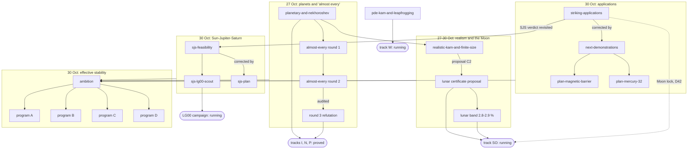

# Explorations

This folder holds research reports, scouting studies, campaign plans and refutation audits written by agents for the
project owners between 27 and 30 October 2026. They survey the literature, propose statements, estimate costs and check
one another. **None of them is a proved result unless it says so**: a theorem counts as proved only when its frozen Lean
statement is sealed (see the [repository README](../../README.md) and [`docs/STATEMENTS.md`](../STATEMENTS.md)). Where an
exploration led to a proved theorem or a running campaign, the catalogue says so and names the decision in
[`docs/DECISIONS.md`](../DECISIONS.md).

This page and the pages under [`themes/`](themes/) are an index written on 31 October 2026. The 20 documents themselves
are not edited here. Numbers are quoted from the documents together with their own qualifications (sampled, projected,
estimated, measured).

**Status legend**

| Status | Meaning |
|---|---|
| **done** | The statements it proposed were frozen and are now proved in Lean. |
| **adopted** / **running** | The owner adopted it (decision Dn); the work it started is under way. |
| **proposed** | A plan or candidate statements; no owner decision recorded yet. Nothing proved. |
| **scouted** | A feasibility study: numerical experiments and cost projections; nothing certified. |
| **audit** | An independent check of another document, with verdicts (confirmed, corrected, unverified). |
| **partly superseded** | Some of its claims were corrected by a later document; the entry says which. |

Abbreviations: SJS, Sun–Jupiter–Saturn; SJSU, Sun–Jupiter–Saturn–Uranus; AMD, angular-momentum deficit; LG00,
Locatelli–Giorgilli 2000 (the secular SJS model); GLS17, Giorgilli–Locatelli–Sansottera 2017; FH25, Figueras–Haro 2025;
MP, multiprecision; CPU-h, kernel CPU-hours; Dn, decision n in [`docs/DECISIONS.md`](../DECISIONS.md).

## Start here

1. [**ambition.md**](ambition.md): the current big-picture proposal. It reframes Zohar's question about chaos and slow
   transport as a certified confinement time for a region, proposes programs A–D, and reviews all twelve earlier
   explorations in one table.
2. [**program-c-plan.md**](program-c-plan.md): a general confinement theorem from approximate integrals, checked
   against the original vector field (no KAM torus or canonical inverse needed), with a complete 13-term example and an
   exact replay of Mogavero–Hoang–Laskar's resonance algebra.
3. [**program-d-plan.md**](program-d-plan.md): what a planetary lifetime theorem would have to say, and two sobering
   tests: the literal stopped estimate behind the existing planetary theorem would need μ < 10⁻³² on a
   Sun–Jupiter–Saturn-like box, and AMD conservation alone already suggests wide non-crossing margins for the
   Sun–Jupiter–Saturn–Uranus secular model.
4. [**sjs-plan.md**](sjs-plan.md): the costed plan for a torus of the planar three-body problem at the real
   Sun–Jupiter–Saturn masses (15–300 CPU-h with a new chart and a packed kernel layer), with eight decisions for the owner.
5. [**sjs-lg00-scout.md**](sjs-lg00-scout.md): the study behind the running LG00 side campaign, aiming at a kernel-checked
   torus of Locatelli–Giorgilli's secular Sun–Jupiter–Saturn model.
6. [**next-demonstrations.md**](next-demonstrations.md): the two proposed next applications of the certifier (a magnetic
   field-line barrier and Mercury's 3:2 spin), with reasons for the candidates not selected; read
   [plan-mercury-32.md](plan-mercury-32.md) next.

## The catalogue

One entry per document, with summary, numbers, outcome and disagreements, is on six theme pages:

| Theme page | Documents | Dates |
|---|---|---|
| [Planetary KAM, Nekhoroshev and the "almost every" question](themes/planetary-and-almost-every.md) | 4 | 27 Oct |
| [Realistic KAM, the Moon and spin–orbit](themes/moon-and-spin-orbit.md) | 3 | 27–30 Oct |
| [Applications of the certifier and the next demonstrations](themes/applications-and-demonstrations.md) | 4 | 30 Oct |
| [Sun–Jupiter–Saturn](themes/sun-jupiter-saturn.md), with the status of the running LG00 campaign | 3 | 30 Oct |
| [Effective stability and planetary lifetimes: ambition and programs A–D](themes/effective-stability.md) | 5 | 30 Oct |
| [PDE KAM](themes/pde-kam.md) | 1 | 28 Oct |

Overview, in date order within each theme:

| Document | Date | Theme | Status | In one line |
|---|---|---|---|---|
| [planetary-and-nekhoroshev](planetary-and-nekhoroshev.md) | 27 Oct | [planetary](themes/planetary-and-almost-every.md) | done (D14) | Why the headline does not apply to planets; three targets, now tracks I, N, P |
| [almost-every-shorter-times](almost-every-shorter-times.md) | 27 Oct | [planetary](themes/planetary-and-almost-every.md) | done in part (D22, D28) | Averaging gives mean error O(√ε), hence exception O(√ε/η); not "O(√ε) off O(√ε)" |
| [almost-every-round2](almost-every-round2.md) | 27 Oct | [planetary](themes/planetary-and-almost-every.md) | done, corrected | Exponential-time safety for every low-AMD initial condition; secular SJS box safe forever |
| [almost-every-round3-refutation](almost-every-round3-refutation.md) | 27 Oct | [planetary](themes/planetary-and-almost-every.md) | audit; done (D25) | Round 2 confirmed with corrections; exponent 1/(2n) unverified; it is Nekhoroshev 1977 Thm 12.3 |
| [realistic-kam-and-finite-size](realistic-kam-and-finite-size.md) | 27 Oct | [Moon](themes/moon-and-spin-orbit.md) | partly adopted (C2 → SO) | A-posteriori KAM plus a computer proof is the realistic form; finite size surveyed |
| [lunar-spin-orbit-certificate-proposal](lunar-spin-orbit-certificate-proposal.md) | 29 Oct | [Moon](themes/moon-and-spin-orbit.md) | adopted (D30), running | Two certified barriers confine the Moon's spin rate; became track SO |
| [lunar-band-2p8-2p9](lunar-band-2p8-2p9.md) | 30 Oct | [Moon](themes/moon-and-spin-orbit.md) | adopted (D37), overtaken (D38) | Move the barriers toward the separatrix floor 2.62 % |
| [striking-applications](striking-applications.md) | 30 Oct | [applications](themes/applications-and-demonstrations.md) | scouted; partly superseded | 13 applications ranked; Moon lock first; SJS judged infeasible (later revised) |
| [next-demonstrations](next-demonstrations.md) | 30 Oct | [applications](themes/applications-and-demonstrations.md) | scouted; proposed | Magnetic barrier and Mercury 3:2; corrects two claims of the scout |
| [plan-magnetic-barrier](plan-magnetic-barrier.md) | 30 Oct | [applications](themes/applications-and-demonstrations.md) | proposed; gate failed so far | One uncrossable field-line graph at ε = 0.003; MP solves still 6 orders short |
| [plan-mercury-32](plan-mercury-32.md) | 30 Oct | [applications](themes/applications-and-demonstrations.md) | proposed | Mercury's spin stays within 0.018 of 3/2 for all time; exact Kepler forcing |
| [sjs-feasibility](sjs-feasibility.md) | 30 Oct | [SJS](themes/sun-jupiter-saturn.md) | scouted; partly superseded | Route B plus packed kernel arithmetic would make the planar SJS torus checkable |
| [sjs-lg00-scout](sjs-lg00-scout.md) | 30 Oct | [SJS](themes/sun-jupiter-saturn.md) | scouted; running (LG00) | LG00's secular torus at lunar-class cost; no new theorem needed |
| [sjs-plan](sjs-plan.md) | 30 Oct | [SJS](themes/sun-jupiter-saturn.md) | proposed | Synodic chart and packed layer: 15–300 CPU-h, 8–15k Lean lines, 4–6 weeks |
| [ambition](ambition.md) | 30 Oct | [effective stability](themes/effective-stability.md) | proposed | Certify slow transport in a region, then a planetary lifetime; programs A–D |
| [program-a-plan](program-a-plan.md) | 30 Oct | [effective stability](themes/effective-stability.md) | proposed | Explicit quasi-convex Nekhoroshev certificates, then the steep theorem |
| [program-b-plan](program-b-plan.md) | 30 Oct | [effective stability](themes/effective-stability.md) | proposed | Finite normal-form confinement near a torus or an elliptic equilibrium |
| [program-c-plan](program-c-plan.md) | 30 Oct | [effective stability](themes/effective-stability.md) | proposed | First-exit confinement from approximate integrals of the original field |
| [program-d-plan](program-d-plan.md) | 30 Oct | [effective stability](themes/effective-stability.md) | proposed | A 5-Gyr secular SJSU action bound; the existing stopped estimate fails a real-mass test |
| [pde-kam-and-leapfrogging](pde-kam-and-leapfrogging.md) | 28 Oct | [PDE KAM](themes/pde-kam.md) | adopted (D30), running | Two-frequency solutions of the cubic Dirichlet wave equation; became track W |

## Reading paths

- **From planetary KAM to proved theorems (27 October).**
  [planetary-and-nekhoroshev](planetary-and-nekhoroshev.md) →
  [almost-every-shorter-times](almost-every-shorter-times.md) → [almost-every-round2](almost-every-round2.md) →
  [almost-every-round3-refutation](almost-every-round3-refutation.md). The outcome is the set of track I, N and P theorems
  in [`docs/STATEMENTS.md`](../STATEMENTS.md), with the exponents chosen by round 3.
- **The Solar System thread.** The rounds above give small-mass results for the full problem and an all-time box for
  the first-order secular model. [striking-applications](striking-applications.md) §9 judges the full planar
  Sun–Jupiter–Saturn torus infeasible; [sjs-feasibility](sjs-feasibility.md) finds two levers;
  [sjs-lg00-scout](sjs-lg00-scout.md) picks the secular LG00 model, now the running LG00 campaign
  ([status](../campaign/side/lg00-status.json)); [sjs-plan](sjs-plan.md) prices the full planar torus. For lifetimes
  rather than tori, continue with [ambition](ambition.md) and [program-d-plan](program-d-plan.md).
- **The Moon and spin–orbit.** [realistic-kam-and-finite-size](realistic-kam-and-finite-size.md) (proposal C2) →
  [lunar-spin-orbit-certificate-proposal](lunar-spin-orbit-certificate-proposal.md) (track SO, D30) →
  [lunar-band-2p8-2p9](lunar-band-2p8-2p9.md) (D37, then N = 65 in D38) → [striking-applications](striking-applications.md)
  §§3–4 (librational tori in a polar chart) → the Moon-lock scoping study
  [SO-LOCK-SCOPE](../tracks/SO/studies/SO-LOCK-SCOPE.md) (D42, D45).
- **Next demonstrations, including a non-celestial one.** [striking-applications](striking-applications.md) →
  [next-demonstrations](next-demonstrations.md) → [plan-magnetic-barrier](plan-magnetic-barrier.md) (a controlled
  magnetic field-line model) and [plan-mercury-32](plan-mercury-32.md).
- **"Almost every" initial condition.** [almost-every-shorter-times](almost-every-shorter-times.md) (most data, polynomial
  times) → [almost-every-round2](almost-every-round2.md) (all data, exponential times) →
  [almost-every-round3-refutation](almost-every-round3-refutation.md). The theme returns in
  [ambition](ambition.md) §1, in B2 of [program-b-plan](program-b-plan.md) (Bounemoura–Farré) and in C3 of
  [program-c-plan](program-c-plan.md) (a certified measure fraction of an initial box).
- **Effective stability programs.** [ambition](ambition.md) → [A](program-a-plan.md), [B](program-b-plan.md),
  [C](program-c-plan.md), [D](program-d-plan.md). Ambition recommends B1 + C as the main program and D's secular
  Sun–Jupiter–Saturn–Uranus model as the application.
- **PDE KAM.** [pde-kam-and-leapfrogging](pde-kam-and-leapfrogging.md) → track W
  ([`nlw2`](../STATEMENTS.md#nlw2), [W-STATEMENTS](../tracks/W/W-STATEMENTS.md)).

## How the documents feed each other

Arrows point from a document to the documents or campaigns it led to. Rounded boxes are campaigns.

## Where later documents correct earlier ones

Each correction is also stated in both catalogue entries.

| Earlier claim | In | Corrected or overtaken by |
|---|---|---|
| Fast-action drift exponent β = 1/(2n) for planetary safety | [round 2](almost-every-round2.md) | [Round 3](almost-every-round3-refutation.md): unverified; frozen theorem uses a = 2/(6n² − 3n + 14), b = 3a/2 |
| Pinzari D.1 as the stopped Nekhoroshev source | [round 2](almost-every-round2.md) | [Round 3](almost-every-round3-refutation.md): whole-interval statement; use Nekhoroshev 1977 Thm 4.4 |
| No rigorous KAM statement for Mercury's 3:2 resonance at true parameters | [realistic-kam](realistic-kam-and-finite-size.md), [striking-applications](striking-applications.md) | [next-demonstrations](next-demonstrations.md): Celletti–Falcolini (1992) constructed trapping tori |
| Lunar band 3 % with barriers at N = 40 | [lunar proposal](lunar-spin-orbit-certificate-proposal.md) | Pilot and [lunar band](lunar-band-2p8-2p9.md): the N = 40 barrier reaches about 3.19 %; targets 3.3 % (D30), 2.8–2.9 % (D37), N = 65 at about 2.71 % (D38) |
| Librational lunar tori need a Birkhoff normal form or a new G1 | [lunar band](lunar-band-2p8-2p9.md) | [striking-applications](striking-applications.md) §3: primary in a polar chart; D45 chose that route |
| Planar Sun–Jupiter–Saturn torus infeasible in the kernel | [striking-applications](striking-applications.md) | [sjs-feasibility](sjs-feasibility.md) (34–351 CPU-h with route B and packed arithmetic); [sjs-plan](sjs-plan.md) (15–300 CPU-h) |
| Hybrid plus packed: 6–19 CPU-h; charts do not reduce support; d'Alembert ÷7; 60–150 products | [sjs-feasibility](sjs-feasibility.md) | [sjs-plan](sjs-plan.md) §8: hybrid gives no kernel gain; chart ÷2.7; ÷3.7 and falling; 252–657 products |
| Route A "proved, not wired"; no `sqrt` node | [sjs-lg00-scout](sjs-lg00-scout.md) | Both now in place; the LG00 campaign runs route A refined at L = 20 with the exact square root |
| Magnetic barrier ranked first among the next demonstrations | [next-demonstrations](next-demonstrations.md) | [plan-magnetic-barrier](plan-magnetic-barrier.md): multiprecision gate failed so far; Mercury has the stronger evidence |
| "Hybrid is a design" | [ambition](ambition.md) | Programs [A](program-a-plan.md)–[D](program-d-plan.md): the hybrid theorems have landed; no certificate wiring yet |
| Certifier not yet better than PlasmaLean on its own example | [striking-applications](striking-applications.md) | [Repository README](../../README.md): a v2 example reaches 65 times PlasmaLean's tolerance, at assumed canonical data |

## Related documents elsewhere in the repository

- [`docs/DECISIONS.md`](../DECISIONS.md): owner rulings cited here (D14 tracks, D22 and D25 planetary milestones, D30 tracks
  SO and W, D37–D38 lunar band, D41 W freeze, D42 and D45 Moon lock).
- [`docs/STATEMENTS.md`](../STATEMENTS.md): every frozen statement and its proof status.
- [`docs/TRACKS.md`](../TRACKS.md): the tracks that grew out of [planetary-and-nekhoroshev](planetary-and-nekhoroshev.md).
- [`docs/campaign/side/lg00-status.json`](../campaign/side/lg00-status.json): stages and evidence of the running LG00
  campaign.
- [`docs/campaign/handoffs/SJS-LG00.md`](../campaign/handoffs/SJS-LG00.md): handoff of the LG00 scout.
- [`docs/campaign/design/APOST-SHARP-V2.md`](../campaign/design/APOST-SHARP-V2.md): design of the v2 a-posteriori theorem,
  its loss inventory and the comparison with Haro–Luque 2019 and Figueras–Haro 2024 (§12).
- [`docs/campaign/design/APOST-SHARP-V2-HYBRID.md`](../campaign/design/APOST-SHARP-V2-HYBRID.md): the hybrid restart step,
  with sampled numbers for the lunar package.
- [`docs/campaign/design/APOST-SHARP-V2-L1.md`](../campaign/design/APOST-SHARP-V2-L1.md): the weighted-ℓ¹ entry step.
- [`docs/campaign/design/APOST-SHARP-V2-DELTA.md`](../campaign/design/APOST-SHARP-V2-DELTA.md): v2 signature changes after
  the design audits.
- [`docs/campaign/design/APOST-SHARP-LEAN-DESIGN.md`](../campaign/design/APOST-SHARP-LEAN-DESIGN.md): Lean design of the
  sharp theorems (the lunar threshold moves from about 10⁻⁷⁵ to about 10⁻²⁵).
- [`docs/campaign/design/CERTIFIER-SHARPNESS.md`](../campaign/design/CERTIFIER-SHARPNESS.md): the checker side of the sharp
  certifier; its composition costs are the baseline of [next-demonstrations](next-demonstrations.md).
- [`docs/campaign/design/SHARP-CERTIFIER-FOR-SO.md`](../campaign/design/SHARP-CERTIFIER-FOR-SO.md): note on moving the lunar
  certificate to the sharp certifier (D36).
- [`docs/campaign/design/SIDE-CAMPAIGN-APOST-SHARP.md`](../campaign/design/SIDE-CAMPAIGN-APOST-SHARP.md): why the sharp
  side campaign was started.
- [`docs/campaign/design/SPIN-ORBIT-PLAN.md`](../campaign/design/SPIN-ORBIT-PLAN.md): the track SO plan that followed the
  lunar proposal.
- [`docs/tracks/SO/studies/SO-LOCK-SCOPE.md`](../tracks/SO/studies/SO-LOCK-SCOPE.md): scoping of the Moon-lock theorem
  (D42, D45).
- [`docs/tracks/SO/studies/SO-CSPLIT-GATE.md`](../tracks/SO/studies/SO-CSPLIT-GATE.md): measured kernel costs on the real
  N = 65 lunar torus, used by the demonstration plans and by [sjs-plan](sjs-plan.md).
- [`docs/tracks/W/W-STATEMENTS.md`](../tracks/W/W-STATEMENTS.md): the track W statements approved in D41.
- [`docs/ERRATA-AND-DEVIATIONS.md`](../ERRATA-AND-DEVIATIONS.md): reader-facing record of source errata and deviations.
- [`docs/errata/ledger.json`](../errata/ledger.json): the findings ledger where the orchestrator records the candidate errata
  these explorations report; [`working-record.md`](../errata/working-record.md) is its generated rendering and
  [`INP-backlog-report.md`](../errata/INP-backlog-report.md) the 27 October backlog verification.
