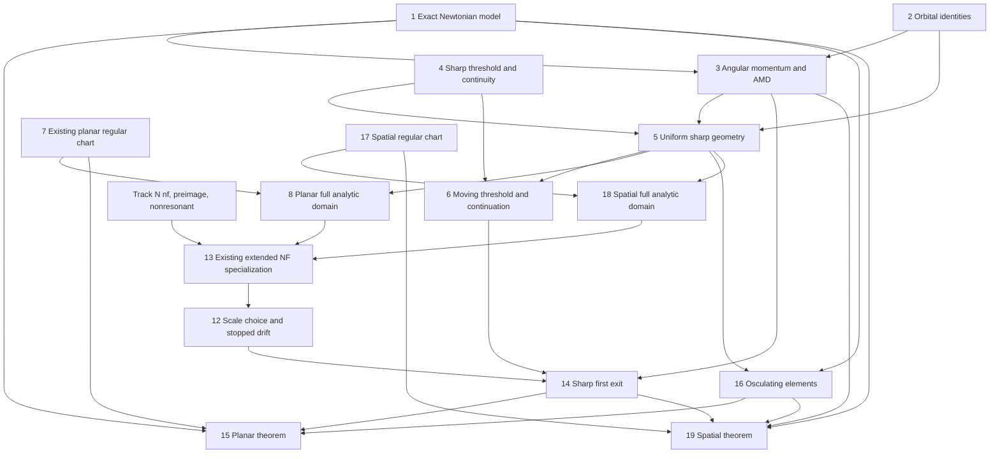

# Lean roadmap: sharp strong AMD safety

This is the formalization plan for `MAIN.md`, Lemmas 1–19, at the inspected repository baseline `f5625f197c621ccc8045e8392a07e23fe0cb10fc`. The mathematical headline results are Theorems 15 and 19. The signatures below are **Lean-shaped planning statements**, not elaborated, approved or frozen declarations. No repository files were changed and no Lean/Lake process was run.

The shortest implementation route reuses `KAM.Nekhoroshev.nonresonant` and `nf`. It does not require a new normal-form foundation. The vector-field proof in MAIN Lemmas 9–12 is a self-contained mathematical supplier and a possible later reusable package; MAIN Lemma 13 verifies how the existing implementation gives the estimate needed for this theorem.

## 1. Carriers, definitions, and conventions

Use the repository ambient types `Fin n → ℝ`, `Fin n → ℂ`, and Fourier indices `Fin n → ℤ`. Physical vectors are `Fin d → ℝ`, with an explicitly defined Euclidean dot product and length. The ambient maximum norm of a `Pi` type is not physical distance. Use `KAM.Planetary.Phase (n * d)` for flattened physical phases, with checked block maps. Preserve the existing planar definitions; add dimension-three definitions or a separately audited dimension-generic implementation and equivalence theorems.

New public definition candidates:

| Object | Exact intended meaning |
|---|---|
| `OrderedActions ν` | Subtype of positive action vectors with strictly ordered axes `(I i / ν i)^2`. Mass positivity is supplied by a genuine mass-data carrier or explicit premises. |
| `pairFeasible I i j` | Subset of `[0,1] × [0,1]` satisfying `axis I i * (1+u) ≥ axis I j * (1-v)`, for `i<j`. |
| `eccentricityDeficit u` | `1 - Real.sqrt (1-u^2)` on `u ∈ Set.Icc 0 1`. |
| `pairThreshold I i j` | The minimum of `I i * D u + I j * D v` on `pairFeasible`. First prove nonemptiness, compactness and attainment; then define the unique minimum value and export its characterization. |
| `strongThreshold I` | Finite minimum of all adjacent pair thresholds and all individual actions; no fallback outside `OrderedActions`. |
| `angularMomentum3 z` | `∑ i, cross (q z i) (p z i)`. |
| `canonicalAMD3 ν z` | `∑ i, canonicalAction ν z i - euclid (angularMomentum3 z)` on the negative-energy, nonzero-position carrier. |
| `fixedPlaneDeficit ν z e3` | `∑ I_i - dot L e3`, distinct from invariant AMD away from aligned configurations. |
| `spatialPoincareDom` | Positive actions with `Γ_i+Z_i<I_i`, as in MAIN (44). |
| `spatialPoincare` | Literal formulas MAIN (18), (19), (46), on their whole stated carrier. |
| `strongSlowBall I₀ δ` | The complete closed Euclidean ball of squared radius `2 * (strongThreshold I₀ - δ/4)`, as in (21)/(47). |
| `actualOsculatingElements` | Literal actual-velocity formulas MAIN (42), with gravitational parameter `1+μν_i`. |
| `strongThresholdModulus U r` | Supremum in MAIN Lemma 6, on the stated compact action carrier. |

The minimum-value characterization must accompany the definition:

```lean
-- Schematic: i,j carry i<j and all quantities are on their physical carrier.
theorem pairThreshold_characterization (I : OrderedActions ν) (i j) (hij : i < j) :
    ∃ uv ∈ pairFeasible I i j,
      pairObjective I i j uv = pairThreshold I i j ∧
      ∀ vw ∈ pairFeasible I i j,
        pairThreshold I i j ≤ pairObjective I i j vw
```

A definition by the real infimum of the compact nonempty image is possible after proving this characterization. Do not choose an arbitrary feasible pair, use a numerical optimizer as the mathematical definition, or totalize an undefined physical quantity by an `if ... then ... else 0` branch.

The manuscript uses radian angles. Existing planar Poincaré formulas also use mean longitude in radians. The Track N interface uses period one: `θ = λ / (2π)`, `Ĥ = H / (2π)`, slow scale `ℓ = w/r`, and weighted slow bracket `2π/ℓ²`. MAIN Lemma 13 checks that the complete conversion preserves physical time. Our planar slow coordinates correspond to repository `(ξ,η)=(x,-y)`; the spatial inclination pair similarly corresponds to `(u,-v)`. Freeze these sign and scale equivalences before reusing symplectic or orbit-transport declarations.

## 2. Headline statement surface

The final theorem must quantify constants **before** mass parameter, initial state, phases, eccentricities, inclinations, and reference-frame choices. Fixing `d=2` and `d=3` in two public declarations is preferable to making dimension-generic cross-product machinery part of the public surface. The following is the intended binder and conclusion structure; `a`, `Λ`, `C`, `peri`, `apo`, `oscPeri`, `oscApo` denote the literal definitions above, not supplied estimates.

```lean
theorem planar_strongAMD_exponentialSafety
    (n : ℕ) (hn : 2 ≤ n) (ν : Fin n → ℝ)
    (hν : ∀ i, 0 < ν i) (hνmax : maxMass ν = 1)
    (A : Set (Fin n → ℝ)) (hA : IsCompact A)
    (hAord : ∀ a ∈ A, PositiveStrictlyOrdered a)
    (δ γ τ : ℝ) (hδ : 0 < δ) (hγ : 0 < γ) (hτ : (n : ℝ)-1 < τ) :
  ∃ μ₀ c T₀ AΛ Aa dStar dPair Aosc : ℝ,
    0 < μ₀ ∧ 0 < c ∧ 0 < T₀ ∧ 0 < AΛ ∧ 0 < Aa ∧
    0 < dStar ∧ 0 < dPair ∧ 0 < Aosc ∧
    ∀ μ : ℝ, 0 < μ → μ ≤ μ₀ →
    ∀ z₀ : Phase (n*2),
      (∀ i, q z₀ i ≠ 0 ∧ specificEnergy ν z₀ i < 0) →
      a ν z₀ ∈ A →
      (∀ k : Fin n → ℤ, k ≠ 0 →
        γ / (modeSize k : ℝ)^τ ≤ |dotIntReal k (meanMotion ν z₀)|) →
      C ν z₀ ≤ strongThreshold (Λ ν z₀) - δ →
    let T := T₀ * Real.exp (c * μ^(-(1 / (2*(τ+1)))))
    ∃ z : ℝ → Phase (n*2), z 0 = z₀ ∧
      IsMovingSolutionOn ν μ (Set.Icc (-T) T) z ∧
      MovingUniqueOn ν μ (Set.Icc (-T) T) z ∧
      IsNewtonSolutionOn (actualMasses 1 ν μ) (Set.Icc (-T) T)
        (fun t => barycentricPositions 1 ν μ (z t).1)
        (fun t => barycentricVelocities 1 ν μ (z t).2) ∧
      ∀ t ∈ Set.Icc (-T) T,
        Elliptic ν (z t) ∧ Ordered (a ν (z t)) ∧
        ‖Λ ν (z t) - Λ ν z₀‖ ≤ AΛ * Real.sqrt μ ∧
        ‖a ν (z t) - a ν z₀‖ ≤ Aa * Real.sqrt μ ∧
        |C ν (z t) - C ν z₀| ≤ n*AΛ*Real.sqrt μ ∧
        C ν (z t) ≤ strongThreshold (Λ ν (z t)) - δ/2 ∧
        (∀ i, dStar ≤ peri ν (z t) i) ∧
        (∀ i : Fin (n-1), dPair ≤ adjacentGap ν (z t) i) ∧
        (∀ i, euclid (q (z t) i) ≥ dStar) ∧
        (∀ i j, i ≠ j → euclid (q (z t) i-q (z t) j) ≥ dPair) ∧
        (∀ i, |oscPeri ν μ (z t) i-peri ν (z t) i| ≤ Aosc*μ ∧
               |oscApo ν μ (z t) i-apo ν (z t) i| ≤ Aosc*μ) ∧
        (∀ i, dStar/2 ≤ oscPeri ν μ (z t) i) ∧
        (∀ i : Fin (n-1), dPair/2 ≤ oscAdjacentGap ν μ (z t) i)
```

Before freezing, replace the schematic proof-dependent arguments of `strongThreshold` by the exact `OrderedActions` terms, and resolve numeral casts, real powers, finite-index adapters and local notation. That is elaboration work, not a license to change the statement. The spatial declaration has the same quantified data and conclusion with `Phase (n*3)`, vector-norm AMD, and genuinely spatial Newtonian/reconstruction definitions. It must not add prograde, small-inclination, nonzero total angular momentum, secular-domain confinement, normal-form existence or stopped-action hypotheses: all are consequences proved in MAIN.

Uniqueness can be exported either via the existing maximal-flow API or the interval uniqueness predicate; the final mathematical conclusion must still identify the actual unique Newtonian solution. Circular/coplanar states remain in the carrier.

## 3. Lemma-by-lemma packages

Each row below is a Lean-shaped statement, not an oracle to put in the headline premises. Module names are proposed new paths below `KAM/Planetary/StrongAMD/` and `KAM/Planetary/Spatial/`; existing frozen files are not to be edited.

| MAIN | Package and Lean-shaped statement | Difficulty / implementation |
|---|---|---|
| 1 | `ExactModel`: `movingHamiltonian_eq_kepler_add_mu_recoil`; `IsMovingSolutionOn ... z → IsNewtonSolutionOn ... (reconstructQ z) (reconstructV z)` with positive masses and a collision-free interval | Planar reuse; dimension-three algebra and reconstruction need new proofs. |
| 2 | `OrbitalIdentities`: `E<0 → ecc^2 = 1 + 2*E*angSpec^2 ∧ angNorm = Λ*sqrt(1-ecc^2) ∧ a*(1-ecc) ≤ r ∧ r ≤ a*(1+ecc)` | Planar reuse, spatial cross/dot identities and scalar quadratic algebra. |
| 3 | `Momentum`: `IsMovingSolutionOn ... → ∀ s,t∈J, L(z s)=L(z t)`; `C ≤ minAction-δ → ∀ i, δ ≤ dot (Li i) (L/‖L‖)`; `C(t)-C(0)=∑(Λ(t)-Λ(0))` | Scalar conservation exists. Spatial torque cancellation and projection inequalities are new, moderate. |
| 4 | `Threshold`: attained minimum characterization; `Continuous pairThreshold`; `Continuous strongThreshold`; `pairThreshold I i j < I j`; `strongThreshold = min crossThreshold (I 0)` | New compact minimum, fixed-interval parameterization MAIN (15). Moderate. Interior optimizer and geometric realization can be separate non-dynamical lemmas. |
| 5 | `Geometry`: `IsCompact U → 0<m → ∃ dS dP>0, ∀ I∈U,e∈[0,1]^n, sumDeficit≤B I-m → ...` with all perihelion/annulus and physical compactness conclusions | New sharp geometry; avoid the existing common-eccentricity box. Moderate. |
| 6 | `ThresholdModulus` and `Continuation`: `Tendsto (modulus U) (𝓝[>] 0) (𝓝 0)` and the literal AMD-error inequality; compact nonsingular stopped trajectories extend | Modulus and first-exit adapters are new; general ODE infrastructure reusable. |
| 7 | `PlanarDictionary`: `poincare` has the exact energy, action, AMD, image and symplectic identities on the whole `Γ<Λ` domain | Existing chart supports this already. Prove the sign/formula equivalence to MAIN, not a second planar chart. |
| 8 | `AnalyticDomain`: `∃ r s w M>0, ∀ I₀∈Lδ, HolomorphicOn fullTube f ∧ FourierBound ... M ∧ denominatorsBound ...` | New center-family compactness and sharp slow ball. Reuse real-analytic chart and periodic complex-extension theorem. Hard interface work, bounded scope. |
| 9 | Optional `VectorFourier`: `norm (lieBracket V W) (ρ-σ) ≤ (2*D/σ)*norm V ρ*norm W ρ`; projection, Fourier-tail and fixed-strip bounds | General weighted/Fourier infrastructure exists; the vector-field norm statement would be new. Not needed for the shortest landing. |
| 10 | Optional `LinearAveragingStep`: source analyticity, initial Diophantine condition, and explicit smallness imply a canonical Lie map, inverse and the literal remainder bound (27) | Reuses holomorphic flows; new vector-field wrapper. Hard if implemented independently. |
| 11 | Optional `LinearAveragingIteration`: `A*ε*N^(τ+1)≤qD → ∃ Φ Z R, ...` with full domains, canonical identity, remainder, both displacements and inverse inclusion | Finite induction and composition; this is an internal analytic theorem, not a premise of safety. |
| 12 | `NonresonantScale`: uniformly choose `κ μ₀`, set `r=√μ`, `K=floor(κ*μ^(-a))`, derive smallness, cutoff and exponential horizon; obtain a stopped drift bound | Prefer Lemma 13 engine below. Arithmetic is moderate; floor/power estimates require focused lemmas. |
| 13 | `NonresonantReuse`: from the actual analytic domain and Diophantine data, construct every field of `ExtNFHyp` and apply `KAM.Nekhoroshev.nonresonant` | Reuse unchanged engine. Verify `Ĥ`, period, weighted slow bracket, scalar Fourier norm, physical time, (37), and actual ODE transport. |
| 14 | `Confinement`: local stopped drift + exact angular momentum + moving sharp barrier produce existence and unconditional safety on the desired interval | New sharp analogue of `amdConfinement`. The stopped drift is an internal hypothesis discharged by package 13 at assembly. |
| 15 | `PlanarSafety`: full planar statement of §2 | Thin assembly after 1–8 and 12–14, then package 16. No new top-level premise. |
| 16 | `Osculating`: on the safe physical compact set, `∃ A μ₀>0, ∀ μ≤μ₀, ... ≤ A*μ` for axes, eccentricity vectors and both radial endpoints | New, elementary smooth/rational estimates with energy denominator bounds. Use the norm Lipschitz inequality at circular states. |
| 17 | `Spatial/Poincare`: literal formula (46), `AnalyticOnNhd`, symplecticity, exact image and inverse on `Γ+Z<Λ`; energy and momentum identities (45) | Main new hard package. Separate rotation algebra, regular Kepler map, Liouville identity, analytic inverse and product construction. |
| 18 | `Spatial/AnalyticDomain`: the statement of package 8 for `4*n` real slow coordinates, with orientation-independent constants | Reuses the compact-extension proof after spatial chart and fixed-plane geometry. Moderate once 17 is sealed. |
| 19 | `Spatial/Safety`: spatial version of §2, with no added secular assumptions | Assembly of vector momentum, spatial chart/domain, unchanged nonresonant engine, sharp confinement and osculating bridge. |

The optional packages 9–11 are **an alternative analytic implementation**, not additional dependencies to conjoin with the existing engine. They should not delay the shortest planar campaign.

Representative analytic source-facing signature:

```lean
-- Schematic expansion of the important quantifier order; D and the norm are literal domains.
theorem uniformStrongAMDAnalyticDomain
    (ν A δ) (hν : PositiveMasses ν) (hA : IsCompact A)
    (hord : A ⊆ positiveOrderedAxes) (hδ : 0 < δ) :
  ∃ r s w M : ℝ, 0<r ∧ 0<s ∧ 0<w ∧ 0<M ∧
    ∀ I₀ ∈ admissibleCenters ν A δ,
      ∃ fC, DifferentiableOn ℂ fC (strongComplexTube I₀ δ r s w) ∧
        (∀ realPoint ∈ realTraceOfTube,
           fC (complexify realPoint) = (exactDisturbingFunction realPoint : ℂ)) ∧
        PeriodicInFastAngles fC ∧
        (∀ z ∈ strongComplexTube I₀ δ r s w, ‖fC z‖ ≤ M)
```

`admissibleCenters` is the literal compact set `Λ(A) ∩ {B≥δ}`. It is not a stability premise. Keep separate exports for nonvanishing of every complex denominator and the chart identities; otherwise a norm estimate can be attached to the wrong analytic function.

Representative new sharp confinement interface:

```lean
-- Internal helper only, never the public conjecture statement.
theorem strongAMD_confinement_of_stoppedDrift
    (fixed geometric data) (T r : ℝ) (hT : 0<T) (hr : 0<r)
    (hbudget : n*r + modulus U r ≤ δ/4)
    (z₀ : PhysicalPhase) (hinit : literalInitialGeometry z₀)
    (hstop : ∀ J z, IsLocalNewtonianSolution ... J z → z 0=z₀ →
      ∀ t∈J, |t|≤T →
      (∀ u∈uIcc 0 t, actionTubeAndHalfMargin z u) →
      ‖Λ(z t)-Λ z₀‖ ≤ r/2) :
    ∃ z, literalExistenceUniquenessAndSafetyConjunction ...
```

Before freezing, expand the planning abbreviations in this internal statement to the concrete inequalities in MAIN (39)–(40). In the public theorem the whole `hstop` proof is a dependency constructed from the analytic estimate; it is not a binder. The generic `amd_exit_forward`/`amd_exit_backward` lemmas should handle the topological endpoint argument, with sharp geometry supplying the compactness and strict improvement.

## 4. Dependency DAG



This is a package diagram with a shared parameterized analytic package, not a cycle: first instantiate 13–14 using 8 and `m=n`, then instantiate the same packages using 18 and `m=2n`. For the independent paper proof, replace the `Track N`/13 supplier of 12 by the linear chain 9 → 10 → 11 → 12. Never require both alternatives as hypotheses. Once actual declarations are frozen, extract a direct declaration-level graph from `MAIN.md`; the present diagram is planning evidence only.

## 5. Inspected repository reuse map

Paths below are relative to `/root/code/KAM`; names are fully qualified unless a file is explicitly only a comparison. These are source inspections at the pinned commit, not a new build or axiom audit.

| File:declaration | Exact reuse / boundary |
|---|---|
| `KAM/Frozen/Planetary/Defs/MovingHamiltonian.lean:KAM.Planetary.movingHamiltonian` | Literal planar physical Hamiltonian. With `G=m0=1`, expand the kinetic square to recover MAIN (1). |
| `KAM/Planetary/Newtonian/Models.lean:KAM.Planetary.movingHamiltonian_split` | Existing moving-Sun split; inspect mass normalization in the adapter. |
| `KAM/Planetary/Newtonian/Reduction.lean:KAM.Planetary.newton_to_moving` | Planar translation/scaling dictionary. |
| `KAM/Planetary/Newtonian/Reconstruction.lean:KAM.Planetary.isNewtonSolutionOn_of_isMovingSolutionOn` | Planar Newtonian export. Spatial positions/velocities need a dimension-three counterpart. |
| `KAM/Planetary/AMD/Elements.lean:KAM.Planetary.elements`, `eccentricity_deficit` | Planar orbital identities and deficit estimate; consume their actual prograde hypotheses after deriving them. |
| `KAM/Planetary/AMD/AngularMomentum.lean:KAM.Planetary.ang_mom` | Exact scalar angular momentum conservation on an interval. Spatial vector conservation is new. |
| `KAM/Planetary/Poincare/Chart.lean:KAM.Planetary.analyticOnNhd_poincare`, `poincare_periodic` | The entire `Γ<Λ` planar region, including circular orbits; not limited to tiny eccentricity. |
| `KAM/Planetary/Poincare/Symplectic.lean:KAM.Planetary.poincare_elements`, `poincare_symplectic` | Exact orbital dictionary and symplecticity. |
| `KAM/Planetary/Poincare/Bijective.lean:KAM.Planetary.poincare_image`, `poincare_localDiffeo`, `poincare_poincareInv` | Onto/inverse assertions needed for the actual physical trajectory. |
| `KAM/Planetary/Poincare/Product.lean:KAM.Planetary.poincareProd_symplectic`, `poincareProd_image`, `movingHamiltonian_poincareProd`, `analyticOnNhd_fMov_poincareProd` | Product chart, exact model identity, real analyticity and physical coverage. |
| `KAM/Kepler/DelaunaySymplectic.lean:KAM.Kepler.delaunay_liouville`, `delaunay_symplectic` | Optional support for the spatial Liouville calculation; do not use singular Delaunay coordinates as the final carrier. |
| `KAM/Kepler/KeplerTube.lean:KAM.Kepler.Tube.eccAnomC_spec` | Uniform eccentric-anomaly tube for a fixed eccentricity cap below one. |
| `KAM/Kepler/KeplerTube.lean:KAM.Kepler.Tube.keplerLongC_analyticOnNhd` | A smaller regular-eccentricity tube; its `regularTube` bound alone does not cover arbitrary permitted eccentricities. |
| `KAM/Planetary/Exponential/ComplexTube.lean:KAM.Planetary.tube` | Periodic complexification of an arbitrary compact real safe set. Replace its particular dimension packaging for spatial use; reuse the proof. |
| `KAM/Planetary/Exponential/KeplerData.lean:KAM.Planetary.keplerSumGen_fderiv2_apply`, `keplerSumGen_hess_norm_le`, `keplerSumGen_real_freq` | Exact Kepler Hessian, complex bound, and frequency formulas. |
| `KAM/Nekhoroshev/Partial/Setting.lean:KAM.Nekhoroshev.PartialBlock`, `ExtNFHyp` | Arbitrary real slow set, physical slow width, weighted symplectic structure, and explicit source hypotheses. |
| `KAM/Nekhoroshev/Partial/NormalForm.lean:KAM.Nekhoroshev.nf`, `nnf_disp_radius` | Complete slow-variable normal form, fast/slow displacements and exponentially small remainder. |
| `KAM/Nekhoroshev/Partial/Preimage.lean:KAM.Nekhoroshev.preimage` | Real preimages and coordinate transfer with the slow collar. |
| `KAM/Nekhoroshev/Partial/Nonresonant.lean:KAM.Nekhoroshev.nonresonant` | Direct stopped fast-action estimate. Its `hstop` covers only the interval through the queried time; discharge it by MAIN Lemma 14. |
| `KAM/Planetary/AMD/ConfinementExit.lean:KAM.Planetary.amd_exit_forward`, `amd_exit_backward` | Generic exit architecture. |
| `KAM/Planetary/AMD/MovingODE.lean:KAM.Planetary.moving_ode` | Planar local existence/uniqueness and continuation infrastructure. |
| `KAM/Frozen/Planetary/Theorems/AmdConfinement.lean:KAM.Planetary.amdConfinement` | Comparison only: consumes `AMDBox`, so it does not directly accept the sharp correlated region. |
| `KAM/Frozen/Planetary/Theorems/PlanetaryExponentialSafety.lean:KAM.Planetary.planetaryExponentialSafety` | Existing crude-box global result; preserve unchanged. It is not a proof of the new statement. |
| `KAM/Frozen/Nekhoroshev/Theorems/PartialConvexNekhoroshev.lean:KAM.Nekhoroshev.partialConvex_nekhoroshev` | Possible later resonance-tolerant route. Not required in the nonresonant dependency chain. |

The private `Exponential` implementation also supplies templates for physical-to-chart lifts, uniform perturbation bounds, and compactness. Its `AMDBox`-dependent theorems must be generalized or adapted with freshly proved sharp-domain hypotheses; they must not be invoked with a fabricated admissible box that excludes part of the allowed sublevel.

## 6. Implementation order, gates and size

1. Audit and freeze the physical conventions and threshold definitions, then formalize Lemmas 2–6. This gives a useful sharp deterministic barrier before any exponential theorem.
2. Reuse and connect the whole-domain planar Poincaré chart. Build the family of full secular balls and uniform analytic collars in Lemma 8.
3. Implement the checked parameter/period/ODE conversion in Lemma 13. Reuse Track N; prove all four inequalities (37) uniformly and export the stopped action bound.
4. Generalize the first-exit assembly to the moving sharp threshold and prove Theorem 15, including the osculating bridge. This is the first complete formal milestone.
5. Build spatial cross-product, momentum, reconstruction and regular-chart packages. Prove every identity and inverse statement in Lemma 17 before freezing a final spatial chart definition as a proved source object.
6. Reuse the same threshold and analytic engine with `m=2n`, then prove Theorem 19.

Planning size estimates, excluding already existing engines:

| New work | Approximate Lean lines | Confidence |
|---|---:|---|
| Sharp threshold, continuity and geometric barrier | 1,500–3,000 | Moderate |
| Planar full-domain and uniform-family adapters | 1,000–2,000 | Moderate |
| Nonresonant scale/convention/ODE adapter | 700–1,500 | Moderate |
| Sharp first exit, planar assembly and osculating bridge | 1,500–3,000 | Moderate |
| Spatial vector algebra, orbital identities and Newtonian export | 2,000–4,000 | Lower |
| Spatial regular chart, symplecticity, inverse and product | 4,000–8,000 | Lower; likely largest package |
| Spatial analytic-domain and final assembly | 1,000–2,500 | Moderate after chart |

Thus a planar upgrade is approximately 5–10k new lines; the spatial increment approximately 7–15k. These are engineering estimates, not measured proof obligations or completion promises. Implementing the optional independent vector-field averaging proof could add roughly 3–7k lines, depending on existing analytic-vector-field APIs; it is unnecessary for the shortest route and should not be included in that route's budget.

All future work must follow the live repository rules: no frozen-file edits, no conclusion-shaped headline premises, no axioms or unregistered placeholders, the module system, focused files below the 1,500-line limit, and no heartbeat overrides. A future implementation task should run the authorized targeted builds and source/axiom audits. **This proof-writing task authorized none of those commands, and none was run.** The next approval object should be the actual elaborated declaration text, not these schematic signatures or a graph based only on theorem names.
